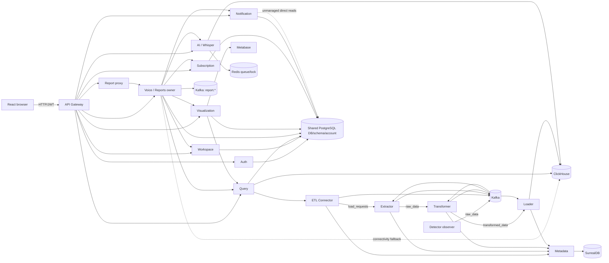

# Current system architecture

## Runtime map



## User flow

1. React stores access and refresh JWTs in `localStorage` and sends them through the Axios interceptor.
2. Gateway checks only that an Authorization header exists, then buffers and proxies the whole request to a path-selected service.
3. Downstream Django services validate JWTs and roles. Workspace scope is carried primarily in JWT claims and remote workspace lookups.
4. Managers add a file/database source, ask a voice/text question, run generated SQL, and create a chart. Analysts can edit SQL; executives view dashboards.

## Data ingestion flow

The implemented path is an on-demand snapshot:

```text
Query public API
  -> Connector test/discover/snapshot API (raw credential in internal HTTP)
  -> destination-policy DNS/IP check
  -> credential encrypted into Kafka request
  -> Extractor decrypts and reads selected tables in chunks
  -> raw rows Kafka topic
  -> Transformer schema/clean/quality/quarantine
  -> transformed rows Kafka topic
  -> Loader buffer/dedupe/ClickHouse insert
  -> metadata/status events -> SurrealDB and query callback
```

Physical table names include workspace and dataset identifiers. This is helpful but is not an authorization boundary. All current bindings normally use the same `etl` ClickHouse database.

## AI and voice flow

The real interactive flow is:

```mermaid
sequenceDiagram
    participant B as Browser
    participant G as Gateway
    participant V as Voice
    participant A as AI
    participant Q as Query
    participant X as Visualization
    participant M as Metabase

    B->>G: upload audio or text
    G->>V: buffered proxy
    V->>V: resolve workspace + dataset; consume quota
    V->>A: synchronous request (up to 300s)
    A->>A: Dagster execute_in_process
    A->>A: Whisper/text -> clean -> classify -> schema -> intent -> compile/review
    A-->>V: SQL + trace; AI “execution” is usually pending integration
    V->>V: persist report
    B->>G: execute report SQL
    G->>V: execute
    V->>Q: authorized query request
    Q->>Q: workspace DB guard; ClickHouse query
    Q-->>V: full rows
    opt forecast requested
      V->>A: full row set for forecast
      A-->>V: rows + inline ClickHouse SQL
    end
    V->>Q: create short-lived authorized query definition
    V->>X: create question by definition ID
    X->>Q: retrieve authorized SQL
    X->>M: create question/dashboard/embed
    X-->>V: visualization metadata
    V-->>B: final report
```

AI stages are partly deterministic and partly nondeterministic:

- Whisper `large-v3` by default, serialized through Redis queue/lock, in the request process.
- Deterministic low cleaning plus optional Ollama preprocessing.
- Ollama classifier, with deterministic routing/guards.
- Strict selected-table schema loading by reading all ClickHouse `system.columns` into a process-global cache, then filtering.
- Ollama then OpenRouter intent extraction fallbacks.
- Structured intent validation, deterministic planner/compiler, optional Ollama SQL review.
- `execute_clickhouse_query` integration path is empty by default, returning `pending_integration`; the Dagster execution asset still returns `status: success`.
- Voice performs the actual query through query-service later.
- TimesFM forecasting with fallbacks; visualization chart selection separately calls Ollama.

## Report and visualization flow

Voice-service owns `voice_reports`, SQL history, dashboard pages, assignments, and pipeline jobs. Gateway sends most read/edit/report routes to report-service, which sends them back to voice-service. Report-service's duplicate models and services are not in `INSTALLED_APPS`; they are legacy/unwired. Visualization-service owns Metabase object mappings and fetches authorized SQL from query-service before creating Metabase objects.

## Subscription and notification flow

Subscription-service owns plans, active subscription rows, payment records, and one coarse counter. `consume=true` increments voice usage atomically before the AI request. It has no idempotency key, reservation/finalization, refund, token, compute, forecast, or storage dimensions.

Notification-service accepts internal event calls and sends email synchronously. To determine recipients and expiry, it directly reads unmanaged projections of `users`, `workspaces`, `workspace_members`, `subscription_plans`, and `workspace_subscriptions` from the shared PostgreSQL schema. A shell-loop worker runs expiry warnings.

## Control plane versus data plane

| Plane | Current appropriate use | Current misuse/gap |
|---|---|---|
| Control | Auth, workspace membership, source test/discovery, plan lookup, query-definition authorization over HTTP | Excessive live lookups; report proxy; broad readiness dependencies |
| Data/event | Snapshot row movement through Kafka | Whole rows in JSON events; no schema registry; credentials in retained events; no CDC envelope |
| Interactive AI | Synchronous request for short intent work is reasonable | Whisper, all AI stages, forecast and visualization are held in one request |
| Domain events | Voice publishes `report.*` topics | No repository consumers, no outbox, persistence and publication are not atomic |

## Deployment shape

Root Compose is a local development topology, not a production architecture. It binds ports to loopback, pins third-party images by digest, and uses volumes, but it has one broker, one ClickHouse, one Redis, one SurrealDB, one Metabase, and a local `host.docker.internal` dependency for Ollama/PostgreSQL. First-party Python images use unpinned base tags, run as root, and invoke `manage.py runserver`. No production ingress/TLS termination, managed secret source, autoscaling, rolling deployment, central telemetry backend, or recovery automation is defined.
