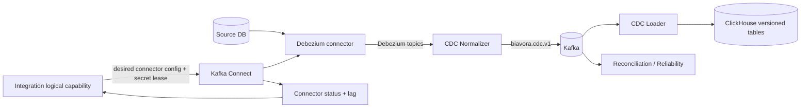

# ETL multi-database and CDC readiness

> **v2 reconciliation:** Absence of CDC is not a P0 defect. It is a **P1 FOUNDATION FEATURE**. PostgreSQL is the only mandatory Week-14 production-certified CDC source, using Debezium + Kafka Connect + Kafka + a BIAVORA normalizer. MySQL/MariaDB CDC is advertised only if the same acceptance suite passes; MSSQL, Oracle, and ClickHouse remain snapshot sources unless separately certified; SQLite is snapshot/scheduled incremental, not enterprise CDC. Existing snapshot connectors are preserved.

## Current capability

The current implementation is a credible **one-time/on-demand snapshot** pipeline, not continuous synchronization. The connector registry exposes PostgreSQL, MySQL, MariaDB, SQLite, SQL Server, Oracle, and ClickHouse. Every capability correctly advertises `snapshot_extraction: true` and `cdc: false`.

```text
snapshot command -> load_requests -> extractor -> raw_data
                 -> transformer -> transformed_data -> loader -> ClickHouse
                 -> metadata_updates/errors/quarantine -> SurrealDB/callbacks
```

P1-R strengths worth preserving:

- common connector Adapter/Strategy registry and capability-driven frontend;
- selected-table snapshot contract and tenant-qualified destination names;
- destination IP policy rejects loopback/private/link-local/reserved/multicast unless allowlisted;
- credential encryption/redaction before Kafka/log serialization;
- bounded loader buffers, batch/dedupe handling, manual offset commit/rewind;
- schema contracts, lineage, quality metrics, quarantine, and failure callbacks;
- extensive deterministic tests across connectors and stages.

## CDC readiness gaps

| Required CDC capability | Current state | Consequence |
|---|---|---|
| Durable source record and credential reference | Absent; credential is transient request/Kafka payload | Cannot reconnect, rotate, schedule, pause, or audit safely |
| Kafka Connect/Debezium runtime | Absent | No log-based capture |
| Source-specific offsets | Absent | No resume/replay/exact recovery point |
| Schema history | Custom snapshot schema contracts only | No DDL/change compatibility across stream |
| Change envelope (`op`, before/after, source position, tx/time) | Absent | Loader cannot distinguish insert/update/delete |
| Snapshot-to-stream handoff | Absent | Gaps/duplicates cannot be bounded |
| Upsert/delete materialization | Snapshot inserts/dedupe only | Changes and tombstones are not represented |
| Connector lifecycle/state machine | Request/job statuses only | No provision/run/pause/restart/recover/delete control |
| Lag/freshness/heartbeat | Absent | No CDC SLO or alert |
| Reconciliation | No source-vs-CH checkpoint validation | Silent loss/duplication cannot be detected |
| Poison/schema-change policy | Invalid event can recur uncommitted | Stream can stall |
| Key and identity policy | Snapshot dedupe helpers, not CDC key contract | Updates/deletes can target wrong/no row |
| Credential rotation/versioning | One Fernet key derived with static salt | Old retained events and rotation are fragile |

## Evolution assessment by engine

| Engine | Week-14 production approach | Readiness / caveat |
|---|---|---|
| PostgreSQL | Debezium PostgreSQL with logical replication/WAL; initial consistent snapshot; publication/slot lifecycle | **Mandatory production CDC target.** Requires privileges, slot/WAL retention guard, schema history, secret vault, reconciliation |
| MySQL | Debezium MySQL/binlog, GTID preferred | Second target if PostgreSQL gate is stable; server ID/binlog retention/DDL testing required |
| MariaDB | Debezium MySQL-compatible connector with explicit certified versions | Share much code, but certify separately; do not assume MySQL parity |
| SQL Server | Debezium SQL Server CDC | Snapshot-only for Week 14 unless a real licensed environment passes the full production CDC suite |
| Oracle | Debezium Oracle LogMiner/XStream depending deployment | Future/enterprise; privilege, licensing, redo retention, and connector operations exceed two-person window |
| SQLite | Scheduled/incremental snapshot based on application-controlled watermark, not enterprise log CDC | Label clearly as refresh, not CDC |
| ClickHouse source | Engine-specific watermark/incremental refresh or materialized integration, not WAL-style CDC | Require immutable key/time contract; avoid pretending generic Debezium support |

## Recommended target

Use **managed/self-hosted Kafka Connect + Debezium** for supported log-based engines rather than embedding WAL/binlog readers in Django. The Integration logical capability owns desired connector configuration and secret references; it is initially co-deployed in the Query control plane. Kafka Connect owns connector tasks and offsets; Data Platform owns normalized envelopes and ClickHouse materialization.



Do not force CDC through the current row-cleaning snapshot topic unchanged. Create a versioned normalized envelope with source ID, workspace ID, dataset/table binding, operation, primary key, before/after, source timestamp, ingest timestamp, transaction/source position, schema version, trace ID, and replay flag. Raw Debezium topics may be retained as an internal plane; consumers use the normalized contract.

## ClickHouse materialization

For mutable CDC tables, choose an engine per table/key semantics (often `ReplacingMergeTree` with version/sign or a staged current-state materialization). Do not promise immediate physical deduplication. Define:

- stable primary/business key policy;
- monotonic source version/position ordering;
- tombstone/delete handling;
- late/out-of-order event policy;
- schema-add/type-change policy;
- replay idempotency;
- snapshot version cutover;
- current and history query semantics.

Query-service must expose only the published current version and exact workspace table allowlist. Historical CDC tables should not be directly queryable by arbitrary generated SQL unless intentionally modeled.

## Security and network concerns

The current destination policy resolves all addresses and rejects a destination if any is forbidden. However, it returns resolved addresses while connection configurations continue using the original host, and `resolved_host` is removed from snapshot events. DNS can change between validation and connection. Bind the connection to a validated address with correct TLS hostname verification, or revalidate at connect time in the same trust boundary. Private destinations should use an explicit approved CIDR plus private agent/VPN transport; never globally enable private IPs.

Replace password-in-Kafka, even encrypted, with a secret reference and short-lived retrieval by the connector runtime. Use a managed vault/KMS envelope, key ID/version, audit, rotation, revocation, and narrow service identity. Apply Kafka TLS/SASL/ACLs and short retention to raw/DLQ topics containing customer data.

## Reliability contracts

- State machine: `DRAFT -> TESTED -> PROVISIONING -> SNAPSHOTTING -> CATCHING_UP -> RUNNING -> PAUSED/DEGRADED/FAILED -> DELETING`.
- Per-source idempotency and one active transition lease.
- Durable outbox for Integration commands and inbox/dedup for consumers.
- DLQ with metadata/pointer; avoid copying full sensitive rows unless encrypted and access-controlled.
- Lag, last event, last successful snapshot, error code, retry count, offset age, and reconciliation result.
- Backpressure and Kafka message-size policy; current row JSON events can exceed safe broker limits.
- Schema compatibility tests and a governed pause on destructive changes.

## Week-14 production scope

**Commit:** durable sources and secrets; PostgreSQL CDC; full snapshot-to-stream handoff; update/delete; lag/freshness; reconciliation sample; pause/resume/recover; tenant and replay tests.

**Stretch:** MySQL and MariaDB CDC after the same certification suite passes.

**Snapshot only:** SQL Server, Oracle, SQLite, ClickHouse source unless real environments and time remain.

**Future enterprise:** HA Connect clusters across regions, Oracle XStream, private agents at scale, automated DDL migration, cross-region disaster recovery, and exactly-once marketing claims.

## Acceptance gate

No CDC engine is “supported” until a disposable live test proves: consistent initial snapshot; concurrent writes during handoff; insert/update/delete; DDL add-column; restart at every stage; duplicate/reorder tolerance; connector crash; Kafka outage; secret rotation; tenant isolation; lag alert; source/CH reconciliation; deletion/revocation; and a documented recovery runbook.
