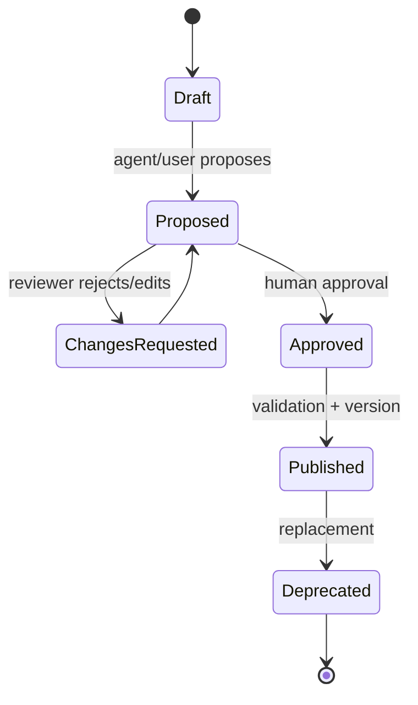

# Semantic layer and modeling agent plan

> **v2 canonical alignment:** The Semantic Layer is a P1 foundational platform feature, not a missing-feature P0 and not a UI convenience. It governs SQL, Analyst, Modeling, Proactive, Trust, RAG, What-if, Reports, and Visualization. The modeling agent may only `PROPOSE -> VALIDATE -> EXPLAIN -> HUMAN REVIEW -> APPROVE -> VERSION -> PUBLISH`; it may never auto-publish business meaning.

## Current state

BIAVORA has schema metadata and semantic **reasoning heuristics**, not a governed semantic layer. Current assets include column types/roles, source schema contracts, intent metrics/dimensions/filters, temporal phrase rules, aggregation repair, synonyms implicit in lexical code, and chart/result-shape contracts. They are valuable inputs but are not persistent business definitions.

Missing are durable workspace-scoped entities, relationships, measures/metrics, dimensions, time dimensions, aliases/synonyms, formulas, descriptions, owners, certification, versions, lineage, review/publication state, and compatibility rules. Prompt context generated from raw schema is not a semantic model.

## Target model

Use a relational, versioned model in a `semantic` PostgreSQL schema; do not start with a graph database solely because relationships exist.

| Entity | Essential fields |
|---|---|
| SemanticModel | workspace, dataset/source version, version, status, owner, created/published/replaced timestamps |
| Entity | stable ID, physical table binding, business name/description, grain, primary key, aliases, sensitivity |
| Relationship | from/to entity, key mappings, cardinality, join type, confidence, evidence, approved flag |
| Dimension | entity, physical expression/column, data type, aliases, description, sensitivity, allowed operators |
| TimeDimension | dimension, granularity/time zone/fiscal calendar, freshness semantics |
| Metric | name, formula AST, aggregation, grain, filters, format/unit/currency, owner, certification, lineage |
| BusinessTerm | term, synonyms, definition, linked semantic objects, locale |
| Proposal/Review | agent proposal, evidence, confidence, diff, reviewer, decision/comment |

Formulae should use a small typed expression AST compiled by an allowlisted compiler, not stored arbitrary SQL. Every published query is tied to one immutable semantic model version.

## Publication workflow

The modeling agent may **PROPOSE and EXPLAIN** only. It cannot silently publish. Approval requires an authorized workspace role, validation against the physical schema, formula/type/grain checks, duplicate-name rules, join-cycle/cardinality warnings, evaluation cases, and an auditable diff.

## Modeling agent inputs and tools

1. Authorized dataset schema and constraints from Integration/Query.
2. Profile summaries (null/distinct/min/max/sample values) with PII policy—not unrestricted raw rows.
3. Existing semantic model/glossary and usage history.
4. Tools: schema lookup, profile lookup, key/cardinality estimator, naming/synonym resolver, formula validator, join-path simulator, proposal writer.

Candidate inference:

- entities from tables and stable grain;
- PK/FK candidates from constraints first, then names/cardinality/statistics;
- relationships with cardinality/evidence and explicit uncertainty;
- measures from additive numeric columns and business names;
- dimensions from categorical columns;
- time dimensions from types/values;
- aliases/descriptions localized to English/Arabic only when reviewed.

Never infer a sum-safe metric solely because a column is numeric. Ratios, percentages, balances, prices, IDs, and semi-additive measures require review.

## Consumption

| Consumer | Use |
|---|---|
| Analyst agent / SQL generation | Resolve business terms, select governed metric, compile joins/filters at a known version |
| RAG | Retrieve definitions and approved documentation; semantic IDs are citation anchors |
| Proactive monitoring | Monitor published metric IDs at defined grain/freshness, not arbitrary SQL |
| What-if | Reuse metric formula, units, baseline, allowed scenario variables |
| Visualization/reporting | Labels, format, valid dimensions/chart roles, semantic version |
| Trust layer | Explain formula, owner, certification, physical lineage, freshness |

## API/events

- `GET /semantic/models/{version}`, `/metrics`, `/entities`, `/resolve?term=`
- `POST /semantic/proposals`, `/reviews/{id}/approve|request-changes`
- internal compile endpoint accepting semantic query, not arbitrary formula SQL
- outbox events: `semantic.model.proposed`, `.published`, `.deprecated`

All reads require workspace scope; only published versions are available to ordinary analysis. Draft/proposal content has separate permissions.

## Migration from current code

1. Characterize current `bi_semantic_layer`, temporal, intent priority, and compiler behavior with golden tests.
2. Create the persistent model and seed it from one curated dataset; do not auto-convert heuristics into certified metrics.
3. Put a Semantic Repository/Resolver interface in front of AI; keep lexical logic as fallback/alias suggestion.
4. Compile a small semantic query DTO into the existing structured intent/compiler.
5. Add proposal/review UI and immutable version selection.
6. After adoption, merge duplicated rule modules and remove fallbacks only with evaluation evidence.

## Week-14 production scope

Deliver one workspace-scoped model version per dataset; entities, simple relationships, dimensions/time dimensions, simple aggregate metrics, glossary/synonyms, human proposal approval, compilation into the existing SQL path, version/certification/lineage, and 30–50 curated evaluation cases. Defer complex modeling DSL, cross-dataset federation, automatic semantic publication, causal metrics, and enterprise catalog federation.
