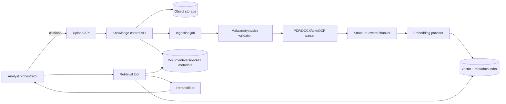

> **SUPERSEDED SUPPORTING PLAN — 2026-10-27.** The body below preserves prior design context, not January commitments. Product Scope revision dated 2026-10-27 in [43](43_BIAVORA_PRODUCT_SCOPE_AND_RELEASE_ROADMAP_2027.md), current architecture 22/30–34, and presentation 44/46 control. Structured & Unstructured RAG, Proactive Monitoring Agent and Arabic & Voice Support expansion are OUT OF JANUARY 10 RELEASE SCOPE; do not implement their old milestones. Existing functionality/security remains maintained.

# RAG and knowledge architecture

> **v2 canonical alignment:** RAG is a Week-14 product feature, not a current implementation defect. Use PostgreSQL + pgvector first if benchmarks pass. Structured facts remain in Semantic/Query; unstructured business knowledge uses permission-filtered retrieval. Hybrid answers must preserve evidence type and citations. Document deletion, versioning, re-index, ACL enforcement, injection defenses, and malicious-content handling are production gates.

## Current state

No operational RAG implementation exists. The repository has no document owner, ingestion job, parser/OCR pipeline, chunk model, embeddings, vector retrieval, reranker, document ACL, citations, reindex/delete flow, or RAG evaluation. LangChain/LangGraph dependencies and SurrealDB availability do not make a RAG system.

BIAVORA should enforce this division:

- Structured facts and metrics → Semantic/Query tools over ClickHouse.
- Unstructured policy, manuals, contracts, glossary, notes → Knowledge retrieval.
- Hybrid question → Orchestrator obtains both, distinguishes evidence types, and cites each claim.

## Target component

Create a **Knowledge capability** with a durable control plane and background ingestion workers. It may begin as a module/service based on deployment simplicity, but it must own document lifecycle and permissions.



## Storage decision

Do not add a specialist vector database for Week-14 production without scale evidence. The platform already depends on PostgreSQL; **pgvector in a separate `knowledge` schema/database** is the pragmatic default because metadata, ACL, versions, deletion, and vector rows can be transactionally coordinated. It is easier to operate than a new distributed store for the expected launch scale.

SurrealDB has graph/document potential but is currently an ETL metadata store with committed local RocksDB data and no production HA/backup contract. ClickHouse can search vectors at analytical scale but is a poor first home for document transactions/ACL/deletion. Revisit only after measured corpus/QPS/latency needs.

An ADR must confirm embedding dimensions/index type, expected document/chunk volume, query latency, backup/restore, and operational ownership before choosing.

## Document lifecycle

1. Create workspace-scoped document/version row in `UPLOADING`.
2. Stream to object storage using generated key; never trust filename/path.
3. Validate size, MIME and magic; malware scan; reject encrypted/unsupported files under policy.
4. Parse in a sandboxed, resource-limited worker. Extract page/section/table coordinates.
5. Detect language and document-level prompt-injection indicators.
6. Chunk by headings/paragraphs/tables with bounded overlap; preserve source spans.
7. Embed using a pinned model/version and batch budget.
8. Write chunks/embeddings with workspace, document/version, page/span, ACL, classification, checksum, and model version.
9. Validate count/checksum/retrieval smoke, then atomically publish the version.
10. Reindex creates a new version; deletion removes object, metadata, chunks, vectors, caches, and auditably tombstones citations.

Supported Week-14 inputs should be PDF, DOCX, and plain text after production acceptance. OCR, complex spreadsheets, scanned contracts, and image-heavy documents are post-launch unless separately certified.

## Retrieval and permissions

Retrieval must require workspace and actor context. Apply document/role ACL filters **before** vector scoring, not after generation. Use hybrid lexical + vector retrieval, metadata filters, diversity, and a modest reranker only if evaluation proves benefit. Return chunk IDs, source title/version, page/section/span, score components, and permission proof to the orchestrator.

The generation prompt treats document text as untrusted quoted evidence. Instructions inside documents cannot alter system/tool policy. Strip active content, cap per-document/context contribution, detect conflicting/low-confidence sources, and require abstention when evidence is insufficient.

## Citations and hybrid answers

Every unstructured claim cites a retrievable chunk and stable document version/page. Every structured numeric claim cites semantic metric version, SQL/query ID, tables, filters, time range, freshness, and query timestamp. The orchestrator must not cite a document as support for a SQL-computed fact unless it truly defines that metric.

Example hybrid plan:

```text
Question: “Did Q3 churn exceed policy tolerance, and what should we do?”
1. Semantic tool resolves certified churn metric/tolerance reference.
2. Query tool computes Q3 churn with exact filters.
3. Knowledge tool retrieves the approved churn policy and playbook.
4. Answer separates observed fact, policy threshold, and recommended actions.
```

## Evaluation and operations

Track ingestion success/latency, parser failures, chunks/document, embedding cost, index age, retrieval latency, zero-result rate, permission denials, stale/deleted citation attempts, and grounded-answer scores. Build answerable/unanswerable, permission, version-conflict, prompt-injection, multilingual, and deletion/reindex datasets. Restore tests must cover object + metadata + index consistency.

## Week-14 production scope and non-goals

Week-14 production scope: bounded workspace corpus; certified PDF/DOCX/text; object storage; PostgreSQL+pgvector; strict ACL; version/reindex/delete; hybrid retrieval; exact citations; security and quality evaluation. Defer broad web crawling, autonomous ingestion, dozens of file types, multimodal models, fine-tuning, enterprise DLP/catalog integrations, and separate vector infrastructure.
