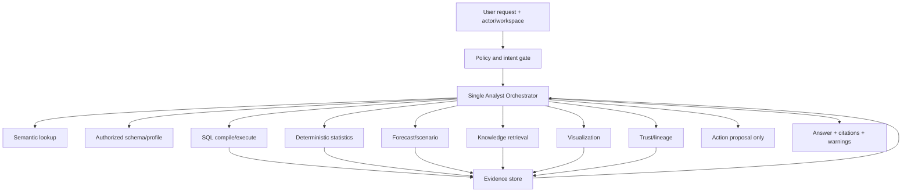

# Agentic architecture

> **v2 canonical alignment:** Week 14 uses **one governed Analyst Orchestrator** with typed tools, durable job state, bounded steps/budget, and policy enforcement. Separate worker pools are permitted for compute or isolation; a conversational multi-agent network is not in scope. Long operations use the canonical `QUEUED/RUNNING/RETRYING/SUCCEEDED/FAILED/CANCELLED` job model.

## Decision: single agent plus governed tools

Use **one Analyst Orchestrator with specialized typed tools**, not multiple conversational agents. Current tasks share the same workspace authorization, semantic context, and answer. Multiple agents would duplicate prompts/state, complicate tracing and evaluation, and increase cost without proven scaling or isolation benefit.

Separate worker pools or services only for resource/security reasons—Whisper GPU, forecast compute, document ingestion, and Tool Gateway—not because they are called “agents”.

## Current state

Current AI is a mostly fixed pipeline, not an autonomous agent. It classifies, builds structured intent/SQL, optionally forecasts, and returns a chart contract. The legacy LangGraph module is small and not the active orchestrator. No dynamic tool registry, bounded planner loop, agent state store, approval system, proactive schedule, or MCP execution exists.

## Analyst Orchestrator target



Every tool has a typed input/output schema, workspace/actor authorization, deadline, cost class, idempotency rule, data classification, and audit event. The orchestrator receives opaque evidence IDs rather than unrestricted service credentials. Limit steps, wall time, tokens, query cost, rows, and repeated tool calls. It must abstain or ask a clarifying question when the plan is ambiguous.

## Analyst task state machine

`CREATED -> PLANNING -> AWAITING_CLARIFICATION | RUNNING -> AWAITING_APPROVAL (actions only) -> COMPLETED | DEGRADED | FAILED | CANCELLED`

Persist the plan summary, tool calls/results references, model/prompt/semantic versions, policy decisions, costs, timestamps, and final evidence. Do not store private chain-of-thought. Resume/retry only from idempotent boundaries.

## Proactive monitoring agent

This is a constrained scheduled workflow, not an open-ended autonomous loop:

```text
published metric monitor -> freshness/data-health gate -> deterministic change/anomaly test
-> limited dimension drill-down -> evidence/likely drivers -> dedupe/suppress
-> notification with links -> optional action proposal
```

Required records: monitor definition, metric/version, schedule, threshold/model, baseline window, run, observations, incident, dedupe key, notification, reviewer feedback. Start with explicit thresholds and robust statistical rules; use an LLM only to summarize evidence. No alert if data freshness/quality fails. Cap dimension exploration and multiple-hypothesis false positives.

## Limited data reliability agent

Week-14 production scope:

- freshness and CDC lag;
- source connectivity/ingestion failure;
- row-count, null-rate, duplicate-rate anomalies;
- schema drift and missing columns;
- basic distribution change on selected columns;
- status history and notification.

Reuse ETL quality/metadata foundations, but move rules/run state into a durable owner and ensure every record is workspace/source/table scoped. The current detector is an observer producing metadata hints, not this agent.

Future enterprise scope includes automatic remediation, learned baselines across seasonal cohorts, root-cause across many pipelines, column-level observability at scale, and incident-management integrations.

## What-if capability

Classify each request before computation:

1. **Historical calculation:** deterministically recompute existing rows under an explicit arithmetic change.
2. **Forecast scenario:** apply stated intervention to baseline/features, then forecast with uncertainty.
3. **Simulation:** use a declared domain model and assumptions.
4. **Causal claim:** reject or qualify unless a validated causal design/model exists.

Persist `Scenario` with semantic model/data snapshot, baseline query/result hash, variables, assumptions, model/version, seed, horizon, outputs, uncertainty, creator, and timestamp. Answers must distinguish “if we mechanically change price” from “price causes demand to change”. A 5% price what-if can recompute revenue at fixed volume; estimating demand response requires an explicit elasticity assumption/model.

Current forecasting can support transparent time-series scenario baselines but not causal inference. Week-14 production should offer reproducible arithmetic and forecast scenarios with warnings.

## Tool security

- Query tool binds exact dataset/table and server resource limits.
- Semantic tool returns published definitions only.
- Knowledge tool enforces document ACL before retrieval.
- Forecast/statistics tools receive bounded result references, not arbitrary network access.
- Visualization tool can create only workspace-owned objects with idempotency keys.
- Action tool creates a proposal; Tool Gateway executes only after policy/human approval.
- Tool results are untrusted data and cannot override orchestrator policy.

## Evaluation

Measure end-task correctness, tool choice, invalid/repeated calls, unsupported claims, query result equivalence, citation/evidence coverage, policy violations, abstention quality, latency, tokens/cost, and human usefulness. Record traces as concise decisions and evidence, never hidden chain-of-thought.

## Week-14 production deliverable

One Analyst Orchestrator with semantic, query, statistics, forecast, RAG, visualization, trust, What-if, and ActionProposal tools; maximum-step/cost/deadline policy; durable jobs; exact citations; deterministic evaluation; and one useful action that executes only after deterministic policy and explicit human approval through the isolated Tool Gateway. Multi-agent delegation is deferred.
