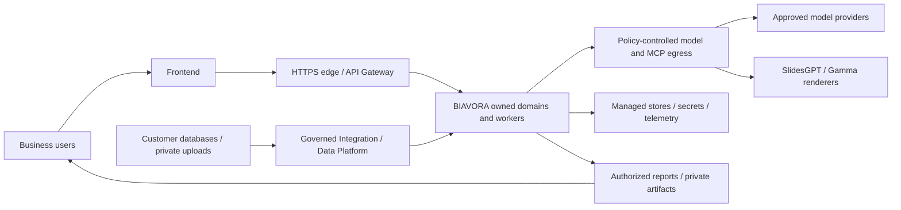
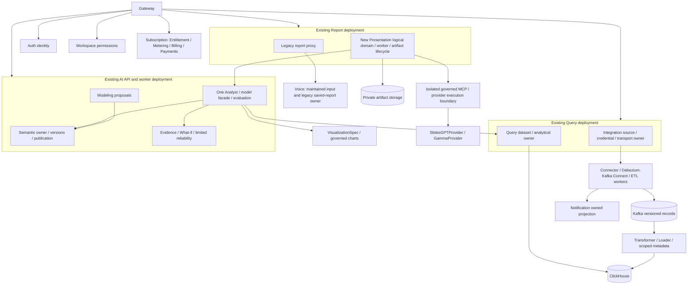
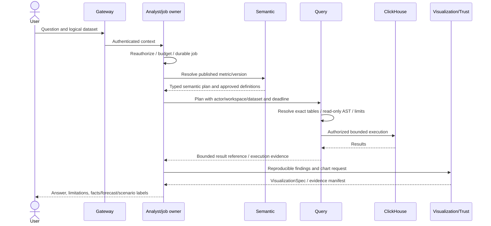
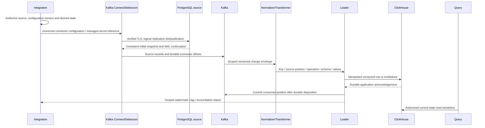
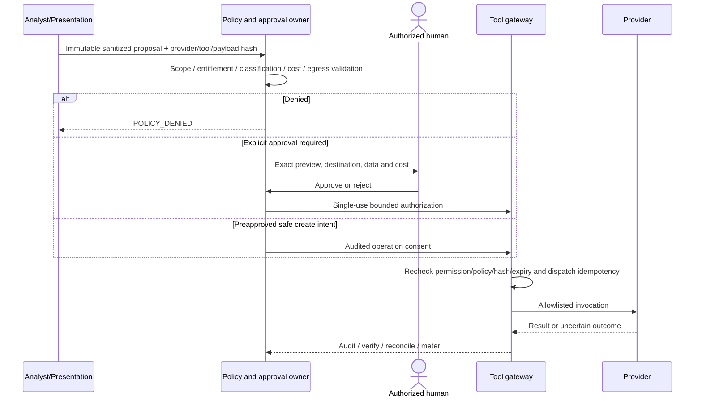

# 22 — January 2027 target architecture

Revision 3.0 · 2026-10-27 · Target **10 January 2027**. Design, not deployment proof.
[43](43_BIAVORA_PRODUCT_SCOPE_AND_RELEASE_ROADMAP_2027.md) controls scope and dependencies; [45](45_BIAVORA_RELEASE_TRACEABILITY_MATRIX.md) separates current implementation from target.

## Context

External databases are ingestion sources, not reachable by the LLM or presentation vendor. No external presentation provider becomes an analytical authority.

## Logical domains and initial deployment

Each owner writes its own PostgreSQL schema with a least-privilege role and separate migration principal; one managed cluster is allowed. Integration already exists in Query with separate role routing. Semantic, durable jobs, usage ledger, MCP and Presentation are target capabilities, not claimed deployed boxes. Report/Voice coexistence is bounded in [ADR-023](46_ADR_023_PRESENTATION_OWNERSHIP_AND_PROVIDER_ABSTRACTION.md). No automatic new Presentation, Semantic or ModelProvider microservice.

Metabase remains an existing downstream consumer of Query-authorized definitions through Visualization. Its actual query execution is a legacy rendering mechanism, not independent authorization. Keep it within scoped read-only grants/tenant object checks; assess that path during operations hardening. Presentation vendors receive approved result projections/assets only and never Metabase credentials or native warehouse access.

## Governed analytical request

AI's existing direct schema readers and process-global cache must be removed from authority before G-J/G-A. Authorized Schema tools provide minimum workspace/dataset context. A logical data ID from a client or model is a selector, never authorization.

## PostgreSQL CDC sequence and correctness contract

Foundation-C local closure, current release CI GREEN and preserved local security boundaries are prerequisites to local CDC. External validation is CAP-14/G-C-DEPLOY before production certification (49). Integration owns desired connector lifecycle; Kafka Connect owns capture offsets; Data Platform owns canonical normalization/materialization; Query owns published analytical bindings. PostgreSQL replication credentials require separately scoped replication/publication privileges, not an unexamined reuse of snapshot SELECT-only credentials. Managed delivery and safe DNS/TLS/egress must cover Connect's own driver; the Python connector pinning proof does not certify a Java Debezium connection.

Choose/test mutable-state storage before loader code: stable primary key, per-key source position/version, duplicate/reorder handling, delete tombstones and a Query-visible current-state view. Background ClickHouse merges alone do not guarantee immediate logical deduplication. Source transactions across tables require an explicit consistency level; January must disclose per-table/per-key eventual consistency unless stronger snapshot visibility is proven. Freeze a repeatable watermark/result reference for multi-query evidence or disclose drift; never claim an atomic multi-table view without tests.

Partition for per-key order, handle snapshot-to-WAL handoff without gaps, commit only after durable write or auditable terminal quarantine, and retain restart checkpoints. Quarantine invalid envelopes with scoped references and a controlled replay path; do not silently skip poison records. Require PKs for mutable release tables; reject unsupported no-key updates/deletes. Additive nullable columns can be a tested supported change; drop/rename/type/PK changes pause ingestion pending reviewed mapping/reseed. Source slot/WAL growth, lag, retention, credential rotation and source/target counts/hashes need alerts/runbooks. No blanket exactly-once marketing claim.

## MCP policy and approval sequence

January includes a tested explicit approval-required deck operation; safe internal analytical calls do not need repeated confirmation. No destructive arbitrary tool/SQL/financial action is in the minimum.

## Presentation sequence and data egress

The normative [presentation sequence, Data Egress Boundary, typed contracts and state machine are in 44](44_AI_PRESENTATION_AND_EXECUTIVE_REPORT_ARCHITECTURE.md). They complete this architecture's required context, ownership, analytical, CDC, approval, presentation and egress views without duplicating vendor logic. Provider adapters are transport-independent and run only after sanitized payload policy. No slide engine is built.

## Platform and deployment

HTTP submits/reads/cancels short control operations; Kafka transports versioned asynchronous records and reliable lifecycle/usage facts. Jobs use owned persisted state and transactional outbox/inbox, not HTTP-held orchestration. Correlation IDs connect calls/events without granting permissions.

Single-region managed containers/state are preferred for the two-person team; Kubernetes is not required. Use isolated staging/production, production process servers/workers, supported pinned dependencies, non-root immutable images, TLS/least-privilege identities, managed secrets/rotation, private artifact/quarantine storage, bounded resources/rates, redacted logs/metrics/traces, measurable SLOs and responder runbooks. Recover PostgreSQL/ClickHouse/Kafka/object storage/metadata/semantic/job/ledger state coherently. Prove migration/rollback and restore/RPO/RTO before launch.

Notification consumes owned events/read projections rather than foreign ORM. Entitlements, immutable Metering, Billing and Payments remain distinct even within Subscription. Paid activation is disabled unless its separate real-provider gate passes. No pgvector/Knowledge plane, Proactive Monitoring Agent or Arabic/Voice expansion is part of this release; existing code remains maintained. All boxes require the tests/deployment evidence in 45 before they can be called production-ready.
