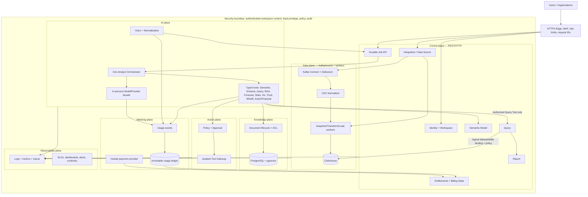
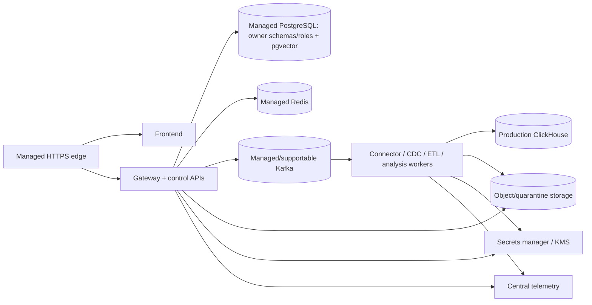

# 22 — Week-14 Deployable Target Architecture

> **Reference Version:** 2.0  
> **Status:** APPROVED_FOR_IMPLEMENTATION_PLANNING  
> **Target:** Production Deployable in 14 Weeks

## Decision summary

BIAVORA evolves into a small set of owned capabilities, not one container per noun. REST/HTTP is the control plane. Kafka/events carry ingestion records, durable job transitions, alerts, usage events, and long-running completion. Query is the sole analytical execution authority. Integration/Data Source becomes a logical owner initially co-deployed in the Query control-plane deployment, with its own module/schema/role; connector workers remain the Data Platform. One Analyst Orchestrator invokes typed governed tools. Entitlements, Metering, Billing, and Payment are separate concepts even when initially co-deployed.

## Plane model

Query executes; Report owns saved report lifecycle. Visualization consumes safe result/spec contracts and never queries ClickHouse directly.

## Runtime deployment topology

Use a managed container platform with separate staging/production environments. Kubernetes is not required unless workload/GPU/network needs justify its operational cost.

## Plane contracts

### Control plane

Synchronous APIs create/test sources, submit/cancel/read jobs, manage semantic/document/report objects, request approvals, inspect usage, and administer entitlements. Responses must be bounded and must not proxy long work in a request.

### Data/event plane

Versioned events carry tenant/workspace/source/job identity, schema version, idempotency key, correlation/trace context, occurred-at time, producer, payload reference, and classification. Owners define partition keys, compatibility, retry, terminal DLQ/quarantine, replay, retention, and PII/logging policy.

### Query boundary

Clients submit logical dataset/table identities. Query resolves immutable authorized physical bindings, requires an exact allowlist, applies read-only/resource settings, executes, and stores or pages bounded results. AI/Voice/Reports/Visualization have no direct ClickHouse credential or fallback. Physical identifiers are not public API fields.

### Integration and transport

Integration owns source definition, engine, secret reference, TLS, transport, table selection, capabilities, snapshot/CDC state, and lifecycle. Initial transport is `DirectSecureInternetTransport`; source models also carry a transport discriminator so `PrivateNetworkTransport` and `AgentTransport` can be added post-launch without changing CDC, metering, UI ownership, or events.

PostgreSQL CDC is `remote PostgreSQL -> TLS -> Debezium -> Kafka Connect -> Kafka -> BIAVORA normalizer -> Transformer -> Loader -> ClickHouse`. Engine claims follow certification, not adapter presence.

### Durable jobs

All voice analysis, large query/report, document indexing, semantic proposal, forecast/What-if, proactive investigations, actions, and large ingestion operations use the common state machine:

`QUEUED -> RUNNING <-> RETRYING -> SUCCEEDED | FAILED | CANCELLED`

Each job has `job_id`, workspace/actor, type/version, idempotency/correlation IDs, attempt, timestamps, deadline/budget, input/result references, error class, semantic/model/prompt versions, and audit trail. State transitions use transactional outbox/inbox or an equivalent proven delivery pattern.

## Ownership and storage

- One managed PostgreSQL cluster is allowed. Critical domains use owner schemas/databases and dedicated roles; no owner writes another domain's tables.
- ClickHouse is analytical storage, accessed only through Query for product analysis and through owned loader identities for ingestion.
- PostgreSQL + pgvector is the initial knowledge store; a new vector database needs benchmark evidence.
- Object storage owns raw/quarantined uploads and document artifacts with tenant keys and retention policy.
- The usage ledger is immutable/auditable and separated from mutable entitlement/billing state.

## Required Week-14 production properties

Exact controls and release evidence are normative in `30_CANONICAL_ARCHITECTURE_RULES.md` and `33_PRODUCTION_SECURITY_BASELINE.md`. The architecture is not considered delivered without staging, secrets management, production process servers/non-root images, resource/rate limits, TLS, observability/SLOs, backup/restore, migration/rollback rehearsal, AI/CDC/security gates, and a real payment path when paid launch is enabled.

## Explicit post-launch scale enhancements

Private network/customer agent transport, MySQL/MariaDB CDC unless already certified, additional action integrations, a dedicated Integration deployment, dedicated Model Gateway service, separate vector database, multi-region active-active, and service mesh are evidence-driven future options—not Week-14 assumptions.
