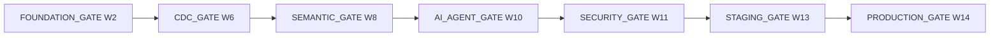

# 25 — 14-Week Production Deployment Roadmap

> **Reference Version:** 2.0  
> **Status:** APPROVED_FOR_IMPLEMENTATION_PLANNING  
> **Target:** Production Deployable in 14 Weeks

## Planning contract

The team is two people: **SE** (software/data/platform focus) and **AI** (AI/evaluation/product focus). They pair only on high-risk contracts and gates. Coding tools may accelerate implementation but do not replace review, real infrastructure, threat modeling, recovery drills, or human evaluation.

The fixed deadline does not permit false claims. PostgreSQL CDC is mandatory; MySQL/MariaDB CDC is conditional on certification. One orchestrator, one useful approval-gated action, bounded reliability/proactive checks, and a reproducible What-if workflow are the constrained Week-14 product. Kubernetes, multi-region active-active, customer agent/VPN transport, and broad action catalogs are not required. AI evaluation and raw usage telemetry begin Week 1. Production engineering starts immediately and intensifies before staging rather than being deferred to the final week.

## Gate sequence

No gate closes on “code complete.” It requires tests, security evidence, telemetry, operational documentation, migration/rollback or recovery evidence where relevant, and named approval.

## Weekly execution plan

### Week 1 — architecture freeze and immediate containment

- **SE track:** implement plan for BIA-001/002/003/005/006/008/010/011; disable production subscription simulation; rotate/invalidate historical secrets; freeze owner schemas/roles; define Query binding/resource and Integration contracts; prepare managed environment choice.
- **AI track:** inventory all provider calls; define in-process `ModelProvider` contract and prompt/model registry; establish English/Arabic voice, intent, schema-resolution, text-to-SQL, and safety golden datasets; record baseline metrics.
- **Shared:** approve ADR directions, threat model Query/AI/source paths, define release claims and issue owners.
- **Dependencies:** production accounts/secrets/payment-provider choice initiated; representative tenants/datasets available.
- **Acceptance:** no production mode can activate simulated subscriptions; secret rotation evidence exists; canonical ownership/query contracts accepted; evaluation harness runs a versioned baseline. This is Week-1 checkpoint, not `FOUNDATION_GATE`.

### Week 2 — fail-closed foundation and durable job spine

- **SE track:** enforce exact Query dataset/table binding; remove Voice direct fallback; add universal query limits; secure upload boundary; implement critical owner roles/schema path; create the minimum persistent multi-source Integration aggregate with opaque secret references/non-destructive lifecycle; build common persisted job/outbox contract; introduce distributed gateway/job limits and base telemetry.
- **AI track:** route active provider calls through facade; emit provider/model/input/output/cached tokens, latency, cost estimate, fallback, prompt/model version, workspace/job correlation; remove broad AI schema path behind authorized Schema/Query tool contracts; add test doubles/timeouts/budgets.
- **Shared:** cross-tenant/adversarial tests; job transition review; logging/redaction policy; on-call/SLO skeleton.
- **Dependencies:** BIA-001/002 seams, managed secrets/telemetry endpoints.
- **FOUNDATION_GATE:** all nine P0s (`BIA-001/002/003/005/006/008/009/010/011`) are closed for their dependent production paths; Query/upload/job/source/owner/subscription tests pass; migrations are reversible; AI facade/eval/usage telemetry is live; security, observability, and rollback evidence is recorded.

### Week 3 — persistent Integration domain and PostgreSQL CDC lab

- **SE track:** create persistent multi-source Integration model and opaque versioned secret refs; direct-secure transport/TLS/egress policy; non-destructive replace/cutover; deploy Debezium/Kafka Connect in staging-like environment; define canonical CDC envelope/schema compatibility.
- **AI track:** bind schema/semantic tool prototype to workspace/dataset identity; extend text-to-SQL/adversarial tenant benchmark; build evidence/trust contract prototypes.
- **Shared:** connection threat model, CDC acceptance dataset, correlation/usage propagation.
- **Dependencies:** Foundation Gate, source database with logical replication, Kafka identity/TLS plan.
- **Acceptance:** two sources per workspace persist independently; secret rotation and failed cutover preserve prior source; initial PostgreSQL snapshot and change record reach a tenant-scoped topic with traceable IDs.

### Week 4 — CDC normalization and reliable loading

- **SE track:** normalize create/update/delete/tombstone events; partition by tenant/source/table; integrate Transformer/Loader; implement idempotency, retry, terminal DLQ/quarantine, poison record handling, scoped status; observe lag/throughput/errors.
- **AI track:** semantic model schema/API/migration implementation; metric/dimension/entity/relationship/time/formula validation; provider/eval regression automation.
- **Shared:** data-correctness fixtures, deletion semantics, schema/version review.
- **Dependencies:** CDC lab, Query bindings, owner schemas.
- **Acceptance:** duplicate/reorder/restart tests do not corrupt results; invalid events have explicit terminal/replay path; scoped status and lineage survive end to end.

### Week 5 — CDC recovery and semantic foundation

- **SE track:** offsets/checkpoints, connector restart/failover, reconciliation, schema drift policy, backfill-to-stream handoff, pause/resume, credential rotation; production Kafka/ClickHouse identity/TLS implementation.
- **AI track:** semantic authoring/read APIs, versions/status/certification/lineage; begin Modeling Agent proposal/validation/explanation; bind Query compiler to published semantic version.
- **Shared:** CDC outage/restore drills and semantic authorization tests; dashboards/alerts/runbooks.
- **Dependencies:** reliable loader, semantic store.
- **Acceptance:** restart/outage/backfill tests meet declared RPO/RTO and row reconciliation; unpublished semantics cannot affect answers.

### Week 6 — certify PostgreSQL CDC and semantic review flow

- **SE track:** run PostgreSQL matrix (initial load, updates/deletes, DDL policy, high volume, lag, outage, rotation, duplicate, reconciliation); expose honest capability matrix; harden connector resource/egress limits.
- **AI track:** complete `PROPOSE -> VALIDATE -> EXPLAIN -> REVIEW -> APPROVE -> VERSION -> PUBLISH`; add semantic diff/rollback and benchmark cases.
- **Shared:** close CDC and security findings; document operator/user behavior.
- **Dependencies:** Week-5 recovery/reconciliation and semantic review implementation.
- **CDC_GATE:** PostgreSQL CDC passes correctness/recovery/security/observability docs and rollback; unsupported engines are not advertised. Snapshot adapters remain regression-green. Semantic proposals cannot auto-publish.

### Week 7 — governed semantic context and knowledge ingestion

- **SE track:** document owner, object/quarantine storage, pgvector migration, workspace/document ACL, deletion/re-index/version jobs; production retention controls.
- **AI track:** semantic resolution in active intent/SQL path; permission-filtered chunking/embedding/retrieval/reranking; citation contract and injection/malicious-content evaluation.
- **Shared:** hybrid structured/unstructured evidence rules; resource/usage instrumentation for embeddings/indexing.
- **Dependencies:** CDC Gate, durable jobs, semantic API, object storage.
- **Acceptance:** semantic version is reproducible in answers; cross-tenant document retrieval is negative-tested; delete removes retrieval; citations resolve to authorized versions.

### Week 8 — semantic certification and Analyst tool orchestration

- **SE track:** harden Query/Schema/Semantic/RAG/Forecast/Visualization tool APIs; result references/pagination; report ownership migration; event/outbox contracts.
- **AI track:** one bounded Analyst Orchestrator with typed tool schemas, step/time/cost budgets, failure/degraded states, Trust evidence; Arabic normalization/voice regression integration.
- **Shared:** semantic, hybrid-answer, prompt-injection, tool-policy, tenant, migration/rollback suites.
- **Dependencies:** Week-7 governed semantic context and permissioned knowledge lifecycle.
- **SEMANTIC_GATE:** published semantics govern SQL/Reports/Trust; reviewer/audit/version/rollback pass; RAG ACL/citations/deletion pass; SLOs and docs exist.

### Week 9 — Analyst, reliability, proactive, and What-if slices

- **SE track:** freshness/ingestion/CDC lag/source availability/null/row-count/duplicate/schema/distribution signals; schedule/job/alert framework; usage reservation/commit/release ledger foundation.
- **AI track:** analyst multi-turn/job behavior; governed proactive investigation; What-if contract separating calculation/forecast/scenario/causality; uncertainty/evidence evaluation.
- **Shared:** budgets, degraded behavior, false-alert review, resource-cost tests.
- **Dependencies:** Semantic Gate, durable jobs, telemetry.
- **Acceptance:** each slice produces reproducible, permissioned evidence; no unrestricted autonomy; usage retries are idempotent.

### Week 10 — approved action and production runtime conversion

- **SE track:** policy/approval state, short-lived single-use token, isolated Tool Gateway, one useful action integration; production process servers, non-root images, graceful drain, resource limits, immutable dependency/image policy; staging IaC/config.
- **AI track:** `ActionProposalTool`, exact parameter explanation, refusal/ambiguity tests; Arabic/RTL product completion; model capacity/cost tuning.
- **Shared:** end-to-end Analyst/RAG/Trust/Reliability/Proactive/What-if/MCP and load profiles.
- **Dependencies:** Week-9 governed slices, identity/approval policy, chosen production platform.
- **AI_AGENT_GATE:** bounded orchestrator and tools pass quality/safety/cost/tenant thresholds; one action requires valid human approval and is audited; runtime conversion passes smoke/rollback tests.

### Week 11 — metering, entitlements, billing, and security convergence

- **SE track:** immutable usage ledger, pricing versions, adjustments, entitlement decisions, reconciliation; hosted/tokenized payment, signed webhooks, idempotency/failure/refund states if paid launch; infrastructure TLS/identity, distributed rate limits, CSP/token hardening.
- **AI track:** validate all LLM/voice/embedding/forecast/tool usage attribution; full Arabic/English quality and safety runs; cost-budget alerts.
- **Shared:** billing abuse/concurrency, RAG/MCP injection, upload, SSRF/DNS, secrets, tenant, and log-redaction testing.
- **Dependencies:** provider/tool telemetry, action gateway, production runtime baseline, hosted payment sandbox if paid launch.
- **SECURITY_GATE:** no open P0; critical tenant/data/financial controls pass; secrets/identities/TLS/rate limits/uploads/logging have evidence; metering reconciles raw provider usage; paid-path staging passes or paid entitlements are disabled.

### Week 12 — staging deployment and recovery rehearsal

- **SE track:** deploy production-like staging; managed backups/PITR; ClickHouse/object/Kafka recovery procedures; migration/rollback; dashboards/alerts/runbooks; dependency/image/SBOM/signing gates.
- **AI track:** full fixed-corpus evaluation on release candidates; latency/cost/capacity tuning; failure/fallback and degraded-mode drills.
- **Shared:** load/soak, dependency outage, CDC recovery, job retry/cancel, restore, alert/on-call, payment reconciliation drills.
- **Dependencies:** Security Gate, managed production-equivalent services.
- **Acceptance:** signed images deploy reproducibly; restore meets RPO/RTO; alerts fire to owner; rollback succeeds; capacity envelope documented.

### Week 13 — release candidate and production rehearsal

- **SE track:** production IaC/config/domain/HTTPS/secrets; data migration dry run; release/rollback automation; close staging defects and SLO gaps.
- **AI track:** freeze prompt/model/semantic/eval versions; red-team failures; operator overrides/kill switches; user-facing trust and Arabic acceptance.
- **Shared:** complete user journeys across two tenants, supported source modes, billing/usage, incidents, support/runbooks; product claims audit.
- **Dependencies:** successful Week-12 restore/rollback/load evidence and production access readiness.
- **STAGING_GATE:** seven-day-equivalent soak/load evidence (compressed testing permitted with justified model), zero cross-tenant failures, restore/rollback/alert/payment drills pass, release candidate digests frozen, runbooks approved.

### Week 14 — controlled production release

- **SE track:** deploy production with canary/limited cohort, monitor SLO/error/cost/CDC/billing, verify backups, audit access, execute rollback criteria if breached.
- **AI track:** production shadow/canary evaluation, quality/cost/safety monitoring, prompt/model rollback readiness, human review of early answers/actions.
- **Shared:** final security, product, operations, data, AI, and financial sign-off; publish support/escalation and certified capability matrix.
- **Dependencies:** Staging Gate and external provider/managed infrastructure readiness.
- **PRODUCTION_GATE:** every item in `16` Production Deployment Definition of Done and `33` pre-production baseline has evidence; no P0; only certified claims enabled; on-call/support active; rollback decision owner present. Result is **GO**, otherwise **NO-GO**—the deadline never waives the gate.

## Contingency and scope discipline

If capacity or an external provider slips, reduce breadth before reducing safety: keep PostgreSQL-only CDC; do not claim conditional MySQL/MariaDB CDC; retain one action; reduce proactive/reliability rule count; limit document formats; limit supported Arabic dialect evidence; disable paid plans if billing is not certified. Do not remove tenant isolation, recovery, semantic approval, RAG ACL/citations, action approval, telemetry/metering integrity, production runtime, staging, or release gates.

## Week 1 first action

Pair for a one-day implementation kickoff that freezes the Query/Integration/Job/provider contracts, disables production subscription simulation, assigns secret rotation, and creates the evaluation baseline. Then work in parallel against the Week-2 `FOUNDATION_GATE`.
