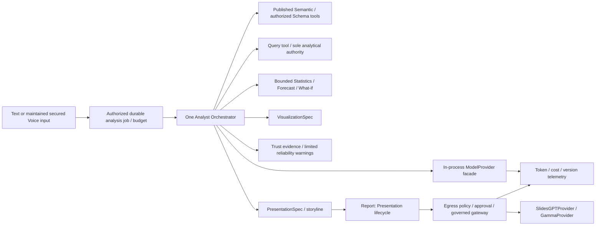

# 32 — Canonical AI architecture

Revision 3.0 · 2026-10-27 · Target **10 January 2027**. Scope: [43](43_BIAVORA_PRODUCT_SCOPE_AND_RELEASE_ROADMAP_2027.md). Current code evidence: [45 EV-05/06](45_BIAVORA_RELEASE_TRACEABILITY_MATRIX.md).

Use one governed Analyst Orchestrator with typed tools and durable jobs. Model output is a proposal, never authorization, metric publication, payment truth or action approval. Preserve deterministic intent/planner/compiler/temporal/forecast tests and existing voice behavior. Existing direct ClickHouse schema readers, process-global cache, synchronous Dagster execution and pending-integration success are open debt, not this target implemented.

## Runtime and contracts

Normalize request, resolve actor/workspace/dataset, reserve usage and persist a job; clarify missing metrics/period/audience before expensive execution. Resolve published semantic version and grain/units/timezone. Build a bounded analytical plan; Query reauthorizes and executes under exact table/resource policy. Return bounded result refs, not unbounded raw rows. Forecast/statistics/scenario use authorized result refs and deterministic methods. Visualization derives governed chart specs; Trust records metric/data/query/method/evidence versions and limitations. Analyst may produce a PresentationSpec; Presentation handles provider and artifact lifecycle, never alternate analytical execution.

ModelProvider is an internal library with typed request/result schemas, provider/model/prompt versions, deadlines, retry classification/circuit/fallback, budget, test doubles and safe redaction. Every call records input/output/cached tokens, latency, estimated/actual cost and unknowns, retry/fallback, correlation and outcome. Do not log raw prompts/rows/hidden chain-of-thought. Provider fallback must retain egress/region/cost policy.

| Tool | Permitted contract | Forbidden behavior |
|---|---|---|
| Schema / Semantic | Minimum authorized logical schema, published metrics/relationships/version | Global warehouse enumeration, cross-tenant cache, draft leakage, auto-publish |
| Query | Actor/workspace/logical dataset and governed query plan; bounded result/evidence | Arbitrary physical tables, direct DB fallback, source credentials |
| Statistics / Forecast / WhatIf | Bounded result refs, baseline/method/model/assumptions/uncertainty | Arbitrary code/network, unlabelled simulation, invented causal conclusions |
| Visualization | Existing VisualizationSpec and approved values | Independent SQL authority or duplicate chart model |
| Trust / Reliability | Evidence refs and scoped freshness/quality signals | Hidden reasoning, unsupported confidence, scheduled proactive investigation scope |
| Presentation planning | Internal spec/storyline tied to analytical evidence | Vendor prompts before analysis, credentials/internal URLs in outbound DTO |
| ActionProposal | Immutable exact operation and safe preview | External credentials or execution before policy/approval |

## Semantic modeling and analytical truth

Modeling proposes candidate metrics, dimensions, relationships, descriptions, aliases and validation advice. Lifecycle: PROPOSE → VALIDATE → EXPLAIN → HUMAN REVIEW → APPROVE → VERSION → PUBLISH. Validate references/types/formula AST/grain/cardinality/cycles/ambiguity and permissions deterministically. AI never silently changes a published definition.

Each material answer/deck claim links to metric definition, logical dataset/source, query/result ref, period, calculation/method and quality. Distinguish fact, correlation, contribution, likely driver, anomaly and causal conclusion. January includes contribution-based diagnosis, not causal inference. OBSERVED, FORECAST and SCENARIO have explicit separate labels. Confidence reflects evidence/calibration, not model self-report.

## Jobs, safety and evaluation

Shared jobs persist actor/workspace, immutable request hash, versions, budget/deadline, steps, attempts, results and failures. QUEUED/RUNNING/RETRYING/SUCCEEDED/FAILED/CANCELLED have validated transitions; detailed Presentation stages map to them in 44. Outbox/inbox and idempotent effects survive worker death; no success while a required operation is pending. Reauthorize tools and dispatch after permission changes; cancellation releases unspent reservation without erasing incurred provider cost.

Evaluation begins P0, not after features. Deterministic CI tests exact fixture results, semantic resolution, SQL equivalence, tool selection, tenant/refusal/injection, evidence and state transitions. Budgeted pinned-model runs evaluate correctness, abstention, task completion, latency and cost; human reviews check usefulness and non-fabricated explanations. Version corpus/model/prompt/tool/semantic/provider configuration, record baseline/candidate delta, and freeze thresholds before each gate. Zero critical tenant/secret/approval bypass and exact numeric fixture equality are non-negotiable. Add exported-deck factuality tests; LLM judges alone cannot approve numbers or safety.

No RAG tool/document ingestion/vector store, Proactive Monitoring Agent, or Arabic & Voice Support expansion in January. Existing language/voice routes retain compatibility/security tests; no new dialect benchmark milestone. Operational telemetry/alerts and limited pre-analysis reliability remain required.
