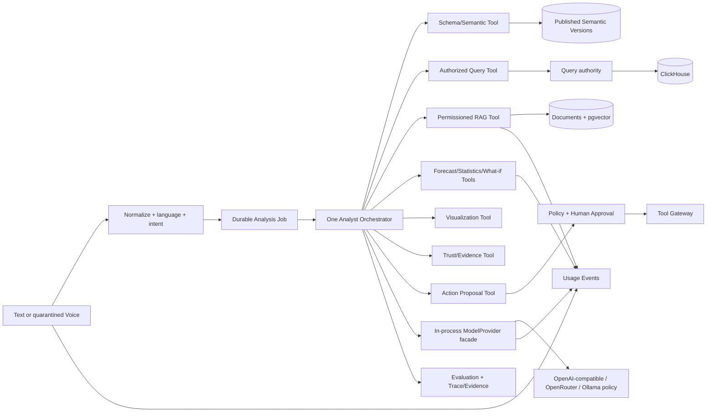

# 32 — Canonical AI Architecture

> **Reference Version:** 2.0  
> **Status:** APPROVED_FOR_IMPLEMENTATION_PLANNING  
> **Target:** Production Deployable in 14 Weeks

## Architecture decision

BIAVORA uses one governed Analyst Orchestrator with typed tools and a shared durable job model. Deterministic parsing, policy, semantic validation, SQL guarding, authorization, metering, and action approval surround model calls. The model proposes and selects within bounds; it is never the security authority.



## Runtime stages

1. **Input/Voice:** validate/quarantine upload, transcribe with workspace/job identity, record language/model/duration/latency/usage, retain/delete by policy.
2. **Normalization:** deterministic cleanup, language/locale/temporal normalization, safe structured intent. Model fallback is schema-constrained and traced.
3. **Semantic resolution:** resolve only authorized published entities/metrics/dimensions/relationships/time terms and record semantic version/candidates/ambiguity.
4. **Analyst orchestration:** execute a bounded plan through typed tools. Persist steps/outcomes as job state and evidence, not hidden free-form “reasoning.”
5. **Query:** compile/review a logical plan/SQL, then Query re-authorizes workspace/dataset/table, guards SQL/resources, executes, and returns bounded result/reference.
6. **RAG:** retrieve only authorized document versions using metadata/ACL filters, resist document instructions, rerank, and return resolvable citations.
7. **Forecast/What-if:** validate data shape and method, persist baseline/assumptions/model/horizon/uncertainty/comparison and distinguish scenario from causality.
8. **Visualization:** derive a safe chart spec from bounded result metadata; it cannot query ClickHouse.
9. **Trust:** assemble permission-filtered SQL, sources/columns, metric definitions, filters/time, semantic/model/prompt versions, query/freshness times, citations, assumptions, warnings, degraded state, and uncertainty.
10. **Action:** create a proposal only. Deterministic policy/human approval/isolated Tool Gateway owns execution.

## ModelProvider facade

The facade is an internal library in the AI deployment for Week 14, not a network service.

```text
execute(
  task,
  messages,
  model_policy,
  response_schema,
  timeout,
  retry_policy,
  budget,
  tenant_context,
  prompt_version,
  job_context
) -> StructuredModelResult
```

It owns provider adapters, model allow policy, structured output validation/repair, timeout, bounded retry, circuit/fallback policy, token/cost extraction, content/safety policy hooks, redaction, tracing, and deterministic test doubles. A fallback is recorded and must respect the same data-region, task, budget, and safety policy. Unsupported token/cost fields are explicitly `unknown`, never invented.

Every call emits: request/job/workspace correlation; task; provider/model; prompt/model/response-schema version; input/output/cached tokens; latency; estimated cost and pricing version; retry/fallback; success/error/degraded state; safety result. Raw prompts/responses are not logged by default.

## Typed tool policy

| Tool | May access | Must return | Forbidden |
|---|---|---|---|
| SchemaTool | Authorized logical dataset schema | Typed minimal fields and schema version | Global `system.columns`, physical secrets |
| SemanticTool | Authorized published semantic version | Entities/metrics/relationships/definitions | Draft from another workspace, silent publish |
| QueryTool | Logical dataset/table binding and query request | Bounded result/ref, execution metadata | Client/model-chosen physical table, direct CH fallback |
| RAGTool | Authorized document/version metadata and pgvector candidates | Snippets/citations/ACL evidence | Cross-tenant chunks, instructions as policy |
| ForecastTool | Authorized bounded series | Method/model/horizon/uncertainty/artifact | Unbounded rows, causal claim |
| StatisticsTool | Authorized bounded result | Reproducible method/output | Arbitrary code/network/filesystem |
| VisualizationTool | Bounded result shape | Validated chart spec | Data query or secret access |
| TrustTool | Existing evidence refs | Permission-filtered answer evidence | Chain-of-thought or unauthorized sources |
| WhatIfTool | Baseline and explicit assumptions | Scenario/comparison/uncertainty | Presenting correlation as cause |
| ActionProposalTool | Allowed action schema and user intent | Exact proposal/risk/parameters | Credentials or execution |

## What AI may access

- The authenticated actor/workspace context and entitlements supplied by trusted middleware.
- Minimum logical schema and published semantic context returned by authorized tools.
- Bounded Query results/result references for the current workspace/job.
- Permission-filtered document snippets and citation metadata.
- Tool/provider policies, remaining job budgets, approved model/prompt versions, and safe aggregate usage state.
- Its own durable job state and permission-filtered prior conversation/report context under retention rules.

## What AI is forbidden to access or decide

- Direct/global ClickHouse, raw database/source credentials, Kafka admin credentials, secret-manager APIs, payment secrets, or third-party write credentials.
- Arbitrary workspace IDs, physical table names, unrestricted filesystem/network, raw upload paths, or another tenant's caches/traces/results.
- Authorization, entitlement truth, semantic publication, payment success, action approval, or final safety policy.
- Unbounded raw datasets or whole structured warehouses through embeddings.
- Hidden chain-of-thought as an audit artifact. Persist structured decisions, tool calls, evidence, versions, outcomes, and errors instead.

## Semantic Modeling Agent

Input is authorized schema/profile, existing published semantic version, and optional business terms. Output is a draft diff with confidence/evidence and validation errors. The only state progression is:

`PROPOSE -> VALIDATE -> EXPLAIN -> HUMAN REVIEW -> APPROVE -> VERSION -> PUBLISH`

Reject unresolved references, cycles, ambiguous joins/grain, incompatible formulas/types, forbidden fields, or unauthorized scope. Publication is a deterministic privileged application operation after reviewer authorization, never a model tool call.

## RAG security and quality

Ingestion is a durable job with safe file validation, parser sandbox/quarantine, content classification, chunk/embedding versions, ACL inheritance, and deletion tombstones. Retrieval filters by workspace/document permission before vector search where supported and rechecks returned citations. Treat content as evidence, not instruction. Evaluate retrieval recall/precision, citation correctness, groundedness, access-control leakage, deletion, prompt injection, malicious files, latency, and cost.

## Evaluation program

Evaluation starts Week 1 and has three tiers:

- **Per-change deterministic CI:** provider adapters/test doubles, parsers, semantic validation/compiler, SQL/tool/action safety, fixed golden cases.
- **Nightly/release model evaluation:** English/Arabic voice, intent, schema resolution, text-to-SQL execution/equivalence, RAG retrieval/citations, tool selection, refusal, forecast/What-if, safety, latency, and cost on versioned corpora.
- **Staging/production monitoring:** shadow/canary cases, sampled human review, drift/error/cost/degraded-rate dashboards, rollback/kill switches. Production data enters evaluation only with permission, minimization, and retention controls.

Thresholds are risk-tiered and frozen with each release. A model/prompt/provider/semantic/tool change cannot ship if it regresses a critical tenant/safety test or exceeds approved quality/cost/latency budgets without explicit release review.

## Metering and observability

Usage events originate at the resource boundary, not reconstructed from user request counts. Voice emits audio seconds/model/compute; providers emit tokens/model/cost; RAG emits embedding/generation/index jobs; agents emit model/tool/expensive operation; forecasting emits job/series/horizon/model. Jobs, tools, queries, traces, and ledger share correlation IDs. Dashboards show quality, latency, fallback, errors, tokens/cost, tool mix, budget refusal, retrieval/citation metrics, and tenant-safe saturation.
