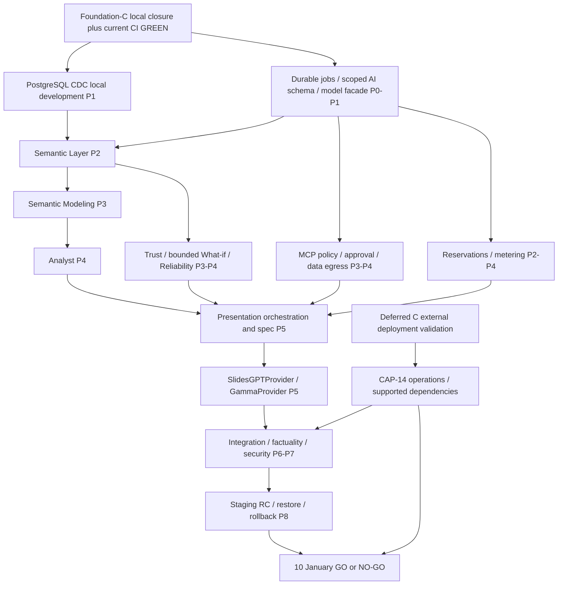

# 43 — BIAVORA product scope and release roadmap

Revision: 3.1 · Product scope revision: 2026-10-27 · Target public launch: **10 January 2027**.
Status: approved scope translated into an evidence-gated implementation plan; **production NO-GO today**.

## Authority and evidence

This document supersedes the rolling Week-14 scope, dates, and future-feature commitments. Precedence: **43 scope/calendar → 34 master context → 22/30/31/32/33 target architecture and accepted ADRs → 20 debt register → latest applicable Foundation evidence → historical reports**. The traceability matrix 45 implements this scope; 44 and ADR-023 in 46 specialize presentation architecture. In a conflict, update subordinate planning before implementation. Planning precedence never overrides observed facts or closes a failed gate. Security requirements cannot be waived by a summary.

Read [34](34_BIAVORA_MASTER_CONTEXT_FOR_FUTURE_PROMPTS.md) first for future work. [48](48_DOCUMENTATION_INVENTORY_AND_SCOPE_REFERENCES.md) classifies retained documents/references. Old readiness percentages (36%, 24%, 18%) describe the earlier scope and are **not current measurements**. No replacement percentage is invented.

Original scope-reconciliation baseline: branch `foundation-c-staging`, HEAD `9ed2439512179b032736c6f1917521fb7c0dce71`, 5,751 tracked paths, no parent-repository untracked files at that earlier entry; only dirty TimesFM. The later CI-repair entry includes the unstaged reconciliation files, preserved as recorded in 49. No staging, commit, push, reset, cleanup or TimesFM edits are authorized in this repair.

| State | Meaning | Current evidence |
|---|---|---|
| CLOSED | Acceptance for a named defect or explicitly scoped local development phase | A: BIA-001/002/010; B: BIA-003/006/011; C local defects in 36–42; C local phase closure in 49, without deployment certification |
| LOCAL PASS | Executed deterministic/disposable checks; not deployed certification | C6 restricted-role lifecycle, migration/rollback, 24 foreign-workspace cases, v2 replay; report 42 |
| PARTIAL | Useful implementation with remaining requirements | BIA-008 credential lifecycle; durable job skeleton; provider/evaluation/metering/operating foundations |
| DEFERRED_TO_PRODUCTION_READINESS | Missing deployment proof retained as a mandatory production gate; no longer a local development blocker | CAP-14 / G-C-DEPLOY; report 49 supersedes sequencing in 42 |
| TRANSITIONAL | Compatibility with a bounded retirement condition | Kafka v1 reader, default OFF in production; real backlog/drain not attested |
| NOT STARTED | Required release capability has no implemented governed runtime found | PostgreSQL CDC, persisted governed semantics/model publication, Presentation domain/provider adapters, governed MCP approvals |

Foundation-A/B retain their scoped GREEN reports. **Foundation-C Local Engineering: CLOSED. Foundation-C External Deployment Validation: DEFERRED_TO_PRODUCTION_READINESS. Production Readiness: NO-GO.** The owner-approved sequencing change is recorded in [49](49_FOUNDATION_C_LOCAL_CLOSURE_AND_CI_REPAIR_REPORT.md); report 42 remains unchanged evidence of the earlier external-blocking interpretation. Previous remote run: **FAILED** (owner-reported Auth production environment and Security Regression dependency conflict). Fix implemented locally; new remote verification: **PENDING_PUSH_AND_RUN**. No repaired remote GREEN is claimed. The workflow runs on PRs, main pushes or manual dispatch; a branch push alone is not proof of a run.

## Product and customer release contract

BIAVORA is a multi-tenant SaaS for business teams that import operational data, govern business metrics, ask questions, understand evidence and uncertainty, and produce executive presentation/report artifacts. Start with one region and conservative measured limits. No university-demo or unlimited-enterprise promise.

A launch customer can create an account/workspace, manage permissions, configure a supported source once with encrypted versioned credentials, connect securely, discover/select tables, import multiple datasets without destroying prior results, enable certified PostgreSQL CDC, publish reviewed metrics, obtain governed analytical answers/charts, request bounded comparative/diagnostic/forecast/what-if analysis, create an evidence-based executive deck, download or share it through authorized BIAVORA access, inspect evidence/usage, and obtain operational support. Existing voice/upload paths are maintained with their security regressions. This does not promise new languages, dialects, or voice features.

## Exact approved capability list

P0 = release-blocking safety/platform requirement. P1 = required launch feature at bounded depth. P2 = optional depth that may be deferred; P2 never removes a P0/P1 safety dependency.

| ID | Approved capability | Priority | January minimum / depth boundary |
|---|---|---|---|
| CAP-01 | Foundation / Production Hardening | P0 | Preserve C local closure; track external proof under CAP-14 and close remaining durable-job, authorization, dependency/runtime/security blockers; preserve A/B/C fixes |
| CAP-02 | Multi-Database Integration | P1 | Preserve seven engine adapters and CSV/XLSX/SQLite imports; advertise only certified production modes below |
| CAP-03 | PostgreSQL CDC | P1 | WAL/Debezium/Kafka Connect, snapshot-to-stream, transformation, ClickHouse current-state correctness, recovery/reconciliation |
| CAP-04 | Semantic Layer & Metrics | P1 | Workspace versions, entities, dimensions, time/grain, measures/formula AST, relationships, aliases, validation and approved publication |
| CAP-05 | Semantic Modeling Agent | P1 | Propose candidates/mappings/descriptions/aliases/validation advice; human approval before deterministic publish |
| CAP-06 | Analyst Agent | P1 | One durable bounded orchestrator; authorized Semantic/Schema/Query/Stats/Forecast/Visualization tools; explicit failure/cancel |
| CAP-07 | Trust & Explainability | P0 | Evidence manifest, metric/query/data versions, freshness, limitations; facts/contributions/correlation distinguished from causes |
| CAP-08 | Data Reliability Agent — Limited | P1 | On-demand/pre-analysis freshness, ingestion failure/CDC lag, missing fields, null/row-count checks; warn or block by policy |
| CAP-09 | MCP Actions with Human Approval — Limited | P1 | One exact-payload approval-gated external presentation creation path; policy, scoped execution, verification and audit; no action marketplace |
| CAP-10 | What-if Analysis | P1 | Reproducible arithmetic scenario over published metrics with baseline/assumptions/delta; bounded forecast with honest uncertainty |
| CAP-11 | AI Presentation & Executive Report Generation | P1 | Versioned internal analysis/spec/job/artifact, both named provider adapters and conformance, at least one live-certified generation/export path; see 44 |
| CAP-12 | AI Evaluation & Security Testing | P0 | Deterministic numeric/tenant/injection gates, model/prompt baseline and regression, provider contracts; starts P0, expands each phase |
| CAP-13 | Quota / Metering evolution | P0 | Server reservations and idempotent usage ledger; tokens, analytical/forecast work, provider/API credits/cost, presentation/export/action usage |
| CAP-14 | Production Deployment / Operations Readiness | P0 | Isolated staging/production, supported runtimes, managed secrets, TLS, telemetry, backups/restore, migrations/rollback, CI/CD, runbooks/support |

Provider redundancy, many templates, additional diagnostic methods, custom report depth, advanced distribution checks, a second independent external action, extra network-engine certifications, complex forecast scenarios, and broad UI polish are P2. Both SlidesGPTProvider and GammaProvider remain in the architecture and adapter test contract; a second live provider is P2 deployment breadth and must stay disabled until certified. One working provider is mandatory. Export promises are capability-specific: the launch includes at least one verified PPTX or PDF download path; do not promise both formats on a provider without proof. Executive report means the same governed analytical narrative/evidence in a supported artifact, not a separate document-editing suite.

Paid checkout is conditional, not silently added to the 14 capabilities. Initial launch may use server-assigned/free entitlements and real usage limits. Paid activation remains disabled unless hosted/tokenized payment, signed/idempotent webhooks, reconciliation, refund/failure handling and support pass. Entitlements ≠ Metering ≠ Billing ≠ Payments.

## Engine and input contract

| Engine/input | Existing snapshot/import evidence | Direct secure production today | January promise | CDC |
|---|---|---|---|---|
| PostgreSQL (`postgres` registry key) | P1-R live, C6 full local lifecycle | Pin/verify-full fixtures pass; combined public TLS/egress blocked externally | Required, after CAP-14 external deployment gate | Required after CDC gate; currently false |
| MySQL | P1-R live snapshot | Explicitly blocked in production transport | Preserve bounded development snapshot; no production claim until pin/hostname certification | Not required; post-launch |
| MariaDB | Independent P1-R live snapshot | Explicitly blocked | Same bounded status; no inferred MySQL parity | Not required; post-launch |
| SQLite | P1-R and B guarded file import | N/A; private staged token | Required file import, new upload when token expires/is consumed | No |
| ClickHouse source | P1-R live; C4 separate TLS fixture | Driver pin/hostname supported; full public snapshot unproved | Optional production source only after separate acceptance | No January commitment |
| MSSQL / Oracle | Adapter/contract evidence, no live certification here | Explicitly blocked | Preserve code; disabled production modes, optional later certification | No January commitment |
| CSV / XLSX | B live validated/scanned import | N/A | Required bounded upload/import | N/A |
| Other engines / documents | No approved production mode established | Unsupported | No new connector/document ingestion commitment | No |

Evidence: [P1-R matrix](../docs/remediation/P1R_DATABASE_ACCEPTANCE_MATRIX.md), reports 37/39/40/42; `etl-final/shared/connectors/core.py::capabilities` and `shared/security/transport.py`. A registry flag is a code capability, not a deployment certificate. Persisted DataSource ≠ permanent TCP connection. Query Dataset ≠ DataSource. Never weaken TLS/DNS/SSRF policy to enlarge this table.

## Removed scope and preserved code

**OUT OF JANUARY 10 RELEASE SCOPE:** Structured & Unstructured RAG; Proactive Monitoring Agent; Arabic & Voice Support expansion. No scheduled business-metric investigations, knowledge/vector store, document indexing, Arabic/RTL completion or dialect expansion is committed. Infrastructure alerts/CDC lag monitoring remain mandatory operations, and bounded reliability warnings remain CAP-08.

Existing Voice Service, language parameters, traces, ETL detector/quality helpers and dormant reasoning/dependency code are **Existing / maintained** or **Deferred**, as classified in 48. None is deleted due to this scope change. Post-launch reconsideration is not authorization to implement. No code-removal work is on the critical path.

## Hard dependencies

Diagram P0–P8 labels mean calendar phases, not priority. G-C-LOCAL names local engineering closure; G-CI requires the current mandatory release CI GREEN; G-C-DEPLOY names the deferred external deployment proof. Foundation-D local implementation requires Foundation-C Local Engineering CLOSED, the required current release CI GREEN, and no A/B/C local-security regression. The local closure record does not satisfy the separate remote CI condition. Until the repaired workflow runs successfully, that condition is pending. External deployment validation gates production certification, not local Foundation-D development. No Analyst before published semantics, Presentation analysis before Analyst foundations, or provider calls before egress/approval. Trust/evaluation/metering/operations begin early. Semantic implementation remains after local CDC acceptance. Documentation/access research and evaluation-corpus design can proceed independently without live customer calls.

## Calendar and two-person capacity

Dates use Asia/Damascus for planning; persisted evidence timestamps are UTC. **SE** owns platform/security/backend/data/operations; **AI** owns analytics/evaluation/frontend/product. Each reviews the other's critical boundary work. Coding tools do not add independent engineers. One primary deliverable per engineer per phase; table side work is bounded, not an extra full-time stream.

| Phase / dates | SE primary work | AI primary work | Entry, current state and exit evidence | Risk |
|---|---|---|---|---|
| P0 · 27 Oct–2 Nov 2026 | Repair strict CI, record C local closure and Foundation-D readiness; no staging provisioning now | Evaluation corpus, scoped AI/provider design and C regression review | C local engineering CLOSED; G-CI PENDING_PUSH_AND_RUN. Exit: G-C-LOCAL, current CI GREEN and preserved A/B/C boundaries | HIGH CI verification dependency |
| P1 · 3–16 Nov | Foundation-D PostgreSQL CDC: capture, normalize, transform/load, checkpoint and recovery; terminal poison/scoped metadata fixes | Durable job/provider/evaluation spine and remove AI global schema access; integration tests with SE | CDC NOT STARTED; jobs PARTIAL. Requires G-C-LOCAL plus G-CI. Exit G-D plus G-J jobs/context/no false success, source/target reconciliation and outage/rollback proof | CRITICAL, two tightly coupled gates |
| P2 · 17–29 Nov | Semantic persistence/compiler/Query integration and owned migrations; reservation/usage transaction contract | Semantic authoring/resolve/review UX and deterministic metric cases | Governed semantics NOT STARTED. Requires G-D/G-J. Exit G-S: published-version queries, exact totals, cross-tenant/version denial, semantic rollback | HIGH |
| P3 · 30 Nov–6 Dec | Report/Presentation ownership seam, artifact-store/role design, metering ledger and MCP policy/approval spine | Bounded Modeling Agent with validation/review/publish, Trust evidence contract, reliability/scenario fixtures | Modeling/MCP NOT STARTED; evidence PARTIAL. Requires G-S. Exit G-M and reviewed policy/evidence/usage contracts; no provider calls yet | HIGH |
| P4 · 7–15 Dec | Finish governed MCP gateway, egress sanitizer, reservations, artifact authorization, runtime/telemetry integration | Analyst tools and evidence, bounded arithmetic What-if and reliability warnings; evaluate reused forecast | Fixed AI pipeline only, new orchestration NOT STARTED. Requires G-M/G-J. Exit G-A plus G-E: deterministic end-to-end analysis, approval replay/expiry/egress and cost bounds | CRITICAL |
| P5 · 16–23 Dec | Presentation job/artifact lifecycle, SlidesGPT/Gamma adapters, transport conformance and certified provider export | Presentation intent/spec/storyline/UI, chart reuse and loss-analysis factuality | Presentation NOT STARTED. Requires G-A/G-E and ledger. Exit G-P: request→analysis→approved safe payload→provider→authorized artifact→meter/audit | CRITICAL external/vendor uncertainty |
| P6 · 24–29 Dec | Cross-service failure/restart/permission/approval and metering reconciliation; close operations gaps | Trust/What-if/reliability integration and human fact/visual review, product acceptance | Integration NOT STARTED. No foundational security feature postponed here. Exit G-I: all 14 capabilities trace to real acceptance, no missing mandatory path | HIGH |
| P7 · 30 Dec–4 Jan 2027 | Security, supply-chain, capacity, alerts, restore/rollback rehearsal and usage reconciliation | Frozen model/prompt/semantic/provider evaluation, factuality/injection/latency/cost, known limits | RC program NOT STARTED. Exit G-Q: no open release blocker, thresholds met, supported pinned runtime, release candidate digests frozen | HIGH |
| P8 · 5–9 Jan | Full staging regression/soak, restore/migration/rollback drills, production configuration and responder runbooks | Customer acceptance, supported modes/UX/evidence audit, release checklist | No large feature development. Requires G-Q. Exit G-R: production-like proofs on frozen digests, both engineers sign | HIGH; small contingency |
| Launch · 10 Jan 2027 | Controlled cohort deployment, backups/alerts and rollback owner | Quality/cost observation and support | G-L: GO only with mandatory evidence; otherwise NO-GO with revised plan | Gate-driven |

Production runtime/dependency work continues from P0 design and P1 compatibility planning. CAP-14 external work is scheduled later, not provisioned in this run: select environment/operator/access and confirm lead time by **16 November**; have a controlled environment available and begin combined C external probes by **29 November**; complete **G-C-DEPLOY by 15 December**, before presentation live-provider acceptance and well before RC. P6 rehearses integration/recovery; P7/P8 revalidate frozen candidates. Managed external secret store/KMS, deployed workload identities and real identity rotation, stable controlled public egress, customer-like PostgreSQL TLS verify-full and allowlist proof, combined full public production-policy ETL, deployed Kafka v1 backlog/drain attestation, and deployment cutover/rollback proof remain mandatory under CAP-14 before public GO. A missed external checkpoint blocks production promotion/live customer exposure and triggers re-planning; it does not retroactively block isolated local CDC development. SE reserves capacity for this work; do not postpone it to January 5.

There are about eleven calendar weeks, with weekends, holidays, external lead time, review and incidents reducing capacity. This is an aggressive target, **not a validated delivery estimate**. Missing CDC, jobs, semantic governance, MCP and two adapters make confidence low until P1 acceptance. Each phase must be estimated in engineer-days at kickoff, reserve at least 25% for review/defects/operations, and fit each person's available capacity. If it does not fit, escalate the date/scope decision immediately; do not assume evenings or unlimited parallel coding.

Serial/shared hotspots: Query/Integration migrations and bindings (SE), shared DTOs/job state (pair once, then freeze), semantic compiler publication (pair security review), Voice/Report routes (SE owns cutover), Gateway policy (SE), metering transitions (SE). AI works against versioned fixtures until these merge. Never have both independently redesign the same ownership boundary.

## Checkpoints, scope freeze and fallback

On 2 Nov require G-C-LOCAL and G-CI; on 16 Nov require G-D/G-J; on 29 Nov require G-S; on 15 Dec require G-A/G-E; on 23 Dec require G-P; on 4 Jan require G-Q. A missed gate blocks dependent work and triggers re-estimation of the remaining calendar that day. Keep the 10 January target visible, but issue NO-GO if minimum scope cannot pass safely.

Reduce P2 depth first: secondary live provider, templates, extra engine certification, complex scenarios/diagnostic methods, advanced reliability distributions, unrelated UI refactors. Do not silently remove PostgreSQL CDC, semantic governance, Analyst, one governed presentation action, evidence, usable export, metering, or deployment controls. Any change to P1 scope/date requires an explicit product decision recorded here and in 45. No new feature enters January unless it replaces an existing requirement, fixes a blocker/security/correctness issue, or is necessary for operations. Existing functionality removed from future scope stays maintained.

## Common Definition of Done and final gate

Every phase records implementation and code review; unit/contract/integration tests; security/tenant review; docs; migration applicability and forward/rollback proof where needed; observability; acceptance result; CI run and exact commit; staging proof where required; rollback/kill switch; named owner/reviewer. Mark nonapplicable items explicitly with rationale. Evidence record: gate ID, capability, owner, UTC time, environment, commit/image digest, command/run link, expected threshold, observed result, limitations and rollback reference. A date or checked box is not evidence.

| Launch gate | Required proof |
|---|---|
| Functional | Signup/auth/workspace, secure source/discovery/import, PostgreSQL CDC, versioned metrics/modeling, Analyst/query/chart, comparative/diagnostic/forecast and bounded What-if, executive presentation/report export, approval action |
| Security | Two-workspace route/tool/cache/job/artifact denial; roles, managed secrets/rotation, SSRF/DNS/TLS/egress, MCP approval, safe downloads and no sensitive logging |
| Data | Snapshot-to-WAL handoff, ordered per-key updates/deletes, restart/replay without double logical application, schema policy, source/target reconciliation and lag |
| AI | Versioned benchmarks and deterministic numerical/semantic/tool/evidence/factuality tests; no unsupported cause; prompt injection/egress negatives; documented forecast limitations |
| Operations | Supported pinned dependencies, non-root production servers, immutable candidate CI/promotion, HTTPS/identities, capacity/soak, backups and successful restore, migrations/rollback, alerts/runbooks/support |
| Commercial/product | Trusted entitlements, concurrent reservation limits, immutable idempotent usage, provider-cost visibility/reconciliation, no simulated paid activation, retention/deletion and user-facing limits |

Freeze numerical quality/latency/cost and RPO/RTO targets from measured baselines by the relevant feature's gate; no blanks permitted at G-Q. Zero tenant/secret/approval bypass and exact deterministic numeric fixture equality are hard requirements now. At least a 24-hour uninterrupted staging soak plus measured peak/concurrency/failure drills is required; begin before P8 and repeat impacted drills after fixes. Performance targets are not invented vendor SLAs. Both engineers must review the launch record and identify operator/support responsibility. **No mandatory evidence = NO-GO**, regardless of deadline.

## Ranked launch risks and exact next phase

| Rank | Risk | Owner / containment |
|---|---|---|
| BLOCKER | Repaired remote CI pending; external C deployment proofs still absent | SE; G-CI before local Foundation-D implementation; CAP-14/G-C-DEPLOY by 15 December and again on RC before public GO |
| CRITICAL | Durable jobs/context, AI schema access, runtime/dependency support and restore gaps | SE+AI; G-J and runtime track before exposure; never infer from old readiness scores |
| CRITICAL | Compressed serial dependency chain and vendor confidentiality/export behavior | BOTH; checkpoint re-estimates; provider sandbox/access/retention checks early; reduce P2 only |
| HIGH | Report/Voice ownership migration risk, presentation factuality, duplicate charges, metering reconciliation | BOTH; ADR-023 bounded split, exact numeric fixtures, dispatch reconciliation |
| HIGH | CDC mutable-state/DDL recovery and broker/warehouse outages | SE; live consistency/recovery matrix and rollback |
| MEDIUM | Forecast model capacity, browser bundle, replacement-source UX | AI; bounded supported forecasts with explicit degraded states, minimum customer flow |
| LOW | Cosmetic/deprecation/debug cleanup outside safety paths | BOTH; defer unless it breaks a gate |

**Next implementation phase: Foundation-D — PostgreSQL CDC.** Foundation-D local implementation requires Foundation-C Local Engineering CLOSED, the required current release CI GREEN, and no A/B/C local-security regression. The local closure record does not satisfy the separate remote CI condition. Until the repaired workflow runs successfully, that condition is pending. External deployment validation gates production certification, not local Foundation-D development. The next human action is review → stage → commit → push → observe required GitHub Actions (PR or manual dispatch if needed). This run does not implement Foundation-D, provision staging or deploy cloud resources.

## Owner-approved local closure policy — 2026-10-27

**Foundation-C Local Engineering: CLOSED. Foundation-C External Deployment Validation: DEFERRED_TO_PRODUCTION_READINESS. Production Readiness: NO-GO.**

Managed external secret store/KMS, deployed workload identities and real identity rotation, stable controlled public egress, customer-like PostgreSQL TLS verify-full and allowlist proof, combined full public production-policy ETL, deployed Kafka v1 backlog/drain attestation, and deployment cutover/rollback proof remain mandatory under CAP-14 before public GO. BIA-008 remains technically PARTIAL until its original deployment acceptance passes. Closing a development phase does not close that evidence obligation. Historical reports 36–42 and 47 retain earlier conclusions.
