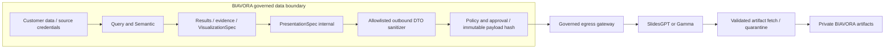

# 44 — AI Presentation & Executive Report Generation

Revision 3.0 · 2026-10-27 · January 10, 2027 release design · **NOT IMPLEMENTED**.
Normative scope: [43](43_BIAVORA_PRODUCT_SCOPE_AND_RELEASE_ROADMAP_2027.md). Ownership decision: [ADR-023](46_ADR_023_PRESENTATION_OWNERSHIP_AND_PROVIDER_ABSTRACTION.md).

## Product intent and ownership

Users can ask “Build me a presentation explaining this year's losses and the reasons behind them”, “Compare this quarter with the previous quarter and explain why profit decreased”, or “Prepare a management deck on sales, top products, weak regions, risks and recommendations”. BIAVORA resolves the business question, computes facts, selects charts, assembles evidence and writes an evidence-bound storyline. A provider composes and renders slides. Sending an untouched user prompt to a deck vendor is not this feature.

Choose a **new Presentation logical domain co-deployed with the existing Report Service**, with its own owned schema/migrations and background worker. No new Presentation microservice. Report currently proxies Voice; it does not yet own the legacy saved-report tables. Preserve those tables and routes under Voice through January. Presentation stores new jobs/specs/evidence manifests/artifacts only and references legacy reports through authorized APIs, never foreign ORM writes. A later separately rehearsed migration may consolidate legacy reports. Do not install the dormant duplicate Report app to obtain persistence accidentally.

AI's Analyst owns analytical planning/findings/storyline/PresentationSpec production. Presentation owns durable lifecycle, validation, policy coordination, adapter selection, exports, artifact retention and audit. Semantic owns business definitions; Query alone authorizes and executes analytical queries; Visualization owns chart contracts. The governed MCP/tool execution boundary holds external secrets and network authority. No provider, MCP server, LLM or Presentation worker receives customer database access.

## Provider-independent flow

```mermaid
sequenceDiagram
  actor User
  participant Edge as Gateway/Auth/Workspace
  participant P as Report: Presentation domain
  participant A as AI: Analyst
  participant S as Semantic
  participant Q as Query
  participant V as Visualization/Trust
  participant G as Policy/Approval/MCP gateway
  participant X as PresentationProvider
  participant O as Private artifact storage
  User->>Edge: Natural-language request or form + request key
  Edge->>P: Authenticated actor/workspace, bounded intent
  P->>P: Reauthorize, reserve usage, create durable job
  P->>A: Plan analysis with logical dataset references
  A->>S: Resolve published metrics/version/grain/time
  A->>Q: Governed analytical plan
  Q-->>A: Bounded result refs + execution metadata
  A->>V: Chart specs and evidence-bound findings
  V-->>A: Validated visual/evidence references
  A-->>P: Versioned PresentationSpec + internal manifest
  P->>G: Sanitized immutable payload, policy context and hash
  opt Policy requires approval
    G-->>User: Exact preview, destination, data class, cost ceiling
    User->>G: Approve or reject bound operation
  end
  G->>X: Selected SlidesGPTProvider or GammaProvider
  X-->>G: Typed job/result or uncertain outcome
  G-->>P: Safe status/export references
  P->>O: Fetch with egress checks; scan/validate and store artifact
  P->>P: Check factuality, commit usage/audit, mark completed
  User->>Edge: Authorized artifact download
  Edge->>P: Reauthorize workspace/object permission
  P-->>User: Short-lived scoped download or streamed artifact
```

Steps 1–13 (identity, intent, semantic resolution, analytical planning, Query, calculated facts, charts, evidence, findings and spec) have no vendor-specific logic. Provider selection and translation occur only after spec validation. Existing HTTP control plane returns a job ID quickly; durable workers and outbox/inbox perform long work. Never keep Gateway waiting for a full deck.

## Versioned domain contracts

Design DTOs using the repository's existing Pydantic contract style (`bi_platform_shared/contracts`), explicit validation and JSON serialization. These are proposed fields, not implemented Python classes. No raw ORM object crosses a boundary. Every stored version is immutable once approved/dispatched. Internal evidence and external payload are different schemas, not a serializer denylist over the same object.

| Contract | Required content | Invariants |
|---|---|---|
| `PresentationRequest.v1` | Server actor/workspace, logical dataset IDs, natural-language request, category, date/comparison ranges, audience, language, theme/output preference, optional provider preference, forecast/what-if flags, max slides, request/correlation/idempotency keys | Membership and entitlement checked server-side; dates/timezone/currency and ambiguous “this year” resolved before analysis; bounded text/slide/data size; client cannot choose physical tables |
| `AnalysisPlan.v1` | Published semantic version, metric/dimension IDs, authorized logical query plans, periods/comparisons, chart intent, forecast/scenario requirements, evidence requirements, step/time/cost limits | Query reauthorizes every execution; no arbitrary tool/code/URL; cross-dataset joins require an approved relationship and supported grain |
| `EvidenceItem.v1` | Stable evidence ID, workspace, metric definition/version, logical source/dataset snapshot or CDC watermark, query/result ref/hash, period/filter/calculation/method, units/currency, freshness/quality/confidence metadata | Important claims resolve to same-workspace immutable evidence; no LLM confidence treated as proof; internal SQL/bindings never copied to vendor |
| `ChartSpecRef.v1` | Reference/hash/version of existing `VisualizationSpec`, authorized result ref, logical labels/units/period, safe asset or bounded chart values | Reuse `bi_platform_shared/contracts/viz.py::VisualizationSpec` and `chart.py::ChartContract`; do not create competing chart semantics |
| `PresentationSlideSpec.v1` | slide_id, title, objective, narrative, bullets, KPI/chart/table/evidence refs, notes, claim classifications | Each material numeric/factual claim has evidence refs; counts/units/rounding reconcile; notes are sanitized too |
| `PresentationSpec.v1` | version, title/subtitle, audience, summary, ordered slides, visual preferences, internal evidence manifest, provider-safe asset refs, provenance/model/prompt versions, hash | No provider-specific IDs or auth; published metric meanings reused; spec freezes before approval |
| `PresentationJob.v1` | UUID, workspace/actor, request key/hash, analysis job ref, spec hash/version, chosen provider/transport version, provider_job_id, state, attempt, deadlines, failure/retry/dispatch status, approval/policy refs, reservation, timestamps, artifact refs | Unique workspace+operation+idempotency key; conflicting request hash rejected; durable lease/version check; provider ID never authorizes user access |
| `PresentationArtifact.v1` | UUID/job/workspace/owner, type, private storage ref, internal provider ref, generation time, MIME/size/checksum, retention/expiry/deletion state, audit/evidence manifest hash, validation state | No permanent public URL; download needs current permission; provider URLs are temporary internal inputs, never ownership proof |

Output language is a validated request field for future extensibility. January default is English, with existing behavior maintained; it does not reintroduce Arabic & Voice Support expansion. Unsupported language/category/output combinations return a useful validation error or clarification, never a falsely supported mode.

## Categories and analytical acceptance

| Category | Required analytical focus | January depth |
|---|---|---|
| EXECUTIVE | KPIs, material changes, contributions, risks, recommendations | Required loss/performance summary |
| DESCRIPTIVE | Totals, trends, distributions, top/bottom | Bounded approved metrics |
| COMPARATIVE | Period/segment/actual-target deltas with comparable definitions | Required period/segment comparison |
| DIAGNOSTIC | Decomposition, contributors, anomalies, associations | Required contribution analysis; no causal inference promise |
| PREDICTIVE | Forecast method, horizon, interval/calibration and assumptions | Bounded evaluated forecast; unsupported data produces explicit limited/unavailable status |
| WHAT_IF | Baseline, explicit parameter changes, model, outcome/delta | Required deterministic arithmetic scenario; no inferred demand elasticity |
| CUSTOM | User-defined objectives composed from allowed analyses | P2 depth; no arbitrary SQL/tools/renderer |

Observed fact, correlation, contribution, likely driver, anomaly and causal conclusion are separate claim types. “Largest contributor”, “associated with”, or “requires further investigation” is correct when causality is unproved. Proven cause requires an approved causal method/evidence absent from January's minimum. Label all values `OBSERVED`, `FORECAST` or `SCENARIO`; do not mix scenario numbers into historical totals.

For a cost reduction scenario: fixed-volume revenue and costs use the same semantic version and baseline result hash; apply the explicit procurement change only to eligible costs, calculate the delta deterministically and label the fixed-volume assumption. Forecasts retain method/version, horizon, fallback, and uncertainty; never fabricate bands if the selected method cannot supply them.

## Dynamic loss deck example and deterministic fixture

Example outline, chosen dynamically from available evidence (not a hardcoded ten-slide product):

1. Title, scope and date period.
2. Executive summary: total loss, comparison and material impact.
3. Financial KPIs: revenue, costs, margin, profit/loss and variance.
4. Monthly/weekly loss trend with a line chart.
5. Segment contributions with a supported bar chart, or waterfall only after chart-contract certification.
6. Main contributors/likely drivers with evidence IDs and qualified language.
7. Anomalies/exceptions with method and coverage limits.
8. Forecast or What-if only if requested and supported, clearly separated from actuals.
9. Recommendations tied to evidence, marked as recommendations rather than observed facts.
10. Methodology, metric definitions, period/freshness, limitations and confidence.

Planned synthetic fixture (not customer results): prior revenue 1,000 and cost 900 gives profit +100; current revenue 900 and cost 1,100 gives profit -200, loss 200 and profit change -300. Contributions: revenue decline -100; procurement increase -150; other-cost increase -50. Current procurement 600 reduced by 8% under fixed revenue/other-cost assumptions yields scenario cost 1,052, loss 152, improvement 48. Fixed decimal units, same currency and same period coverage are mandatory. Tests must verify those exact numbers and the additive bridge, chart data, metric definitions/evidence refs, scenario labels, and absence of an invented cause. Trends require fixture observations for each time bucket; never synthesize missing months.

## Visualization and evidence boundary

`VisualizationSpec` currently includes Metabase configuration, result shape and field assignments. Presentation references the versioned internal spec and derives a deliberately narrow outbound chart projection: safe labels, approved aggregate series, units, period and caption, or a pre-rendered safe chart asset. Do not serialize Metabase IDs, embed tokens, query definitions, SQL, internal URLs or complete recommendation metadata to vendors. Extend the existing chart contract for a new chart type only with contract tests; bar/table/line/KPI remain the safe initial subset. A chart renderer for existing governed charts is reusable infrastructure; building a slide/PPTX layout/theme/typography/serialization engine is prohibited.

Store the complete internal evidence manifest separately from export-visible summaries. It must answer “Where did this number come from?” and “Why did the system say this?” after provider completion. Export citations use friendly metric/source/period/method summaries. Evidence reads reauthorize; missing/deleted underlying evidence causes a visible limitation or retention tombstone, not a dangling claim of reproducibility.

Limited reliability attaches `HIGH_CONFIDENCE`, `LIMITED_DATA`, `STALE_DATA`, `POSSIBLE_QUALITY_ISSUE` with deterministic reasons. Missing required metric/permission, incompatible currency/grain, failed query or unusable baseline blocks generation. Freshness beyond a workspace-approved threshold, null spikes, partial history and noncritical schema warnings require a displayed warning; high-sensitivity policy can require approval or deny. Thresholds are versioned per dataset/metric and frozen before acceptance; no universal invented freshness SLA and no block on every harmless warning.

## Provider abstraction and transport

```text
PresentationProvider
├── SlidesGPTProvider → governed MCP client/gateway → SlidesGPT remote MCP
└── GammaProvider     → governed MCP client/gateway → Gamma MCP
                     └→ governed official REST adapter when preferable
```

The named adapters map vendor contracts; MCP/REST clients own protocol/auth/retry plumbing. The selected execution adapter runs inside the governed egress boundary. Domain logic depends only on versioned DTOs. A transport change does not rewrite analysis, metrics or evidence. Both adapters must pass the same conformance suite; unsupported capabilities remain explicit.

Conceptual interface (not implemented; use repository conventions at implementation):

```python
class PresentationProvider:
    def capabilities(self): ...
    def validate_configuration(self): ...
    def generate(self, safe_spec, idempotency_key): ...
    def get_status(self, provider_job_id): ...
    def export(self, provider_job_id, format): ...
```

Typed outcomes distinguish accepted/completed, rejected, retryable failure, unsupported capability and **unknown remote outcome**. Capabilities describe PPTX/PDF, themes, images, async generation, max slides, editing, native sharing, cancel/delete, idempotency and result reconciliation; unknown ≠ supported. Synchronous vendors may return completed status through the same contract. If no separate export API exists, export may retrieve the artifact from generation; unsupported extra formats fail cleanly. No hidden second generation to manufacture another export format.

Selection is deterministic from workspace entitlement, approved provider/configuration, required format/capabilities, data classification/region/retention, cost ceiling, availability and circuit state. Normal users need no provider choice. A permitted preference cannot bypass policy. No random fallback or generation in both vendors. Fallback changes destination and needs a new policy decision and, where required, approval bound to the new payload/provider. Never retry/fallback while an earlier dispatch may have succeeded without reconciliation.

## Official-provider verification record

Documentation inspected 2026-10-27; **no provider connected, account authenticated, paid call made or contract certified**. These links are research inputs, not pinned production configurations.

- SlidesGPT advertises remote MCP at `https://mcp.slidesgpt.com/mcp`, including generation/theme/image tools and a keyless flow. Its page does not establish BIAVORA tenant confidentiality, retention/deletion, commercial licensing, billing visibility or durable idempotency. Verify these before enabling customer data. [Official SlidesGPT MCP page](https://slidesgpt.com/products/mcp).
- Gamma's current MCP index points to its setup and tool reference; custom-client access/authentication, available tools and export behavior must be checked against those specific pages and a sandbox account. [Official Gamma MCP index](https://developers.gamma.app/mcp), [setup](https://developers.gamma.app/mcp/gamma-mcp-server), [tool reference](https://developers.gamma.app/mcp/mcp-tools-reference). Expected endpoint for verification: `https://mcp.gamma.app/mcp`; do not assume a public endpoint grants a custom application access.
- Gamma's REST documentation describes asynchronous generation/status and temporary export URLs; export/asset behavior is capability-specific. Recheck the current contract and never assume one generation yields every desired format. [Official API scope](https://developers.gamma.app/reference/common-feature-requests), [generation parameters](https://developers.gamma.app/guides).

Capture endpoint/origin/tool-schema version, auth and tenancy model, format/slide/size limits, cost units, callback/poll behavior, timeouts, idempotency/status lookup, asset access, retention/deletion, sharing defaults and factual-preservation behavior in a reviewed adapter evidence record. Search snippets can lag official pages; live conformance, not marketing wording, controls enablement. If confidentiality or reliable export cannot be established, that adapter is blocked. Both adapters remain planned; no self-built slide engine is the fallback.

## Formal Data Egress Boundary



Default allowed: approved aggregates/calculated values, safe labels, bounded chart-ready series or safe chart images, sanitized narrative, evidence summaries and slide structure. Classification is inherited from sources/metrics; aggregation alone does not guarantee anonymization. Small cohorts, identifying labels and sensitive categories can still require redaction, suppression, approval or denial.

Always forbidden: database passwords, credentials, `credential_ref`, encryption keys, auth/service tokens, private connection strings, internal service URLs, physical ClickHouse names, infrastructure identifiers and arbitrary raw dumps. Neither user request nor approval can override these prohibitions. Strip hidden metadata from images/files. Use managed provider credentials only inside the execution boundary; never frontend, Git, Kafka, PresentationSpec or logs. A provider that is keyless still requires strict governance and confidentiality review.

If a provider fetches chart assets, grant only exact sanitized asset access with short TTL, narrow audience and byte limits; never open a tenant bucket or provide an internal URL. If the vendor demands publicly retrievable/rehosted assets and tenant policy forbids it, deny that mode. Do not use provider upload tools for raw customer databases/documents. Accept only validated download URLs with trusted origin, HTTPS, DNS/IP/redirect checks, size/time limits; do not let provider output create SSRF.

## Policy and human approval

| Operation | Policy and approval |
|---|---|
| Internal analytical tool | Trusted actor/workspace + Query/semantic authorization and budgets; no extra click for every SELECT |
| External data egress | Classification/minimization/vendor policy first; denied classes cannot be approved away |
| User-requested deck creation | Explicit create intent may count as operation consent only for policy-preapproved sanitized payload/destination/cost; record that decision |
| Sensitive or policy-controlled permitted egress | Exact human preview/approval bound to workspace, actor/approver, provider/tool version, sanitized payload hash, output, cost ceiling and expiry |
| Destructive/financial/unrelated external action | Outside January minimum; never implicit permission from deck creation |

January's CAP-09 acceptance must exercise an actual approval-required presentation operation, including approve/reject/expire/replay/changed-payload negatives; merely auto-allowing every deck does not satisfy it. Approvals are single-use and revocable; recheck permission, policy and reservation at dispatch. Changed scope/spec/provider/format/cost invalidates prior approval. Audit every invocation: actor/workspace, approved operation/tool/provider/version, classification/hash, request ID, timestamp, outcome and safe external correlation. Never log raw sensitive payloads.

## Job state, retries and cost integrity

```text
REQUESTED → PLANNING → ANALYZING → SPEC_READY → POLICY_CHECK
POLICY_CHECK → AWAITING_APPROVAL → GENERATING → EXPORTING → COMPLETED
POLICY_CHECK → GENERATING  (only explicit policy-approved consent)
```

Terminal outcomes: `VALIDATION_FAILED`, `ANALYSIS_FAILED`, `POLICY_DENIED`, `PROVIDER_FAILED`, `EXPORT_FAILED`, `CANCELLED`, `EXPIRED`. `AWAITING_APPROVAL` has an expiry; rejection maps to POLICY_DENIED. Add nonterminal `RECONCILING` when a timed-out dispatch may have created a deck. `COMPLETED` requires a validated stored artifact, factuality acceptance and finalized audit/usage; provider success alone is insufficient.

Map these domain stages onto shared jobs: REQUESTED→QUEUED, planning through export→RUNNING, bounded backoff/reconciliation→RETRYING, completed→SUCCEEDED, explicit failures/expired→FAILED with category, cancelled→CANCELLED. Approval wait is a persisted domain stage without a held worker or DB transaction. Shared jobs retain stage history and never flatten failure reasons.

Persist a dispatch intent and unique attempt before network I/O. Transactional outbox/inbox, database uniqueness, worker lease/CAS, spec hash and stable workspace-operation key prevent duplicate local dispatch. Same key/same payload returns existing job; same key/different payload returns conflict. Native vendor idempotency is used only if verified. Local idempotency cannot prove remote exactly-once behavior: timeout-after-send without vendor lookup stays RECONCILING and needs operator resolution, not automatic regeneration. Export retries reuse the same generation. Bound attempts/backoff/absolute deadline, 429 policy and per-tenant/provider concurrency. No retries on auth, validation, policy denial or exhausted budget.

Cancellation stops undispatched work immediately; after dispatch, attempt vendor cancellation only if supported, record unavoidable cost and prevent automatic redispatch. A late artifact is quarantined/reconciled and does not revive a cancelled job. Worker restart resumes from durable state; revoke/tenant deletion prevents new execution/download. Reservations use reserve→commit actual→release unused plus append-only adjustments; remote costs incurred on failure are recorded honestly. Unknown cost is flagged for reconciliation, never treated as zero or silently charged twice.

## Artifact lifecycle and product UX

Private object storage holds validated PPTX/PDF/provider-supported artifacts with workspace/job keys, checksum, size/type, provider/version and internal evidence manifest ref. Verify magic/MIME, reject executable/macro/unsafe active content, scan and isolate rendering. No raw vendor HTML/widget is embedded in the application; any future embed needs sandbox, CSP, origin and tenant authorization certification. Rendered artifacts must be checked for numeric/label/evidence drift before release; if automatic extraction cannot verify a required claim, hold for human review or fail closed. Never let provider rewriting silently change a calculation.

Use policy-defined retention/expiry/deletion for specs, assets, artifacts, evidence, audit and vendor copies. Record delete request, vendor acknowledgement or unsupported/unknown deletion, retry and retention obligations. Cannot promise deletion the vendor cannot prove; provider eligibility must satisfy the tenant's policy. Backups have a separately documented retention limit. Expired download URLs may be reissued only after reauthorization. No public-by-default provider share links; January sharing is authorized BIAVORA workspace access. Artifact names/URLs never reveal internal keys.

UX supports natural language and a form: dataset, category, date/comparison, audience, language, forecast/what-if, theme/max slides and optional allowed provider preference. Resolve missing business context before charging. Show Analyzing → Preparing deck → Awaiting approval when needed → Generating presentation → Ready, or a safe retryable/nonretryable failure and request ID. Include cancel, retained job history, usage/cost status and evidence/limitations. Do not expose internal SQL bindings, stack traces, MCP schemas or vendor credential details.

## Threat model and planned controls

| Threat | Control and release test |
|---|---|
| Prompt injection in database text, labels or descriptions | Treat content as data; deterministic schemas/allowlisted tools; inject hostile labels and assert no policy/tool override |
| Sensitive data exfiltration in provider prompts | Positive outbound schema, classification/DLP/minimization, cohort suppression; forbidden-field and semantic-sensitive-value tests |
| Provider credential leakage | Managed secret injection, scoped workload access, redacted errors/logs, no credential in DTO/event; secret-marker tests |
| Cross-tenant presentation access / artifact IDOR | Reauthorize every job/spec/evidence/download/retry; tenant-keyed caches/object keys; two-workspace guessed-ID suite |
| Unsigned/public artifact URLs | Private storage and short-lived scoped download; expiry/revocation/redirect and public-bucket negative tests |
| Callback spoofing/replay | Prefer authenticated bounded polling; if callbacks supported, signature/timestamp/nonce + job binding + dedupe; forged/late/duplicate tests |
| Duplicate generation/cost amplification | Unique request/dispatch, native idempotency when proven, RECONCILING unknowns; concurrent/timeout-after-commit tests |
| Malicious chart content and stored XSS | Escape text, safe asset validation, no vendor HTML; hostile Unicode/HTML/URL/metadata fixtures |
| Oversized requests / cost denial of service | Slide/context/query/asset/bytes/deadline/concurrency limits and reservation ceiling; overflow and abuse tests |
| Provider outage, timeout, 429 or 5xx | Bulkhead, circuit breaker, bounded retry, typed uncertain state; outage/recovery tests |
| MCP tool/server spoofing or capability expansion | Register exact HTTPS origin/tool/schema/version; allowlist operations, reviewed capability changes; discovery-change denial tests |
| Malicious provider result/download SSRF | Treat as untrusted; schema validation and pinned/revalidated fetch/redirect policy; metadata/private-IP/oversize responses denied |
| Provider alters facts/creates invented causes | Deterministic spec checks plus exported artifact fact/evidence comparison; altered values/causal wording rejected |
| Permission/policy changes while waiting | Reauthorize at dispatch and download, bind approval to immutable content/policy; revocation race tests |

## Test, rollout and observability gates

| Layer | Planned gate |
|---|---|
| Unit | Request/spec validation, category/period handling, state transitions, positive sanitizer, mapper and idempotency/conflicting keys |
| Contract | Both provider adapters and MCP/REST mapping, auth/error/capability/status/export fixtures; same internal conformance suite; no assumed native methods |
| Security | Every threat above, cross-tenant job/artifact/evidence, egress/approval replay, malicious provider results, secrets absent from all sinks |
| Analytical | Deterministic loss fixture and scenarios, exact totals/comparisons/contributors/charts, evidence coverage, no invented cause; no missing-period fabrication |
| Failure | Timeout before/after remote commit, 429/5xx, malformed response, missing export, retry/cancel/restart, insufficient entitlement, meter outage and duplicate delivery |
| E2E | Request→Query/semantic analysis→spec→policy/approval→certified provider→artifact validation/download→audit/usage; both workspaces; actual staged vendor path |
| Recovery | Job/outbox/ledger/artifact/evidence restore together; restart at each boundary; policy/adapter rollback without replaying paid dispatch |

Rollout: deterministic mocks first; synthetic vendor conformance; staging with sanitized fixtures; internal approved cohort; tenant-allowlisted canary; wider launch only after factuality/security/cost/operations gates. Both adapters implemented/conformance-tested; each live provider disabled until independently accepted. Kill switches stop new dispatch by tenant/provider/tool, while preserving authorized artifacts and reconciliation. Rollback uses compatible DTO readers, expand/contract migrations and drains outboxes; never discards in-flight provider IDs or usage.

Metrics: end-to-end, analysis, provider and export latency; success/failure categories, retries/reconciliation age, circuit state, deck/slide/asset size, analytical query count, AI input/output/cached tokens, provider credit/cost and generation/export counts, rejected egress and approval expiry, artifact validation failures. Trace Gateway→Analyst→Query→Visualization→Presentation→MCP/provider→artifact using request/job/correlation IDs. Emit low-cardinality operational metrics; tenant-level usage belongs in authorized ledger views. No prompts, credentials, raw rows or permanent signed URLs in logs/traces.

Launch requires deterministic factuality and a real export/download path, not a screenshot of vendor success. Query remains the sole analytical execution authority throughout.
