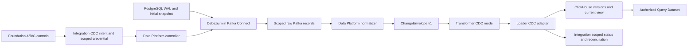

# BIAVORA Foundation-D / D0 — PostgreSQL CDC architecture and repository audit

Audit date: 2026-11-02 (Asia/Damascus). Evidence baseline: branch `foundation-c-staging`, HEAD `ca4547eb683bab21dbcbb8dab6cb1d18453632fa`. This document audits the **existing, unstaged working tree**. `OBSERVED` means source/configuration inspected here; `HISTORICAL EVIDENCE` means a dated report describes an earlier execution; `OWNER-REPORTED` is not independently verified here; `PROPOSED` is future work; `DEFERRED` is deployment proof reserved for Production Readiness. File paths below are relative to the repository root.

## Executive Summary

The D0 architecture gate is ready for D1 review. The repository is already beyond a blank D0 baseline: an untracked Foundation-D implementation report, CDC contract, workers, Compose fixture, tests and migration, plus modified Query/Integration files, predate this audit. They are preserved untouched. D1–D5 below therefore describe review and completion of the present implementation, not instructions to recreate it. `Foundation-D Local Engineering` is **PARTIAL** and G-D is open: the documented 120-second Kafka recovery gate and 300-second concurrent snapshot budget failed; full acceptance on the final Debezium pin and new-change remote CI are not proved [50 implementation report](50_FOUNDATION_D_POSTGRESQL_CDC_IMPLEMENTATION_REPORT.md). No CDC runtime was implemented in D0.

Integration in the Query deployment owns source and CDC intent; Data Platform owns capture, normalization, transformation and materialization; Query owns dataset publication and analytical execution. This matches [22](22_TARGET_ARCHITECTURE.md), [30](30_CANONICAL_ARCHITECTURE_RULES.md), [31](31_CANONICAL_SERVICE_OWNERSHIP_MAP.md) and the inspected code. The working tree's CDC path is real code, but its local fixture and historical test report do not certify production transport, identities, durability or recovery time.

## D0 Scope and Non-Goals

Read-only architecture/code/configuration audit and this one new plan. No CDC code, migration, Kafka topic, WAL setting, ClickHouse DDL, Compose service, test fixture or CI edit was made here. No staging, reset, clean, commit or push. The dirty TimesFM submodule was not entered or changed. This audit does not independently execute the historical E2E matrix or assert Foundation-D GREEN.

## Authoritative Documents Read

Reading precedence: Tier 1 [34](34_BIAVORA_MASTER_CONTEXT_FOR_FUTURE_PROMPTS.md), [43](43_BIAVORA_PRODUCT_SCOPE_AND_RELEASE_ROADMAP_2027.md), [45](45_BIAVORA_RELEASE_TRACEABILITY_MATRIX.md); Tier 2 [22](22_TARGET_ARCHITECTURE.md), [29](29_CANONICAL_PRODUCT_SCOPE.md), [30](30_CANONICAL_ARCHITECTURE_RULES.md), [31](31_CANONICAL_SERVICE_OWNERSHIP_MAP.md), [32](32_CANONICAL_AI_ARCHITECTURE.md), [33](33_PRODUCTION_SECURITY_BASELINE.md), [24 ADR register](24_ARCHITECTURE_DECISION_RECORDS_NEEDED.md) ADR-001/002/004–010; Tier 3 [20](20_TECHNICAL_DEBT_AND_PROBLEM_REGISTER.md), [23](23_FEATURE_READINESS_MATRIX.md), [24](24_ARCHITECTURE_DECISION_RECORDS_NEEDED.md), [25](25_14_WEEK_IMPLEMENTATION_ROADMAP.md), [26](26_MASTER_REFACTOR_BUILD_DELETE_PLAN.md); Tier 4 [36](36_FOUNDATION_A_QUERY_SECURITY_IMPLEMENTATION.md), [37](37_FOUNDATION_B_EXTERNAL_BOUNDARY_IMPLEMENTATION.md), [38](38_FOUNDATION_C_SERVICE_OWNERSHIP_INTEGRATION_IMPLEMENTATION.md), [39](39_FOUNDATION_C_CREDENTIAL_TRANSPORT_IMPLEMENTATION.md), [40](40_FOUNDATION_C_FINAL_ACCEPTANCE_REPORT.md), [41](41_FOUNDATION_C_FINAL_CLOSURE_REPORT.md), [42](42_FOUNDATION_C_HARD_GATE_CLOSURE_REPORT.md), [49](49_FOUNDATION_C_LOCAL_CLOSURE_AND_CI_REPAIR_REPORT.md), and the pre-existing untracked [50 implementation report](50_FOUNDATION_D_POSTGRESQL_CDC_IMPLEMENTATION_REPORT.md). Report 49's `PENDING_PUSH_AND_RUN` records its **then-current** remote result; later canonical summaries contain owner attestation, not a run ID. No accepted standalone CDC ADR beyond the canonical planning register was found; report 50 labels its packaging choice `ADR-D-01`, which is implementation-report evidence rather than a separately ratified ADR.

## Repository State

`git status --short --branch`, `git rev-parse HEAD`, and `git submodule status` were inspected before analysis. Branch `foundation-c-staging` tracks `origin/foundation-c-staging`; HEAD is `ca4547eb683bab21dbcbb8dab6cb1d18453632fa`. At entry there were 24 modified tracked parent paths, 22 untracked first-party paths as counted by the pre-existing implementation report, and the dirty `services/ai-service/forecasting/timesfm` submodule indication. The visible status includes modified canonical 20/22/23/25/26/29/30/31/33/34/43/45, release CI/scripts, Query code/tests, and untracked CDC code/Compose/report/runbook/tests/scripts. This audit did not attribute those changes to HEAD. `git ls-files` confirms `integration/models.py` is tracked while `integration/cdc.py`, `bi_platform_shared/cdc_contract.py`, `docker-compose.cdc-local.yml` and the CDC implementation report are not. Only this D0 report is new from the present run.

## Foundation-D Entry Gate Assessment

| Gate | Status and evidence |
|---|---|
| Foundation-A | `HISTORICAL EVIDENCE`: scoped CLOSED/GREEN in 36; Query binding, fail-closed authority and resource/cancel controls have code anchors below. No rerun in D0. |
| Foundation-B | `HISTORICAL EVIDENCE`: scoped CLOSED/GREEN in 37; payment containment, secret and upload controls. No rerun in D0. |
| Foundation-C local | `HISTORICAL EVIDENCE` plus canonical decision: CLOSED in 49; 42 has earlier C6 local execution. External deployment evidence remains deferred. |
| Baseline release CI | `OWNER-REPORTED` GREEN in 34/43/45 and the task brief. 49 still says `PENDING_PUSH_AND_RUN` for its dated repair. No independent current GitHub run ID, URL or SHA verification in this environment. The unstaged D work has no claimed remote CI result. |
| Foundation-D runtime | `OBSERVED` source/configuration exists in the dirty tree; `HISTORICAL EVIDENCE` 50 reports local E2E passes and two bounded failures. Local D closure is PARTIAL; production NO-GO. |

These distinctions satisfy the local D entry policy without converting an owner-reported CI state into independent proof. No A/B/C regression was executed by this D0 audit; D6 must rerun it.

## Current Ownership and Architecture

Workspace authorizes membership/roles; `integration` in `services/query-service` owns `DataSource`, configuration, table selection, credentials, replacement and CDC desired state; Query owns the `database.Database` analytical Dataset and physical binding; Data Platform is `etl-final/connector-service`, `extractor-service`, `transformer-service`, `loader-service`, `metadata-service` plus `etl-final/shared` utilities. HTTP carries source/CDC commands and callbacks; Kafka carries snapshot and CDC records. Query alone executes product analytics through `query_api/application/query_execution.py`, `services/workspace_db_resolver.py`, `sql_guard.py` and `clickhouse_executor.py`. `31` and `30` prohibit another source owner or arbitrary AI/Voice/Report/Visualization/MCP warehouse access. The existing CDC package is a Data Platform logical module, not an additional product microservice.

## Existing DataSource and Dataset Architecture

`services/query-service/integration/models.py` defines `DataSource` (UUID, workspace/creator, engine, nonsecret `connection_metadata`, `selected_tables`, transport, configuration version, active/disabled/retired), `SourceCredential` (candidate/active/superseded/revoked, ciphertext/key/version), `SourceExecution`, `SourceCandidate`, `SourceOperationBudget`, and dirty-tree `CdcPipeline`/`CdcAudit`. `integration/service.py` owns selection/update/retire; `integration/views.py` and `database/urls.py` expose source CRUD, credential actions and replacement; `integration/metadata.py` allowlists metadata/public fields; `integration/scope.py` derives manager/workspace from authenticated principal. `database/views.py:DatabaseSnapshotStartView` creates Query datasets and `integration_source_id` v2 snapshot scope, preserving old datasets; `integration/views.py:SourceReplacementActionView` handles staged cutover/rollback. `etl-final/shared/connectors/core.py:BaseDatabaseConnector.capabilities` advertises snapshot engines with `cdc: False`, including `PostgresConnector`; the separate CDC API is explicitly gated.

`services/query-service/database/models.py:Database` is the Query-owned Dataset (legacy table name `manager_databases`), with nullable `source` FK, workspace, `ingestion_job_id`, `source_kind`, source tables, ETL status, ClickHouse database/table and schema. `database/views.py` implements list/detail, schema and preview, imported-table selection and status callback; `database/serializers.py` excludes physical destination from public `source_tables`. `database/cdc.py` creates a distinct `source_kind="cdc"` Dataset and publishes only the server-derived current view after loader evidence. `integration.CdcPipeline.dataset_id` is a logical ID with no cross-owner FK. This is preferable to overloading snapshot `etl_status` with continuous states, but publication across Integration and Query persistence is not one atomic transaction and needs failure/retry proof.

## Credential and Transport Architecture

Snapshot path: `DataSource` → `integration/credentials.py:authorize_execution` → opaque `{source_id, workspace_id, dataset_id, job_id, credential_id, credential_version}` (`execution_reference`) → Kafka v2/Connector or Extractor → `etl-final/shared/security/credential_client.py:resolve_source_execution` → `integration/internal_views.py:ResolveSourceCredentialView` → ciphertext/key version only to authenticated service → decrypt locally → `shared/security/transport.py:DirectSecureInternetTransport.before_connect` → engine driver. `SourceExecution` binds one operation/config/version and expiry. Rotation validates a candidate, atomically activates it and leaves bounded superseded overlap; revocation blanks ciphertext; pruning removes expired decryptable superseded values. `bi_platform_shared/credential_crypto.py` and `secret_delivery.py` supply versioned crypto/secret reads. `etl-final/shared/security/destination_policy.py` plus `transport.py` enforce destination policy, preconnect DNS revalidation/pinning and production verified TLS for certified Python PostgreSQL/ClickHouse adapters. Existing resolver authentication has separate Connector/Extractor keys and previous-key overlap.

`OBSERVED` CDC does **not** reuse that short-lived snapshot execution grant: `integration/cdc.py:InternalCdcView` returns active credential ciphertext only to a `controller` stage key; `etl-final/shared/cdc/worker.py:control_pipeline` decrypts it, `connect.py:write_password` writes a protected per-scope file, and Kafka Connect gets a FileConfigProvider reference. No password/ciphertext is in the inspected `ChangeEnvelope`. This is a new scoped controller mechanism inside the same Integration authority; it needs explicit production identity/expiry/rotation hardening. `cdc/postgres.py` uses the Python transport for preflight but `cdc/connect.py` refuses production because Java/JDBC reconnect DNS pinning, TLS/egress and managed delivery are **not** certified. Replication requires non-superuser REPLICATION, table SELECT and an administrator-created exact publication; snapshot SELECT credentials must not be assumed sufficient.

## Existing Kafka/Event Architecture

`etl-final/shared/config/kafka_topics.py` lists primary `raw_data`, `transformed_data`, `load_requests`, `metadata_updates`, `errors`, `quarantine` and legacy aliases including `connection_topic`, `extracted_rows_topic`, `clean_rows_topic`, `load_rows_topic`, `metadata_topic` and DLQs. `shared/utils/kafka_producer.py` uses JSON, schema validation, redaction, acks=all, retries and idempotent producer; `kafka_consumer.py` supports manual commit/rewind but its validation path can skip bad records, explaining BIA-016. `shared/security/legacy_kafka.py` bounds v1 source replay; historical C evidence describes v2 opaque credential refs and default-off production v1 reader. `etl-final/shared/utils/kafka_validation.py` and `kafka_schema_validator.py` are snapshot contracts, not a generic Debezium envelope. Metadata writes use `metadata_topic`/SurrealDB and are not a CDC status authority.

The dirty-tree `bi_platform_shared/cdc_contract.py:Scope.topic` derives per-pipeline `biavora.cdc.v1.<scope-hash>.{raw,normalized,transformed,dlq}`; `raw_topic` adds schema/table. `etl-final/shared/cdc/worker.py:PipelineConsumer` uses dedicated normalize/transform/load groups, explicit offset commits, one-key producer sends, checkpoint callback and scoped DLQ. Local Compose uses one business partition and separate Connect config/offset/status topics. These abstractions should be reviewed for ACL, partition/retention, bounded replay, stage coordination and poison guarantees before deployment. Never put reusable passwords, ciphertext or key material in a new Kafka event.

## Existing Connector / Extractor / Transformer / Loader Architecture

| Component | `OBSERVED` snapshot path | CDC boundary and conclusion |
|---|---|---|
| Connector | `etl-final/shared/connectors/core.py` registry, `PostgresConnector`/six other snapshot adapters, validation/discovery/inspection; `etl-final/connector-service/connector/etl_engine/views.py` internal test/discovery/snapshot dispatch and upload guards. | CDC preflight/config REST belongs to Connector-owned Data Platform module. Present `etl-final/shared/cdc/{postgres,connect,worker}.py` uses that logical boundary, while Integration controls intent. No user-supplied Connect config. |
| Extractor | `etl-final/extractor-service/extractor/engine/{kafka_listener,database_extraction_strategy,extraction_checkpoint,extraction_progress}.py` consumes finite requests, paginates, uses dataset-scoped `source_id` plus `integration_source_id`, emits rows/schema and retries. | Raw Debezium `before/after`, tombstones, LSN and transaction order are unlike paginated snapshots. Do not route raw CDC through finite extraction/cleaning. Current dedicated normalizer is consistent. |
| Transformer | `etl-final/transformer-service/transformer/engine/{kafka_listener,transformer_service,cleaning_rules}.py` cleans finite row batches, optional schema contracts, quality/dedup metadata. | Reuse safe type/schema utilities, not destructive row-cleaning defaults. `etl-final/shared/cdc/schema.py:transform` converts catalog-defined images and rejects mismatch; CDC package's `transform` mode is logically Transformer-owned. |
| Loader | `etl-final/loader-service/loader/engine/{kafka_listener,loader_logic,clickhouse_client}.py` batches finite inserts, staging and dedup; retries and DLQ. | Existing finite-row load cannot represent delete/LSN. `etl-final/shared/cdc/clickhouse.py:CurrentStateStore` is a Loader-owned adapter. Keep Query read identity distinct from loader write/DDL/bootstrap identity. |

The package names/Compose roles are existing dirty-tree work, not created by D0. The packaging choice is supported by the different row semantics above, not by convenience.

## Existing ClickHouse Storage Model

Legacy snapshot loader `loader/engine/kafka_listener.py:_ensure_table_schema` creates `MergeTree()` ordered by batch/time or `ReplacingMergeTree(_loaded_at)` ordered by `_transformed_dedup_key`; `shared/models/bronze_schema.py` uses immutable `MergeTree()`; `loader_logic.py` supports batch/staging inserts. None alone is a correct mutable per-source-PK current state, and background replacement cannot guarantee immediate Query-visible deduplication. The dirty-tree CDC `CurrentStateStore.prepare` creates `ReplacingMergeTree(_cdc_version)` ordered by catalog PK, with `UInt128` version, delete marker and event ID. It creates a business-column-only view using `FROM versions FINAL WHERE _cdc_deleted=0`; the delete filter is after version selection. `apply` uses JSONEachRow and exact decimal strings. This design is plausible and historically tested locally (50), but `FINAL` cost, tie behavior, retention, privileges and production scale remain open. Source replacement/reseed must create a generation and atomically rebind Query; existing snapshots are retained, not mutated.

## Existing Job / Metadata / Status Model

Query `database.Database.ingestion_job_id` and `etl_status` track finite ingestion; `database/views.py:IngestionDatasetStatusView` accepts scoped internal callback and rejects invalid transitions. Extractor has `extraction_checkpoint.py`/`extraction_progress.py`. `etl-final/metadata-service/metadata/api/kafka_listener.py` persists unified events to SurrealDB but its legacy `process_load_status` projection stores `source/table/status/time/error/count` and omits workspace/dataset/job; BIA-017 remains open. `shared/utils/metadata_schema.py` requires scope fields for canonical metadata. The dirty-tree `integration.CdcPipeline` persists CDC desired/observed state, offsets/LSNs, health and reconciliation; it is an Integration CDC runtime aggregate, not a second general AI job system. Its per-event HTTP checkpoint and ClickHouse write path is durable but high overhead. `services/voice-service/voice_reports/models.py:VoicePipelineJob` and `application/job_service.py` are an unwired/broken general-job skeleton per BIA-009; `services/ai-service/intent_extraction/routing.py` still emits `pending_integration` (BIA-020). Do not couple CDC correctness to that skeleton or claim it solves durable AI jobs. CDC status must stay source/workspace/dataset scoped and distinguish capture, processing, application and publication.

## Query Analytical Verification Path

`integration.CdcPipeline` selects `dataset_id` → `database/cdc.py:publish_live_dataset` binds `Database.clickhouse_table_name` to the current **view** and `etl_status=completed` → `query_api/views.py:QueryExecuteInternalView` derives authenticated workspace → `query_api/application/query_execution.py:resolve_authorized_query_binding` rejects client physical overrides → `query_api/services/workspace_db_resolver.py:resolve_workspace_dataset_binding` requires the exact completed Dataset and nonempty server-side allowed tables → `query_api/services/sql_guard.py` enforces SQL allowlist → `query_api/resource_policy.py` limits execution → `query_api/services/clickhouse_executor.py` reads ClickHouse and sanitizes results. `database/views.py:DatabaseSchemaView`/`DatabasePreviewView` are scoped Query-visible schema/preview routes. D6 must compare source truth with **this authorized Query result**, including foreign workspace and physical-table denial, not merely a direct warehouse SELECT. The present current view hides CDC technical columns from normal Query metadata.

## Current CDC Capability Gap

**Reusable as-is:** Integration source/workspace ownership, selected tables, versioned encrypted credentials and revocation; snapshot registry/transport guard for Python adapters; Query logical binding/SQL/resource policy; Kafka infrastructure and control-plane conventions; separate Dataset and historical snapshot materializations (`integration/models.py`, `credentials.py`, `scope.py`, `database/models.py`, `query_api/application/query_execution.py`).

**Reusable with modification/review:** dirty-tree `CdcPipeline` lifecycle and controller identity, `ChangeEnvelope.v1`/offset handling, CDC ClickHouse adapter, scoped DLQ, local fixture, release workflow; snapshot metadata projection and finite-row utilities. These are implemented but not certified complete. Existing generic snapshot Kafka consumer and metadata worker require BIA-016/017 repair independently.

**Missing for G-D:** bounded broker recovery on final pin, full final-pin acceptance, empty-table snapshot-completion signal, controlled reseed/generation cutover, measured bulk catch-up, schema-history/replay policy, controller coordination/admission, slot/retention loss drill and complete live type matrix. Report 50 explicitly records these gaps.

**Blocking local D1:** no architectural ambiguity that prevents reviewing D1; protect the current dirty tree, agree that D1 means review/remediation of existing code, and keep production enablement off. Before any *new* CDC coding, capture a reviewable baseline and decide/review ADR-007/008/009 details (topic ownership/retention, state transitions and storage tie policy). This D0 plan supplies those decisions but does not certify them.

**Blocking final G-D closure:** failed 120-second recovery gate, exceeded 300-second race budget without measured completion time, unrun full final-pin matrix and new-change remote CI; empty-table readiness and reseed path if included in the launch contract. No phase is complete merely because files exist.

**Deferred to Production Readiness:** external managed secret/KMS and workload identity, Java JDBC TLS/DNS/reconnect/egress proof, broker/ClickHouse ACLs/TLS, hosted source/slot/WAL operations, immutable deployment/cutover/rollback, staging restore/soak, deployed v1 drain. These do not block local design or isolated tests but block public GO (33/43/45/49/50).

## Proposed Foundation-D Architecture

`PROPOSED` target, largely reflected in dirty-tree code:

Use a server-owned one-table pipeline scope and one ordered source stream per table. Integration commands are workspace-authorized HTTP. Internal callbacks and secret delivery are authenticated and stage-limited. Kafka remains the data plane; Connect owns capture offsets, CDC stages own consumer checkpoints, Integration owns observations and Query owns published analytical binding. Do not grant Query authority to AI/Voice/Report/Visualization/MCP or give a product client a physical topic/slot/table selector.

## Proposed CDC Lifecycle

`PROPOSED` retain `DataSource` active/disabled/retired as source lifecycle and a dedicated per-table `CdcPipeline` desired/observed aggregate. Existing states in `models.py` include DISABLED, PROVISIONING, SNAPSHOTTING, STREAMING, PAUSING, PAUSED, DEGRADED, FAILED, STOPPING, STOPPED, RESEED_REQUIRED. Restrict **desired** values to STREAMING/PAUSED/STOPPED; use the others only as observations, with explicit transition guards and terminal error codes. Enable is idempotent for the same source/table but must never rebind an arbitrary dataset. Publish Query Dataset only on verified snapshot completion or a safe empty-snapshot completion marker and durable loader watermark. Pause stops capture without discarding slot/offsets; stop retains recoverability until an explicit operator cleanup; RESEED_REQUIRED is sticky and requires generation replacement. Dataset `etl_status` means Query readiness only, never continuous liveness. Audit every command and reconciliation request. Existing `SourceCdcView` implements much of this but needs transition and cross-store failure proof.

## Proposed ChangeEnvelope Contract

`OBSERVED` `bi_platform_shared/cdc_contract.py` already implements `ChangeEnvelope.v1`; D3 should review/evolve, not introduce a competing contract. Fields: `contract`, deterministic `event_id`, `workspace_id`, `source_id` (Integration UUID), `pipeline_id`, `dataset_id`, source `schema/table`, `operation` SNAPSHOT/INSERT/UPDATE/DELETE, `primary_key`, `before`, `after`, `position` (`lsn`, `transaction_id`, `event_index`), decimal-string `version`, `schema_version`, `source_timestamp_ms`, `snapshot_complete`. Scope comes from trusted subscription, never raw event claims. `normalize` maps Debezium r/c/u/d; `validate` reconstructs identity and version. `safe_dlq` contains safe identifiers/reason, no payload.

`PROPOSED` review optional `ingested_at`, trace/correlation ID, source schema fingerprint, connector configuration version and credential **version number** where operationally needed. Do not put credential ID/ref, ciphertext, password, token or key in row events unless a threat-reviewed need is shown; current event has no credential field. Verify event ID collision/tie behavior under duplicate snapshot/replay and transaction ordering. Debezium null tombstones are transport cleanup, not second logical DELETE; heartbeats update capture health only; schema and transaction metadata are internal control/ordering signals with validation, not arbitrary row writes. Unsupported/truncate/schema events stop or quarantine safely. Version all changes and retain old decoder during a controlled migration.

## Snapshot-to-Stream Design

Existing finite snapshots create separate immutable Datasets and cannot themselves supply a WAL handoff. Current CDC uses Debezium `snapshot.mode=initial`, a persistent slot/offset, then the same CDC pipeline for snapshot (`r`) and stream (`c/u/d`), with Query publication after Loader acknowledgement; no wall-clock handoff. Official [Debezium PostgreSQL connector documentation](https://debezium.io/documentation/reference/3.4/connectors/postgresql.html) defines `initial` as snapshot when offsets are absent and `no_data` as requiring confidence that all needed data remains in WAL. Thus `initial` fits a new live Dataset; `no_data` fits only a separately proved consistent preseed and retained position. `always` would resnapshot on restart and demands generation/dedup planning; `when_needed` may resnapshot after unavailable offsets and cannot silently repair a stale bound Dataset. Incremental snapshot is a future reseed option only after conflict/DDL/window tests, not an assumed handoff.

D2/D6 must prove no gap between snapshot and stream, duplicate handling at equal LSN, correct deletion during snapshot, source write overlap, correct table/dataset binding, offset/slot retention and restart. The historical 5,000-row race eventually matched but exceeded 300 seconds. Empty initial tables currently lack a last-row signal (50), so Query publication must wait for an explicit verified completion event/offset. Never declare STREAMING solely because Connect reports RUNNING.

## ClickHouse Current-State Strategy Options

| Option | Evidence and tradeoff | D4 disposition |
|---|---|
| Versioned `ReplacingMergeTree` by source PK + `FINAL` current view + retained delete marker | Present in `etl-final/shared/cdc/clickhouse.py`; historical replay tests in 50. Highest source version wins before delete filtering; query-time `FINAL` has a measurable cost and equal-version ties need policy. [ClickHouse documentation](https://clickhouse.com/docs/en/engines/table-engines/mergetree-family/replacingmergetree) describes merge-time replacement and `FINAL`. | Preferred current candidate; validate cost, type/key constraints, replay, schema and retention at G-D. |
| Explicit UPDATE/DELETE mutations | Existing snapshot loader is insert-oriented; mutation completion/ordering and replay checkpoints are complex. | Do not select without end-to-end timing and idempotency proof. |
| Staging plus merge/swap | `loader_logic.py` has finite staging helpers; could support controlled reseed generation but not simple continuous per-row mutations. | Evaluate for reseed/cutover, not current per-event default. |
| Snapshot `MergeTree` or `_loaded_at` replacement | Actual snapshot order keys are not source PK/source position and cannot encode delete. | Reject for mutable current state. |

`FINAL` must be applied before filtering `_cdc_deleted`; source PK must be nonnull/stable. Retain tombstones while old events can replay. D4 must test physical duplicates, equal-version conflict, multiple partitions if introduced, query latency and storage growth before freezing the strategy.

## Ordering and Idempotency Model

At-least-once transport, **effectively once logical current state** per key is the realistic target. Current version formula `(LSN << 33) + snapshot/stream rank + transaction event index` ranks stream above snapshot at the same LSN (`cdc_contract.py`). Kafka sends by serialized PK with one local business partition; production partition policy must preserve per-key order. Connect offsets and stage Kafka commits occur after durable downstream send/write and Integration checkpoint; a crash between these actions replays safely only if version and event identity make effects idempotent. Reject missing/invalid LSN, transaction order, key or schema. Reorder and duplicate tests must cover consumer/loader/connector restart, offset fallback, and last DELETE followed by stale UPDATE. No global or cross-table transaction-atomic Query view is proven; disclose per-key/per-table eventual consistency. Do not claim exactly once.

## DLQ and Poison-Record Strategy

Current `worker.py:PipelineConsumer.poll` sends `CdcFailure.v1` with scope, validated/hash event ID, code, stage, retry count and time, then persists failure and commits the terminal poison offset. It omits rows/keys/credentials/exception strings. The rest of a poll is not processed after poison. Transient Kafka/ClickHouse/control-plane failures remain unacknowledged and retry after consumer recreation; retention gaps become RESEED_REQUIRED. D3/D5 must prove DLQ publish and failure callback atomic-enough behavior under crashes, bounded retries, operator replay authorization, TTL/ACL/retention, and no silent skip. BIA-016 remains open for legacy snapshot listeners; the CDC-specific policy does not close the whole issue.

## Recovery and Checkpoint Model

| Scenario | Required decision and later test |
|---|---|
| Debezium/Connect restart; PostgreSQL outage | Resume retained slot/config/offset, no new snapshot unless deliberate generation; compare source and Query. Missing slot/WAL → RESEED_REQUIRED/manual reseed. |
| Kafka broker outage/restart | Retain source WAL and stage offsets; recover within an **approved measured** bound, no offset skip. Present 120-second test fails (50). |
| Normalizer/Transformer/Loader restart; ClickHouse outage | Commit only after durable downstream effect; replay same event/key/LSN, verify one logical current row and correct delete. Existing crash-after-write fixture is historical proof for one path. |
| Credential rotation/revocation | Validate candidate, stop capture, refresh protected delivery, resume same slot; revoked source fails closed, no stale secret use. |
| Malformed/poison/scope mismatch | Safe payload-free DLQ plus scoped paused state; no foreign write or secret leak; operator fixes/replays or reseeds. |
| Unsupported schema change | Pause/RESEED_REQUIRED depending compatibility; preserve old Query view, never silently coerce. |
| WAL/slot pressure, consumer lag, retention loss | Alert before cap; throttle/admit/recover; if continuity cannot be proved, terminal reseed. |
| Partial application/callback failure | Reconcile stored ClickHouse version, Kafka committed position and Integration checkpoint; never mark success from a single stage heartbeat. |

Checkpoint owner is Connect for source LSN, each Kafka group for read offset, Integration for scoped fallback/status, Loader for durable materialization. D5 must test precedence and crash boundaries, multi-instance fencing, and controlled stop/retire cleanup; no manual offset advance to manufacture a pass.

## Reconciliation Strategy

Current `worker.py:reconcile` reads bounded PostgreSQL rows via `cdc/postgres.py:bounded_rows` and the Loader current view, converts both through `cdc/schema.py`, and persists MATCH/MISMATCH/count/time/limit/consistency in `CdcPipeline`. It rejects >10,000 rows and labels the comparison as requiring a quiescent source; this is valuable evidence, not an atomic two-store snapshot. D5 should compare at a recorded applied LSN/watermark and quiescent or bounded consistency window, chunk by stable PK and hash plus exact mismatch drill-down, scope/authorize every request and store an audit trail. Mismatch pauses or marks DEGRADED according to severity and requires controlled replay/reseed; never silently overwrite Query state.

## Schema-Change Policy

`cdc/schema.py:inspect_schema` requires ordinary, supported typed columns and PK; `schema_additions` accepts only compatible nullable ADD with unchanged PK; `postgres.py:preflight` requires REPLICA IDENTITY FULL, exact publication, no RLS and replication capacity. `connect.py` delivers TRUNCATE to the normalizer, where unsupported operation fails closed. Controlled quiesce/drain/ADD/resume passed historically (50); DROP/RENAME/type/PK changes require pause/reseed or reviewed mapping. Old-schema replay after ADD is not supported. D5 must freeze schema fingerprint, generation and retention policy; test live type matrix, old records across DDL, publication drift and source failure. Avoid claiming arbitrary online schema evolution.

## Credential Rotation Strategy

Use Integration's `SourceCredential` candidate → source validation → activation with expected active ID → controller observes version change → Connect STOP and wait → atomically replace protected file/config reference → RESUME same slot/offset → verify fresh mutation through Query → prune superseded only after overlap/rollback window. Explicit revocation invalidates all versions and must stop further capture; pre-existing in-flight records may still be applied according to a documented fence. Never publish reusable secret/ciphertext/ref in Kafka. Production needs managed identity-bound secret delivery and Java source reconnect validation before enablement; the local FileConfigProvider path alone is insufficient.

## Security and Tenant Isolation Requirements

Preserve signed workspace/role claims and manager authorization (`integration/scope.py`), source/table selection, Query Dataset allowlists/resource/read-only policy, separate loader/query credentials, stage-limited internal callbacks (`integration/cdc.py`), exact persisted scope comparison, no physical identifiers in public serialization and no arbitrary Connect REST/config API. CDC topics/groups/config/offset/DLQ require scoped ACLs, TLS and retention. Replication user: non-superuser with only REPLICATION and SELECT on selected ordinary table; publication creation is an administrator action, not a customer-provided SQL string. Python preconnect DNS/SSRF/TLS controls do not certify Java Debezium reconnect; production remains disabled until independently tested. Logs/metrics/audit must expose bounded codes and IDs, not DSNs, rows, source password, ciphertext, keys or tokens. Test two-workspace denial at API, callback, Kafka, storage, Query and reconciliation boundaries. Preserve Foundation A/B/C security regressions.

## Observability Requirements

Persist per workspace/source/pipeline/dataset: desired/observed state and transition time, connector/task state, source availability, last source/received/applied event times, last LSN and per-stage offsets, consumer/processing lag, DLQ/retry counts, reconciliation status/difference, slot activity/retained WAL bytes/cap warning, last safe error and recovery attempts. Current `CdcPipeline.health/checkpoints/reconciliation/heartbeat_at`, `worker.py` Prometheus stage counters/gauges and `postgres.py` slot check are partial. Stage/global metric labels should remain bounded to avoid tenant IDs in high-cardinality public telemetry; detailed tenant scope belongs in access-controlled status. Low-traffic heartbeat is not proof of a new business event. Define thresholds and operator ownership from measured baselines; 50 reports 256-MiB warning and a local 512-MiB cap, not a production SLA.

## Public/Internal API Plan

Owner is Integration for source/CDC commands and observations, Query for Dataset/schema/preview/analytics. `OBSERVED` routes are `database/sources/<uuid>/cdc/` GET and `.../<action>/` POST in `database/urls.py`, implemented by `SourceCdcView`; `internal/v1/cdc/` is stage-authenticated `InternalCdcView`. Public actions require authenticated manager in the source workspace, active PostgreSQL source/selected table for enable, and exact pipeline/source/workspace binding thereafter. Responses use logical IDs, state and safe error codes with asynchronous 202 semantics; physical topic, slot, publication and ClickHouse table stay private.

| Operation | Public/internal and valid state | Idempotency / result / remaining review |
|---|---|---|
| Enable | Public; active PostgreSQL source, selected single table, credential configured; absent or same pipeline | Existing same source/table returns same pipeline/202. Reject different dataset binding; rollback orphan Dataset if cross-store create fails. |
| Get configuration/status | Public GET; source in same workspace, including retired for retained status | 200 logical pipeline list; no ciphertext or physical identifiers. Separate configuration from fresh runtime health. |
| Pause | Public; streaming/provisioning/degraded; retain slot/offset | Repeated pause yields same intent/202; wait for stopped capture, show PAUSING then PAUSED. |
| Resume | Public; PAUSED/STOPPED with active source and valid slot/credential; never RESEED_REQUIRED | Repeated resume is same intent/202; preflight again and publish only after durable readiness. |
| Stop (`disable` currently) | Public; any nonterminal pipeline | Repeated stop/202; retain state and dataset, deliberate cleanup separately. Name/semantics should be standardized before clients depend on it. |
| Reconcile | Public command on retained pipeline, including paused state where safe; internal controller executes | Repeated request coalesces; return 202 with request/correlation ID, bounded persisted result. Current boolean lacks request identity. |
| Reseed | `PROPOSED` operator/internal initially; only RESEED_REQUIRED or explicit approved generation replacement | New generation, fresh slot/offset, snapshot and atomic Query rebind; never reset offsets in place. |
| Stage poll/callback | Internal, stage key/mTLS or workload identity; exact persisted scope and allowed fields | Replay monotonic checkpoint, audit/fence stale worker; never accept public JWT as internal identity. |

## File-Level Change Map

`Existing` means present in the entry working tree, including untracked CDC files; `PROPOSED` means no path exists. Actions describe later phases, **not D0 edits**. Every path is relative to repository root.

| Existing / Proposed File | Owner | Purpose | D Phase | Action |
|---|---|---|---|---|
| `BIAVORA_PRODUCTION_READINESS_AUDIT/50_FOUNDATION_D_CDC_ARCHITECTURE_AND_IMPLEMENTATION_PLAN.md` (this file) | Architecture | D0 audit/plan | D0 | READ ONLY |
| `services/query-service/integration/models.py` | Integration | Source/credential/pipeline state | D1/D5 | MODIFY LATER |
| `services/query-service/integration/migrations/0005_cdcpipeline_cdcaudit_and_more.py` | Integration | Existing dirty-tree CDC migration; review/verify, never rewrite applied history | D1/D6 | READ ONLY |
| `services/query-service/integration/cdc.py` | Integration | CDC commands, auth, observations | D1/D5 | MODIFY LATER |
| `services/query-service/integration/credentials.py` | Integration | Versioned credential lifecycle | D1/D5 | MODIFY LATER |
| `services/query-service/integration/internal_views.py` | Integration | Snapshot resolver boundary | D1 | READ ONLY |
| `services/query-service/integration/service.py` | Integration | Source state/table selection | D1 | MODIFY LATER |
| `services/query-service/integration/views.py` | Integration | Source replacement/rotation | D5 | MODIFY LATER |
| `services/query-service/integration/scope.py` | Integration/Workspace boundary | Manager/workspace scope | D1/D6 | NO CHANGE |
| `services/query-service/integration/test_cdc.py` | Integration | CDC API/state tests | D1/D6 | MODIFY LATER |
| `services/query-service/database/models.py` | Query | Dataset/ingestion metadata | D1/D4 | MODIFY LATER |
| `services/query-service/database/cdc.py` | Query | Live Dataset create/publish | D1/D4 | MODIFY LATER |
| `services/query-service/database/views.py` | Query | Snapshot/status/schema/preview/delete guard | D4/D6 | MODIFY LATER |
| `services/query-service/database/serializers.py` | Query | Logical public Dataset fields | D6 | NO CHANGE |
| `services/query-service/database/urls.py` | Query/Integration routing | Public source/CDC routes | D1 | MODIFY LATER |
| `services/query-service/service_config/urls.py` | Query/Integration routing | Internal CDC route | D1 | MODIFY LATER |
| `services/query-service/query_api/application/query_execution.py` | Query | Sole authorized analytics | D6 | NO CHANGE |
| `services/query-service/query_api/services/workspace_db_resolver.py` | Query | Dataset/allowed table binding | D4/D6 | NO CHANGE |
| `services/query-service/query_api/services/clickhouse_executor.py` | Query | Bounded result and decimal handling | D4/D6 | MODIFY LATER |
| `bi_platform_shared/cdc_contract.py` | Shared contract / Data Platform | Existing envelope/scope/DLQ | D3 | MODIFY LATER |
| `etl-final/shared/cdc/connect.py` | Data Platform Connector | Debezium config/Connect client | D2/D5 | MODIFY LATER |
| `etl-final/shared/cdc/postgres.py` | Data Platform Connector | Preflight/source reconciliation | D2/D5 | MODIFY LATER |
| `etl-final/shared/cdc/worker.py` | Data Platform stages | Control/normalize/transform/load/checkpoints | D3/D5 | MODIFY LATER |
| `etl-final/shared/cdc/schema.py` | Data Platform Transformer | Catalog typing/schema policy | D3/D4/D5 | MODIFY LATER |
| `etl-final/shared/cdc/clickhouse.py` | Data Platform Loader | Version table/current view/write | D4/D5 | MODIFY LATER |
| `etl-final/shared/cdc/Dockerfile` | Data Platform | Existing local worker image | D2/D6 | MODIFY LATER |
| `etl-final/shared/connectors/core.py` | Data Platform Connector | Snapshot registry; CDC flag stays gated | D2/D6 | NO CHANGE |
| `etl-final/extractor-service/extractor/engine/kafka_listener.py` | Data Platform Extractor | Finite snapshot path | D6 | NO CHANGE |
| `etl-final/transformer-service/transformer/engine/kafka_listener.py` | Data Platform Transformer | Finite snapshot path | D6 | NO CHANGE |
| `etl-final/loader-service/loader/engine/kafka_listener.py` | Data Platform Loader | Finite snapshot path | D6 | NO CHANGE |
| `etl-final/metadata-service/metadata/api/kafka_listener.py` | Data Platform metadata | Legacy scoped-status debt BIA-017 | D5 | MODIFY LATER |
| `etl-final/shared/config/kafka_topics.py` | Data Platform Kafka | Snapshot/legacy topic registry | D3 | NO CHANGE |
| `etl-final/shared/utils/kafka_consumer.py` | Data Platform Kafka | Legacy manual commit/poison behavior | D5 | MODIFY LATER |
| `docker-compose.yml` | Platform | Existing snapshot/local services | D2 | NO CHANGE |
| `docker-compose.cdc-local.yml` | Platform | Existing isolated logical replication fixture | D2/D6 | MODIFY LATER |
| `etl-final/tests/test_cdc_contract.py` | Data Platform QA | Envelope/type tests | D3/D6 | MODIFY LATER |
| `etl-final/tests/test_cdc_offsets.py` | Data Platform QA | Offset/replay tests | D5/D6 | MODIFY LATER |
| `scripts/verify_foundation_d_cdc.py` | Platform QA | Existing local E2E harness | D6 | MODIFY LATER |
| `scripts/verify_foundation_d_migration.py` | Integration QA | Existing migration rehearsal | D1/D6 | MODIFY LATER |
| `.github/workflows/p0c-release-gate.yml` | Release | Mandatory CI gates | D6 | MODIFY LATER |
| `docs/remediation/FOUNDATION_D_CDC_RUNBOOK.md` | Operations | Existing local runbook | D5 | MODIFY LATER |
| `services/query-service/integration/migrations/<next_number>_cdc_generation.py` (PROPOSED) | Integration | Controlled reseed generation if schema needed | D5 | CREATE LATER |

## Dependency and Readiness Map

| Dependency chain / support | Readiness | Evidence / condition |
|---|---|---|
| Foundation A/B → C local | READY, scoped local | 36/37/49 historical closure; preserve regressions. |
| C external transport/identity | DEFERRED_TO_PRODUCTION_READINESS | 33/49/50; required before public production. |
| Integration CDC domain → Debezium capture | PARTIAL | `integration/cdc.py`, migration 0005 and `cdc/connect.py` exist; state/identity/generation proof open. |
| Kafka/Connect → raw scoped events | PARTIAL | Local Compose and `Scope.topic`; broker recovery/ACL/retention open. |
| ChangeEnvelope → Transformer CDC mode | PARTIAL | `cdc_contract.py`, `worker.py`, `schema.py`; schema-history/replay and complete final-pin test open. |
| Loader → ClickHouse current view | PARTIAL | `cdc/clickhouse.py`; correctness locally reported, latency/retention/capacity open. |
| Query verification | READY for bounded local testing | Existing sole-authority path and current view binding; D6 must execute final acceptance. |
| Credentials/transport/security | PARTIAL local; DEFERRED external | Foundation-C versioning and Python pinning; Java reconnect/managed delivery/ACL proof missing. |
| Durable jobs / metadata/status | PARTIAL | CDC-scoped checkpoint aggregate exists; BIA-009 general jobs and BIA-017 legacy status open. |
| Recovery/reconciliation | PARTIAL | Bounded compare and several historical drills; recovery budget/reseed/large-source strategy missing. |

Dependency order: A/B/C → CDC domain/credential intent → Debezium/PostgreSQL capture → Kafka raw → ChangeEnvelope → Transformer → Loader → ClickHouse current view → Query verification. Kafka topic/offset retention, security, scoped status, recovery and reconciliation cross-cut every stage. Do not mark a PARTIAL component READY solely because its file exists.

## D1–D6 Implementation Plan

| Phase | Exact later work and ownership | Exit evidence (none executed in D0) |
|---|---|---|
| **D1 — CDC Domain & Lifecycle** | Integration/Query review existing `CdcPipeline`, migration 0005, `SourceCdcView`, `database/cdc.py`; freeze desired/observed transitions, workspace auth, dataset creation compensation, state/status API, per-source/table uniqueness, audit and migration rollback. Keep existing snapshot Dataset semantics. | ORM/API tenant-negative/transition/idempotency tests; forward/reverse/reapply and owner-role denial; no orphan binding on failure. Existing code is a starting point. |
| **D2 — PostgreSQL WAL / Debezium / Kafka Connect** | Data Platform Connector/Platform review existing local Compose, preflight, exact publication/slot, `snapshot.mode=initial`, connector config and protected credential file; certify pinned version compatibility, capture/offset/restart, source privilege and topic retention. Production transport remains gated. | Empty/nonempty and concurrent-write source fixture; exact raw r/c/u/d and LSN; slot/WAL restart/retention proof; no secret in Connect config/Kafka. |
| **D3 — ChangeEnvelope & Processing** | Shared contract/Normalizer/Transformer review existing `ChangeEnvelope.v1`, server-scope validation, tombstones, heartbeat/schema/transaction handling, safe DLQ and stage ACL; version/fingerprint and poison atomicity. | Contract golden vectors, malformed/foreign/duplicate/reordered events, durable terminal disposition and replay without row corruption. |
| **D4 — ClickHouse Current-State Correctness** | Loader/Query evaluate existing versioned table/current view, equal-version tie, delete retention, exact types, Query publication, `FINAL` latency and bulk write/checkpoint optimization. | Source→authorized Query exact insert/update/delete, reverse replay, restart, no stale resurrection, current-view-only binding, measured race catch-up. |
| **D5 — Recovery / Reconciliation / Operations / Security** | Integration/Data Platform/Operations close broker recovery, controller fencing, admission, empty snapshot, generation reseed, schema history policy, credential rotation/revocation, lag/WAL alarms, scoped reconciliation and runbook; separately track legacy BIA-016/017. | Scenario matrix below with measured budgets, failure/retry/terminal decisions, no secret/tenant bypass, operator-owned recovery. |
| **D6 — G-D Acceptance** | QA/owners rerun final pinned full snapshot-to-stream matrix, two workspaces, failure/restart/rotation/DDL/reconciliation, Query authority, A/B/C regressions, migration/rollback and mandatory new-change CI. | Exact commit/image/run IDs and expected vs observed; all required thresholds pass. Historical 120/300-second failures remain failures until a fresh run passes an approved bound. |

## Test and Acceptance Plan

Use the existing `scripts/verify_foundation_d_cdc.py` phases (`bootstrap/check`, `recovery`, `storage_recovery`, `lifecycle`, `race`, `race_verify`, `broker_recovery`) with an isolated, retained fixture and the final pinned images. Test empty and populated initial tables; concurrent INSERT/UPDATE/DELETE during capture; duplicate/reordered event, tombstone and key conflict; Connect/broker/source/worker/ClickHouse restarts; write-before-ack crash; credential rotation/revocation; nullable ADD and incompatible DDL; slot loss/retention gap; poisoned/foreign event; source-vs-current-view reconciliation; two-workspace HTTP/Kafka/Query denial. Confirm Query result exactness against source at a recorded watermark. Track elapsed recovery and bulk catch-up from a defined start/stop condition, with an explicitly approved local bound; do not retroactively reinterpret the 120/300-second failures. Run full final-pin suite and reviewed remote CI on a known candidate SHA. Current report 50 is historical evidence only; no test executed for this D0 document.

## Regression Plan for Foundations A/B/C

Preserve `.github/workflows/p0c-release-gate.yml` nine mandatory jobs: `current-tree-secret-scan`, `static-and-compose`, `frontend`, `backend-and-ai`, `etl`, `security-regression`, `migration-drift`, `docker-build`, `foundation-c-owner-boundary`; `release-gate` aggregates them. `scripts/verify_release_workflow.py` checks the structure. Representative exact commands from the workflow/report 50: `python scripts/verify_release_workflow.py`; `python scripts/run_security_regression.py query|visualization|voice|auth|workspace|etl` in separate service environments; Query `python -m pytest tests -q` and `python manage.py test integration --settings=service_config.sqlite_test_settings --verbosity 1`; ETL `python -m pytest etl-final/shared/models etl-final/shared/security -q`, listener suites, and `python -m pytest etl-final/tests/test_cdc_contract.py etl-final/tests/test_cdc_offsets.py -q`; `python -m pytest tests/test_owner_boundary_environment.py -q`; `python scripts/verify_foundation_d_migration.py` with explicit disposable PostgreSQL; `docker compose config --quiet`/build. Also preserve Foundation-A Query workspace/SQL/resource/cancel tests, Foundation-B payment/upload/secret tests, Foundation-C source/credential/transport/DNS/multi-engine/replacement/migration/tenant tests and v2 replay. A new CDC result cannot waive any existing gate. Commands are a future plan, not D0 execution claims.

## Production-Readiness Deferred Evidence

`DEFERRED_TO_PRODUCTION_READINESS` under CAP-14/G-C-DEPLOY: managed secret store/KMS and separately deployed workload identities/rotation; stable controlled public egress; customer-like PostgreSQL TLS verify-full, hostname, hostile DNS/reconnect and allowlist proof for **Java Debezium as well as Python**; source replication/publication/slot operator grants; broker topic/group ACL/TLS and deployed v1 drain; ClickHouse separate loader/query/bootstrap grants and TLS; production-like staged deployment, backup/restore of source offsets/slot/warehouse/control state, measured capacity/soak/WAL pressure, immutable-candidate CI, rollout/cutover/rollback and incident response. Local fixture/admin bootstrap in `docker-compose.cdc-local.yml` does not prove these. Public CDC enablement is currently gated off in production (`integration/cdc.py`, `cdc/connect.py`, `cdc/postgres.py`, `cdc/worker.py`).

## Risks and Open Questions

1. **Current-state audit vs chronology:** the owner asked for D0 after an already implemented unstaged D path. Do not overwrite the historical implementation report or present D1–D5 as absent. Review/preserve a candidate baseline before any further changes.
2. **G-D measured failures:** 3.4.3 broker recovery eventually caught up but missed 120 seconds; 5,000-row race eventually matched after exceeding 300 seconds. Root cause, capacity and accepted bounds remain open (50).
3. **Empty source and reseed:** no snapshot-complete row for empty table; uniqueness and existing dataset binding need generation-safe recovery rather than in-place offset reset.
4. **Cross-store publication:** Integration pipeline creation and Query Dataset creation/publication are separate persistence actions; test orphan/partial failure and idempotent repair.
5. **Version ties and retention:** equal source position with different values, old-schema replay, tombstone cleanup and `FINAL` cost require explicit correctness/performance decisions.
6. **Controller scaling:** one local controller and per-event callbacks do not prove multi-instance fencing, bounded pipeline admission or high-volume catch-up.
7. **Security/deployment:** current local FileConfigProvider and Python pinning do not prove Java reconnect or managed credentials; shared local Kafka/ClickHouse permissions are not production ACLs.
8. **Legacy debt:** BIA-009 general jobs, BIA-016 snapshot poison handling and BIA-017 legacy metadata scope remain open even though CDC has its own bounded paths.
9. **Documentation drift:** 43's P1 row still says `CDC NOT STARTED` while its appended 2026-10-27 section and 45/50 say PARTIAL. 49 accurately retains `PENDING_PUSH_AND_RUN` for its earlier repair; current baseline CI GREEN is owner-attested, with no independently inspected remote run for this worktree.

## Recommended Documentation Updates

After D0 and only under a separate documentation change, reconcile the stale 43 P1 row and any similar planning rows against report 50 while preserving dated history; record an independently verified CI run ID/SHA only if obtained; ratify ADR-007/008/009 decisions (topic/retention/offset owner, lifecycle, version/tie/delete/current view); keep 34/45 status labels aligned with G-D after actual acceptance; retain report 49's dated `PENDING_PUSH_AND_RUN` and report 50's failed time budgets unchanged. Do not broadly rewrite canonical files on the strength of this audit.

## D0 Exit Decision

**D0 READY FOR D1**

Ownership, control/data plane, existing code locations, envelope/storage candidates, security boundary and phase-specific acceptance work are sufficiently identified to review D1 safely. This does **not** mean D1–D5 are absent, complete or production certified; the existing dirty-tree implementation is PARTIAL. G-D and Production Readiness remain open. No CDC runtime code or infrastructure changed in D0.
