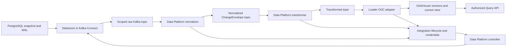

# 50 - Foundation-D PostgreSQL CDC implementation report

2026-10-27. Local engineering evidence; no deployment certification.

## 1. Executive status

**FOUNDATION-D: PARTIAL. Production Readiness: NO-GO.**

The real capture-to-Query path works, including exact mutable current state, tenant denial, durable replay, rotation and controlled schema evolution. The bounded Kafka interruption test failed twice on Debezium 3.3.1 and once on 3.4.3: no matching Query result within 120 seconds. On 3.4.3, later read-only inspection found automatic catch-up, all stage offsets at their ends, and source/Query both at 779, without a Connect restart. This is a recovery-latency/acceptance failure, not proof of permanent data loss. The 5,000-row concurrent-snapshot test exceeded 300 seconds, then passed exact comparison and reconciliation. These harness budgets are local acceptance observations, not production SLAs. G-D remains open.

No Semantic Layer, other-engine CDC, cloud infrastructure, staging deployment, commit or push was started. Foundation-A/B/C local closure remains intact. The owner explicitly attested baseline CI GREEN at entry; this report does not claim a new remote run for unstaged changes.

## 2. Entry branch / HEAD

- Branch: `foundation-c-staging`.
- Entry and final HEAD: `ca4547eb683bab21dbcbb8dab6cb1d18453632fa`.
- Entry working tree: only pre-existing ` ? services/ai-service/forecasting/timesfm`.
- All task changes remain unstaged. TimesFM was excluded from reads, traversal, export, edits and staging. Parent Git status/diff inspection is the sole reference to it.
- Historical reports 36-42 and 49 are unchanged. Owner-attested entry CI supersedes the pending-entry interpretation in canonical summaries, without rewriting report 49.

## 3. Scope

PostgreSQL logical replication, Debezium/Kafka Connect, scoped Kafka normalization/transformation, versioned ClickHouse current state, Integration lifecycle and Query publication, local acceptance and documentation. One pipeline selects one ordinary table with a primary key and REPLICA IDENTITY FULL; one source may own multiple distinct table pipelines. Existing snapshot datasets stay separate and unchanged.

Production enablement is rejected. No exactly-once, cross-table atomicity, global ordering, transparent arbitrary DDL, failover or unlimited-scale claim is made.

## 4. Documents / source inspected

The mission, canonical 20/22/23/25/26/29/30/31/33/34/43/45, historical Foundation evidence and release workflow informed the implementation. Source inspection covered Integration models/credentials/scope/routes, Query dataset authorization and ClickHouse execution, shared connector transport/type behavior, ETL listeners/security, owner-schema migration, Docker and regression tooling.

Primary implementation references: [Debezium PostgreSQL 3.4](https://debezium.io/documentation/reference/3.4/connectors/postgresql.html), [3.4 tested version matrix](https://debezium.io/releases/3.4/), [3.3 matrix](https://debezium.io/releases/3.3/), [Kafka Connect lifecycle](https://kafka.apache.org/40/kafka-connect/user-guide/), and [ReplacingMergeTree](https://clickhouse.com/docs/reference/engines/table-engines/mergetree-family/replacingmergetree). These support configuration choices; local results below are independently executed evidence.

## 5. Architecture implemented



**ADR-D-01: Data Platform worker packaging.** The existing snapshot listeners infer/clean finite batches; applying those transformations to WAL before/after images would corrupt CDC meaning. A shared CDC package provides controller, normalizer, transformer and loader modes in one non-root image. These are components of Data Platform, with the existing logical ownership and shared security/credential libraries. They introduce no product API, separate analytics authority or new business microservice. The Loader adapter alone defines physical CDC storage; Query alone publishes analytical bindings. This isolates continuous processing and recovery from finite snapshot jobs without replacing Debezium or decoding WAL ourselves.

## 6. Service ownership

Integration owns source identity, active encrypted credentials, lifecycle intent, audit and durable observations in `integration_cdc_pipelines` / `integration_cdc_audit`. Query owns the live `Database` row and authorized business-column view. Data Platform owns capture control, event normalization, conversion and materialization. Kafka Connect owns source offsets. Auth and Workspace retain their existing ownership boundaries.

The owner-schema table inventory includes both CDC tables. No cross-owner dataset foreign key was added; the dataset ID is a logical Query reference. Owner CRUD, foreign-write denial and rollback were rechecked in a separate PostgreSQL database. The local integration fixture itself uses an administrative metadata bootstrap connection; it is not deployed runtime-role certification.

## 7. Debezium / Kafka Connect configuration

Final Compose pins:

| Component | Version / digest |
|---|---|
| PostgreSQL | 18.3; `sha256:7e32e9833a6fb1c92c32552794cb6ed569d51b445a54907d35fc112ef39684db` |
| Debezium Connect | 3.4.3.Final; `sha256:4f807bd409b47268077e1142524f368db170560d5caceaee48a6a7a7fd288570` |
| Kafka / ZooKeeper | Confluent 7.5.0; respective pinned digests in Compose |
| ClickHouse | 26.2.3.2; `sha256:0b2d7824347397b2ba6fcb216f0ae772568105f1f47e19f0d3247e24c79bc10a` |
| Worker Python | 3.11 slim; `sha256:233de06753d30d120b1a3ce359d8d3be8bda78524cd8f520c99883bfe33964cf` |

Initial core/recovery/lifecycle/race evidence used 3.3.1.Final. Its tested matrix excludes PostgreSQL 18, so the final fixture was upgraded to 3.4.3, whose matrix includes 18. Registry download failures delayed the upgrade; it ultimately completed. The upgrade preserved offsets and captured fresh writes, but did not pass the 120-second broker gate. The entire earlier matrix has not been rerun on the final pin; no final-pin certification is implied.

Fixed settings: PostgresConnector, pgoutput, one task, exact table include, precreated exact-table publication, initial snapshot, transaction metadata, five-second heartbeat, decimal strings, microsecond temporal precision, tombstones, no error tolerance, retained slots. TRUNCATE is delivered (`skipped.operations=none`) and rejected explicitly by normalization. `lsn.flush.mode=connector` and `offset.mismatch.strategy=no_validation` retain upstream fail-on-unavailable-WAL behavior; no trust-slot offset skipping is used. Desired fixed configuration drift causes controlled stop/configure/resume.

Business topics have one partition in the local fixture and 24-hour/512-MiB retention. Internal Connect config/offset/status topics are separate, with replication factor one for local testing. Connect REST is private, without a host port. No public connector-config passthrough exists. The final runtime build digests observed were worker `50b8315880522ee78dbe754ddede50c15eea39c012ed2f4c50a93e11710fe37d` and Query `a957fc978bbb156cd4b3bc91856822c7e2677970804d1945613f3388185be5da`; these are local build identities, not published artifacts.

## 8. Credential handling

Integration resolves the active Foundation-C encrypted credential only to the controller identity. The controller decrypts in memory and writes a per-scope Java Properties file atomically with protected permissions. Connect configuration persists a FileConfigProvider reference, never the reusable password. The secret volume is mounted read-only in Connect. Normalizer/transformer receive neither source ciphertext nor ClickHouse credentials. Separate stage callback keys are required.

Rotation uses Foundation-C validation/activation, then controlled task STOP, credential file/config refresh and RESUME. Actual old PostgreSQL password rejection, new-password read and subsequent CDC propagation passed. Source replication roles are non-superusers with replication and SELECT on selected tables; the fixture administrator creates publications. Production JDBC DNS/reconnect pinning and managed credential delivery remain uncertified, and production CDC refuses to start.

Final live inspection checked **17,327 business records**, including scoped DLQ, against old/rotated fixture source passwords, the encryption key and acceptance identity; connector configs contained references only. Pinned Gitleaks exited zero on a first-party export excluding TimesFM. Neither scan certifies external brokers, logs or managed identities.

## 9. CDC data model / state machine

Migration: `integration/0005_cdcpipeline_cdcaudit_and_more.py`, dependent on `0004_sourceoperationbudget`. It adds only pipeline/audit tables and uniqueness constraints; no synthetic credential or CDC backfill occurs.

Intent and observations distinguish PROVISIONING, SNAPSHOTTING, STREAMING, PAUSING/PAUSED, STOPPING/STOPPED, DEGRADED, FAILED and RESEED_REQUIRED. Scope includes workspace/source/pipeline/dataset/schema/table. Schema, PK, active credential version, stage offsets/max LSN, health, reconciliation and timestamps persist across restarts. RESEED_REQUIRED is sticky across pause/disable and cannot be resumed. Source retirement overrides desired capture to STOPPED while retaining dataset and replication state.

Unknown/stale capture heartbeat is displayed as DEGRADED / `CDC_CAPTURE_STALE`, even when a process last reported STREAMING. This is a conservative freshness warning; a quiet source and a stalled source may both need inspection. Public actions are manager-authorized, source/workspace-scoped, audited and rate-limited. A dedicated self-service reseed/generation replacement is not implemented; it remains local debt.

## 10. Event contract

`ChangeEnvelope.v1` contains server-derived workspace/source/pipeline/dataset/schema/table, operation, primary key, before/after, schema version, source timestamp, LSN/transaction/event index, deterministic event ID, version and snapshot-complete marker. Kafka topic names derive from a 160-bit prefix of a scope hash. Transport offsets never choose row version.

SNAPSHOT/INSERT/UPDATE/DELETE map from Debezium r/c/u/d. Kafka null tombstones are acknowledged separately from logical deletion. Event version is decimal-string UInt128: `(LSN << 33) + streaming_rank + transaction_order`; streaming ranks above snapshot at the same LSN. Transaction order must be present for streaming. Reconstructed envelope validation rejects changed scope, version, identity and malformed fields. Ordering is per row within its source stream, not global across tables or transactions.

## 11. Snapshot-to-stream algorithm

Debezium owns the consistent initial snapshot and subsequent WAL position; BIAVORA does not synthesize a handoff timestamp. Snapshot rows enter the same durable stages. Query publication waits until Loader applies the last-snapshot or a streaming event. A 5,000-row fixture was updated continuously while snapshotting, then deleted row 1 and inserted row 5001. The snapshot saw an intermediate writer value; subsequent WAL updates were present. Eventual source/Query comparison of every row and value passed.

The original 300-second race command timed out before Loader reached the end. A separate read-only continuation proved correctness without resetting source/Kafka offsets. It does not reconstruct an unmeasured completion duration. Empty initial tables have no last-row event in this implementation and require a completion-notification solution before broad enablement; no empty-table readiness claim is made.

## 12. ClickHouse current-state strategy

The Loader writes exact typed rows to `ReplacingMergeTree(_cdc_version)` ordered by PK, with UInt128 version, deletion marker and event ID. A Query-bound view selects business columns from `FINAL` and then filters deleted rows. Query never relies on background merge timing. Reverse replay, duplicate snapshots/updates/deletes/tombstones and three repeated Query checks passed while merges were disabled.

Decimal conversion preserves strings through JSONEachRow; the Query serializer returns an exact string where float conversion would lose decimal precision, retaining existing float output for exactly round-trippable common values. Technical columns are absent from the public view/schema. Raw versions are not Query-bound tables. Continuous events do not pass through snapshot cleaning/inference.

## 13. Schema policy

Catalog mapping covers bounded integers, Decimal up to 76 digits, bool, text/varchar, UUID, Date32, timestamp/timestamptz to microsecond UTC representation, nullable fields and canonical JSON/JSONB strings. Unconstrained numeric, unsupported types, nonordinary/RLS tables, missing PK and unsuitable replica identity fail explicitly. Representative conversions are deterministic unit tests; a full live round trip for every type is not claimed.

Only compatible nullable ADD is allowed. Operational sequence: quiesce writes, reconcile/drain, pause and confirm inactive slot, perform ADD, resume. Catalog validation precedes storage evolution; historical rows get NULL for the new field. This flow passed live with `note text`, schema version 2 and exact reconciliation. DROP, RENAME, type changes and PK changes fail comparison; a live numeric type change produced RESEED_REQUIRED and resume was rejected. No destination column is dropped automatically.

Old-schema records replayed after an ADD are rejected rather than silently reinterpreted. Schema history/cutover-aware replay is not implemented, so arbitrary online DDL or replay across schema generations is not supported.

## 14. Delete semantics

PostgreSQL DELETE produces a versioned logical tombstone; Query excludes the row. Null Kafka tombstones are not additional deletes. Old versions and deletion markers remain physically retained, preventing stale replay from resurrecting deleted keys. There is no automatic TTL cleanup or claim of physical erasure. Physical retention and explicit customer erasure need a separately reviewed policy.

## 15. Checkpoint / recovery

Each stage acknowledges only after durable downstream effect plus persisted control-plane checkpoint. A crash in between replays safely. Kafka committed offsets take precedence; if absent, the Integration checkpoint supplies a fallback. Rebalance validates retained beginning/end offsets and fails RESEED_REQUIRED on a business-topic retention gap. Heartbeat expiry never changes a business checkpoint. No manual Connect offset rewrite, slot recreation or source-LSN advance occurred.

Loader fault injection in APP_ENV=test exited 86 after ClickHouse write and before checkpoint/ack. Query saw the durable value; restarting Loader replayed it without duplicate current rows. Source, Connect, normalizer, transformer, Loader and Query restart tests passed in the initial matrix. ClickHouse interruption passed independently. Broker recovery remains bounded-acceptance debt as described in section 21.

## 16. DLQ / poison policy

Permanent parse/contract/scope/type/schema failures produce a scoped `CdcFailure.v1` with safe reason/stage/time/retry count and validated identity only. No raw row, key payload, before/after, credential reference or exception string is copied. A malformed event ID becomes null. After durable DLQ and failure callback, the poison offset is committed and the pipeline pauses; the rest of that batch is not processed. Transient operational errors remain unacknowledged and close/recreate consumers.

Final live test inserted a forged-workspace normalized event and a deliberately malformed sensitive-looking event ID. Transformer rejected it, wrote a server-scoped payload-free DLQ, paused the pipeline, and Query's correct current value remained unchanged. This addresses BIA-016 for CDC; legacy snapshot debt is not globally closed.

## 17. Multi-tenant controls

Two real metadata workspaces/users (11/22), separate PostgreSQL databases and replication roles, and separate source/pipeline/dataset scopes were used. B read its own row 99. B querying A's dataset returned 403; B reading A's source/CDC status returned 404; A supplying B's pipeline to its own source action returned 404; a viewer received 403. Public raw connector options are rejected. Public JWTs/wrong-stage keys cannot call internal CDC APIs. Callback scope must exactly equal persisted scope. The final foreign-scope poison test additionally exercised the Kafka-to-transform boundary.

These checks use signed JWTs against the real Query HTTP service, not a deployed public Gateway/TLS path. Existing Gateway/route regression evidence remains scoped to Foundation-C; CAP-14 deployment proof is not inferred.

## 18. Observability

Persisted stage/partition checkpoint and max LSN, source slot activity, retained-WAL bytes, 256-MiB WAL warning, reconciliation counts/status/time, source capture heartbeat/age and worker control-poll heartbeat are available. Prometheus counters use bounded stage/outcome labels; event-lag and worker-heartbeat gauges avoid workspace labels. Worker health checks require a recent successful control poll; public capture health is separate. Logs print bounded stage/exception class instead of DSNs or records.

The local source has a 512-MiB slot WAL cap. Paused/retired slots are retained and can still consume WAL; no automatic drop occurs. Operator WAL/retention alerts, per-pipeline lag dashboards, notification delivery, saturation/soak and low-traffic heartbeat interpretation remain open operational work.

## 19. Tests

Native Windows Python 3.12 service venvs were reused separately; Linux Docker images run the isolated fixture. No service dependencies were merged into one interpreter. `QPY`, `EPY`, and `OPY` below mean the external query, ETL and owner venv Python executables. `CP` means `docker compose --project-name biavora_foundation_d --env-file <external fixture.env> -f docker-compose.cdc-local.yml`.

| Command / check | Passed | Failed | Skipped / limits | Environment |
|---|---:|---:|---|---|
| `EPY -m pytest etl-final/tests/test_cdc_contract.py etl-final/tests/test_cdc_offsets.py -q` | 35 | 0 | None | Native ETL venv |
| Same plus `etl-final/tests/test_p0_transform_loader_listeners.py` | 42 | 0 | None; existing deprecation warnings | Native ETL venv |
| `QPY manage.py test integration.test_public_boundary integration.test_cdc --settings=service_config.sqlite_test_settings --verbosity 1` | 14 | 0 | None; final status boundary revision | Query directory, in-memory SQLite |
| `QPY -m pytest tests -q --tb=short` | 118 | 0 | None; 9 executor tests also passed separately | Query directory |
| `python scripts/run_security_regression.py query` | 22 pytest + 13 Django at that revision | 0 | Final Django rerun above adds stale-health test | Query venv |
| Same runner: visualization | 8 | 0 final | Initial 7 setup errors from default DB configuration; corrected to disposable fixture | Visualization venv + PG18 |
| Same runner: voice / auth / workspace / etl | 8 / 2 / 4 / 16 | 0 | None | Four separate native venvs |
| `OPY -m pytest tests/test_owner_boundary_environment.py -q` | 16 | 0 | None | Production-settings subprocess tests |
| `QPY scripts/verify_foundation_d_migration.py` | C + D forward/reverse/reapply | 0 | Explicit disposable DB only | PG18 `foundation_d_migration` |
| `OPY scripts/verify_foundation_c4_owner_roles.py` | Owner CRUD / foreign denial / rollback | 0 | Table inventory proof, not deployed identity | PG18 `foundation_d_owner` |
| `QPY manage.py makemigrations --check --dry-run --settings=service_config.sqlite_test_settings` | No drift | 0 | Query/Integration scope | Native Query |
| `python scripts/verify_release_workflow.py` | Nine mandatory jobs / security isolation / CDC coverage | 0 | No new remote run | Host |
| `scripts/p0c_static_check.py` main with Git-listed first-party paths | 820 files | 0 | TimesFM pruned before traversal | Host syntax/merge check |
| `CP build query controller` | Both images built repeatedly, final build passed | 0 final | Registry transient retries documented | Docker Desktop 28.3.3 |
| Pinned Gitleaks `dir --redact --no-banner --log-level error /repo` | Exit 0 | 0 | 5,780-file first-party export, TimesFM excluded | Linux scanner |
| `QPY scripts/verify_foundation_d_cdc.py --env-file <external> --phase bootstrap/check` | Core fixture / exact Query / isolation / reconciliation | 0 | Initial Debezium 3.3.1 | Local Docker |
| Same, `--phase recovery` | Replay, process restarts, PG outage | Kafka budget twice | Later steps not reached; separately run below | Initial 3.3.1 |
| Same, `--phase storage_recovery` | CH outage / crash 86 / replay / secrets | 0 | Independent continuation | Initial 3.3.1 |
| Same, `--phase lifecycle` | Rotation / ADD / incompatible type / retirement | 0 | Controlled DDL, no generic online schema replay | Initial 3.3.1 |
| Same, `--phase race` | Capture proceeded | 300-second timeout | Eventual duration not measured | 5,000-row concurrent source |
| Same, `--phase race_verify` | All rows / overlap / MATCH | 0 | Does not erase original timeout | Same persisted fixture |
| Same, `--phase broker_recovery` | Upgrade resumed fresh writes | 120-second timeout | Later automatic exact catch-up observed; one harness `start --no-deps` error corrected before rerun | Final 3.4.3 |
| `CP run --rm --no-deps acceptance poison --pipeline <race>` | Scope rejection / safe DLQ / pause / unchanged state | 0 | Synthetic attack in owned fixture only | Final images / 3.4.3 |
| `CP run --rm --no-deps acceptance secrets` | 17,327 records + persisted configs | 0 | Fixture secret set, not all possible secrets | Final fixture |

No test was marked skipped to hide a failure. Full frontend/AI/all-service image rebuild and the entire nine-job remote release were not rerun for this patch. The applicable local tests above pass, but this is not a claim that current unstaged changes have full release CI GREEN. Final CDC rerun: 35 passed in 1.40 seconds. Documentation validation passed for 14 Markdown files and seven structurally checked Mermaid blocks; diagrams were not rendered. The final 5,782-file first-party export also passed the pinned redacted Gitleaks scan with exit zero.

## 20. E2E results

Initial source A: `(1,Alice,100,pending)`, `(2,Bob,200,pending)`, `(3,Carol,300,paid)`. Mutations: insert Dave/id4/400/pending; Bob amount 250 and paid; delete Alice; Dave cancelled.

Exact PostgreSQL, ClickHouse current view and authorized Query result after settling:

```text
2 | Bob   | 250 | paid
3 | Carol | 300 | paid
4 | Dave  | 400 | cancelled
```

Workspace B independently retained `(99,Workspace B,999,private)`. Later lifecycle tests added nullable `note`; Bob's note became `nullable addition`, the other notes remained null. The final incompatible type test deliberately left A in RESEED_REQUIRED. B was retired with its dataset retained. The race dataset returned to id2500 amount 777 before the terminal-poison test; its correct data remained readable after pause.

## 21. Recovery results

Reverse duplicate delivery before ClickHouse merges preserved the newest row and logical deletion. Connect, normalizer, transformer, Loader and Query restarts caught fresh writes; PostgreSQL and ClickHouse temporary outages recovered; the write-before-ack crash replay passed.

Kafka interruption did not meet the 120-second acceptance budget on either pin. Initial 3.3.1 diagnostics included interrupted keepalive/active-slot retry behavior; controlled Connect restart recovered retained WAL. This was not proven to be the sole cause. On 3.4.3, bounded diagnostic logs did not show those same error markers, and later inspection found task RUNNING, fresh capture heartbeat, raw 5,629 records, normalized/transformed 5,628, committed offsets at their respective ends, and exact Query amount 779. No Connect restart occurred between that timeout and observation. Recovery latency/root cause remains unresolved; no offsets were skipped to force a pass.

## 22. Reconciliation

Internal reconciliation reads at most 10,001 rows, rejects more than 10,000, orders by PK, converts both sides through the same exact catalog types and compares every row/value. Results persist MATCH/MISMATCH, counts, duration, limit, timestamp and a quiescent-source consistency qualifier. The three-row core, post-ADD source and 5,000-row race matched. This is bounded observation, not a transactionally synchronized cross-database snapshot. Larger data requires chunked PK/hash reconciliation and is not scanned without limit.

## 23. Performance baseline

Four committed changes reached exact Query state in **2.235 seconds** in the core fixture. The 5,000-row race exceeded **300 seconds**; eventual exact correctness passed, but completion time and peak throughput were not reconstructed. The per-event HTTP checkpoint and per-row warehouse write path needs batching/capacity work. Kafka recovery exceeded **120 seconds** but later caught up on 3.4.3.

A single earlier resource sample recorded Connect about 455 MiB, normalizer/transformer about 31 MiB each, Loader 35 MiB, Query 79 MiB, ClickHouse 739 MiB, PostgreSQL 63 MiB, Kafka 428 MiB and ZooKeeper 138 MiB, with controller stopped. This is not a peak or soak measurement. No production SLA, capacity or memory-leak claim is made.

## 24. Files changed / created

- `bi_platform_shared/cdc_contract.py`; `etl-final/shared/cdc/` contract consumers, schema, PostgreSQL preflight, Connect client, ClickHouse adapter, worker health, Dockerfile and requirements.
- `docker-compose.cdc-local.yml`; `scripts/verify_foundation_d_cdc.py`, `foundation_d_kafka_probe.py`, `verify_foundation_d_migration.py`.
- Query deployment Integration `cdc.py`, models, limits, migration 0005, boundary tests and routes; Query `database/cdc.py`, deletion protection and exact-decimal executor/tests.
- Owner table inventory, release security runner/workflow validator and `.github/workflows/p0c-release-gate.yml`. CDC tests/image build and disposable migration proof were added without weakening any required job; owner table count is seven.
- Canonical 20/22/23/25/26/29/30/31/33/34/43/45 and this report. Historical 36-42/49 are preserved.
- [Local CDC runbook](../docs/remediation/FOUNDATION_D_CDC_RUNBOOK.md) documents startup, preflight, limits, recovery and retained-state cleanup policy.

## 25. Deferred production deployment evidence

CAP-14/G-C-DEPLOY still requires real hosted PostgreSQL, public TLS verify-full and Java reconnect/DNS/egress protection, managed secrets and workload identities, source/broker/warehouse ACLs, real Connect deployment, backup/restore and offset/slot lifecycle, capacity/soak, WAL retention alarms, failover/incident response, deployed immutable-candidate CI and operator-approved cutover/rollback. External C validation remains DEFERRED_TO_PRODUCTION_READINESS; production remains NO-GO.

## 26. Open debt

**Foundation-D:** explain and close bounded Kafka recovery latency; repeat final-pin full acceptance; reduce/bound bulk catch-up and checkpoint/write overhead; implement empty-snapshot completion; define controlled reseed generation replacement; support safe schema-history replay or retain explicit quiesce/drain restrictions; add durable multi-instance/controller coordination before scaling; bound active pipeline admission; certify full live type matrix and retention/slot-loss drills; improve lag/alerts/low-traffic health. Retirement currently fences at worker polling/batch boundaries, not an instantaneous cancellation of already in-flight writes. Local shared broker ACLs and loader bootstrap grants are not production isolation. Legacy BIA-016/017 outside CDC remain open.

**CAP-14:** the external evidence in section 25, including production transport and deployed runtime identity/least privilege.

**Post-launch:** other-engine CDC, arbitrary online DDL, cross-table/global transaction ordering, chunked large-source reconciliation, multi-region capture and advanced retention optimization. No work on those was started.

## 27. Foundation-D final decision

**PARTIAL**, not GREEN. Core correctness and most local lifecycle/security tests passed, with real implementation and reproducible fixtures. The bounded recovery gate failed and the final pin has not passed the complete matrix. The two latency timeouts are retained as failures; later exact results are additional evidence, not retroactive passes. Production remains NO-GO independently of local status.

Final validation passed: documentation links/fences/tables/stable IDs; release workflow contract; Compose configuration; 820 maintained Python syntax/merge checks; `git diff --check`; status/stat/name inventory; empty staged diff; unchanged branch/HEAD; empty parent diff for TimesFM; and byte-equivalent historical reports 36-42/49 after CRLF normalization. Inventory contained 24 modified tracked files and 22 new first-party files, all unstaged, plus the unchanged pre-existing dirty TimesFM indication. No new env file, certificate/private key, database dump/test SQLite file or broker/warehouse data directory appears in the repository inventory. Fixture secrets/results and the test SQLite artifact are outside the repository. No commit or push occurred. The isolated acceptance stack was stopped without deleting volumes, offsets, slots or retained evidence; unrelated containers were not changed.

## 28. Next exact phase

Continue **Foundation-D acceptance closure**: diagnose broker-recovery delay, establish an explicit approved local recovery budget, optimize bounded bulk catch-up, close empty-snapshot/reseed handling, and rerun the complete matrix on the final immutable candidate. Do not automatically start Semantic Layer. After G-D closes, the expected next phase is Semantic Layer & Metrics plus the remaining P1 durable/scoped AI spine required by G-J. CAP-14 remains a separate production gate.
