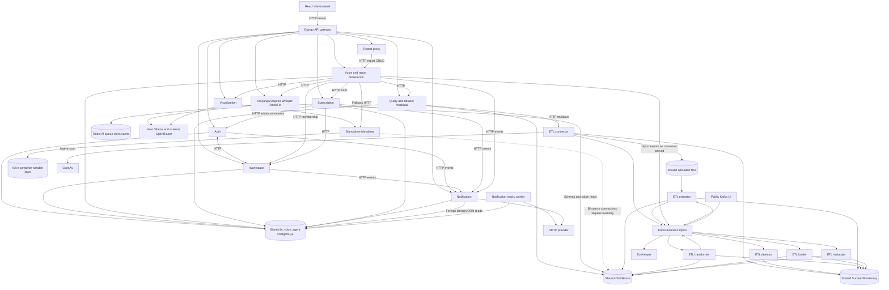

# Current architecture

Source inspected on 2026-09-13. Use SERVICE_INVENTORY.md for all 24 unified Compose entries and runtime_inventory.json for actual containers, ports, mounts and networks. Declared dependencies do not establish successful runtime behavior. The legacy ETL deployment is a conflicting alternate topology, not six additional product domains.

The diagram shows active source call categories. Gateway, report and visualization also configure the same PostgreSQL credentials for framework state; that grants access but is not proof of domain queries. AI and ETL configure local SQLite for Django framework state despite descriptions of statelessness. Report's copied ORM references workspace models but that app is absent from its active INSTALLED_APPS.

HTTP dependency depth can reach browser → gateway → report → voice → workspace/auth, or browser → gateway → voice → AI → several sequential model calls, followed by query and Metabase. Report CRUD requires voice availability. Gateway startup is gated on nearly every service, and voice on visualization/query/AI; optional expensive capabilities therefore affect availability of basic APIs.

The gateway checks that Authorization exists but delegates cryptographic verification downstream. It buffers request/response bodies, has a 360-second upstream timeout, uses in-process path/IP throttling, and lacks a TLS edge. No WebSocket implementation was discovered; normal JSON/multipart requests dominate.

PostgreSQL ownership is logically divided in the code but not enforced by database credentials. The notification service explicitly reads five other domains' tables. ETL shares repositories and SurrealDB access. Kafka business communication and shared files conflict with the requested target policy. Redis is presently internal infrastructure for AI, not a discovered inter-service pub/sub bus.

All host-published internal ports are **DEVELOPMENT ONLY** at best. PostgreSQL, ClickHouse, Redis, Kafka, ZooKeeper and SurrealDB should be **DATABASE/INFRASTRUCTURE INTERNAL**. Core services, ETL APIs, Kafka UI and model endpoints should be **INTERNAL ONLY**. Only frontend/TLS gateway and a controlled embedding edge should be **PUBLIC**. Initial bindings use all interfaces; firewall and Internet reachability were not verified.
