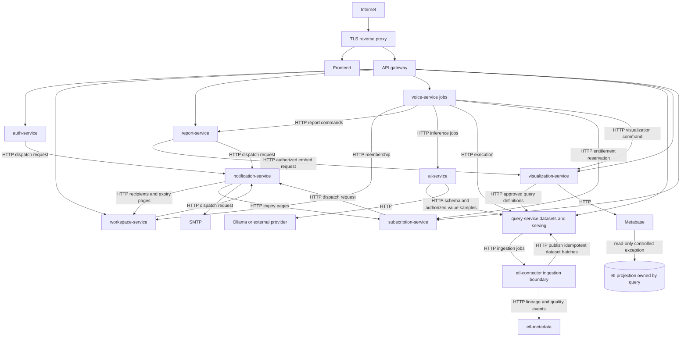
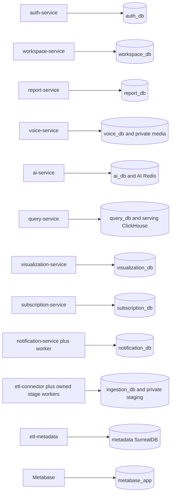

> **SUPERSEDED PLANNING — 2026-10-27.** Retained as the Phase-0 design/evidence context. For implementation use [the January scope and roadmap](../../BIAVORA_PRODUCTION_READINESS_AUDIT/43_BIAVORA_PRODUCT_SCOPE_AND_RELEASE_ROADMAP_2027.md) and master context 34. HTTP remains control plane; Kafka remains data/event plane; logical ownership precedes physical separation. Old Kafka-removal, service-move and next-phase directions below are not current instructions.

# Target microservices architecture

This is a migration design, not an implemented architecture. Keep Django/React/ClickHouse/Metabase; no framework rewrite is required. Enforce database ownership and HTTP service contracts before changing deployment topology.

Use `/api/v1/...` for public APIs and `/internal/v1/...` for service APIs. External requests enter a TLS reverse proxy and the API gateway. Internal APIs require service identity plus a validated user/tenant context when acting on a user's behalf. A shared static key is a temporary bridge, not tenant authorization. Gateway strips inbound internal identity headers and establishes a request ID. Auth alone holds private signing keys; services verify issuer/audience/JWKS and consult owner APIs for sensitive current permissions.

The two ingestion/query arrows are asynchronous job submission and batch publication, not a synchronous callback cycle. Query creates a durable ingestion request and returns 202; ingestion later publishes idempotent batches. Do not keep an HTTP request open while calling back into its waiting caller. Voice orchestration similarly persists stages and returns job IDs for expensive work.

## Boundaries and ownership

| Existing service/boundary | Target responsibility | Owned durable storage |
| --- | --- | --- |
| auth-service | Accounts, verified identity, recovery, refresh sessions | auth_db, auth role |
| workspace-service | Workspaces, invitations, membership/roles | workspace_db, workspace role |
| report-service | Reports, pages, widgets, SQL-edit history and saved query references | report_db, report role |
| voice-service | Voice/text workflow state and orchestration | voice_db, voice role; private media store |
| ai-service | Transcription, intent/SQL proposal, forecasts | ai_db for durable inference job records if jobs outlive requests; AI-owned Redis and model cache |
| query-service | Dataset ownership, validated queries, execution limits and serving ingestion API | query_db; serving ClickHouse DBs; dedicated migration/write/read roles |
| visualization-service | Tenant-to-card/dashboard ownership and embedding decisions | visualization_db; exclusive Metabase API credentials |
| subscription-service | Plans, entitlements, reservations, usage and payment records | subscription_db, subscription role |
| notification-service and expiry worker | Durable dispatch/idempotency and delivery attempts | notification_db, notification role |
| etl-connector ingestion boundary | Source credentials, upload lifecycle, extraction/transformation checkpoints and staging | ingestion_db; private upload/staging storage; optional separate staging ClickHouse DB |
| etl-metadata | Lineage/quality/log projections and API | own persistent SurrealDB namespace/database/credential |
| api-gateway | Routing, validation, identity propagation, quotas | no business DB; own short-lived throttling store if needed |
| Metabase | BI application metadata | metabase_app DB and separate role |

In development, logical PostgreSQL databases may share the Windows PostgreSQL server, with separate roles and credentials. Production may use the same topology initially with backup/isolation policies; separate servers are a scaling decision, not a prerequisite to logical ownership. Use independent migration roles where practical and revoke public cross-database CONNECT privileges.

Foreign identifiers become scalar IDs or immutable snapshot fields; no cross-service foreign keys, ORM imports or repositories. Local foreign keys inside a service remain valuable. HTTP read models may cache explicitly versioned snapshots with expiration; they must not become uncontrolled replicas of another domain's mutable data.

## ETL decision and HTTP-only policy

The existing connector/detector/extractor/transformer/loader split has no independent business data ownership and shares source events, schemas and repositories. Recommended target: fold detector, extractor, transformer and loader into modules/workers owned and deployed by the **etl-connector ingestion boundary**. This does not rename every service: retain current entrypoints during migration, then retire the redundant deployment units. Internally owned workers may use native infrastructure, but ingestion→query and ingestion→metadata always use HTTP. Once ownership is consolidated, remove Kafka and shared-volume exchanges between independent services. If independent stage deployment is retained for measured scaling needs, each stage must instead gain a private DB and a versioned HTTP job/batch API; do not leave Kafka business edges in the final target.

Redis transcription locks/queues remain owned solely by AI. Native PostgreSQL/ClickHouse/Redis protocols are allowed for owner persistence. A SurrealDB `/sql` call from another service is forbidden foreign database access even though its transport is HTTP.

Metabase is an infrastructure exception: it may read a dedicated BI projection with a read-only identity and controlled tenant access. It must never write serving data or read operational auth/workspace/report databases. If strict no-external-reader policy is required even for BI tools, replace native Metabase queries with rendered query-service results; do not give Metabase broad credentials. Document this exception explicitly and test its grants.

## Resilience and security contracts

Default internal transport: 3-second connect, 10-second read, at most 3 attempts including first for idempotent reads, bounded exponential backoff with jitter and a total deadline. Override only with an endpoint budget. Long jobs return 202 plus status URL. Mutating retries require owner-enforced idempotency keys. Emit `{code,message,request_id,details}` errors; preserve 401/403/404/409/429/503 distinctions. Implement retry budgets and circuit breakers for costly dependencies, and avoid retrying unsafe POSTs without idempotency.

Tenant/workspace/dataset IDs come from authenticated context and owner authorization; a frontend ID is never proof. Query owner validates AST, table/database allowlists, tenant scope, read-only settings, statement count, result/memory/time limits and cancellation. AI proposes SQL but cannot grant execution rights. Visualization consumes an authorized query definition; Metabase embedding requires tenant-to-object ownership and short expiry.

Use an edge network, application network and owner-scoped datastore access policies. Expose 443 publicly; optionally redirect 80. Keep model/database/broker/admin ports private. Separate secrets and configuration per service; production must fail before accepting requests if a required sensitive value is absent. Structured logging should exclude passwords, bearer tokens, source rows, raw audio, prompts with sensitive data and signed embed URLs.

Initial production needs reproducible builds, backup/restore drills, reliable tenant isolation, a small number of deployable boundaries and operational metrics. Hundreds/thousands of users justify scaling stateless APIs and bounded job workers from measurements; they do not justify adding Kafka or a service mesh without need.
